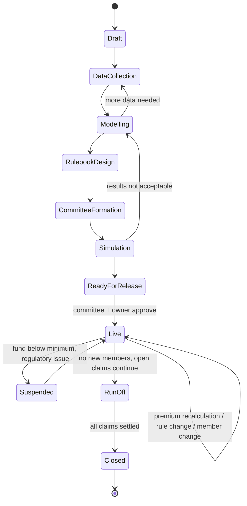

# Plan 01 — Platform Overview and Scope

| Field   | Value                                      |
|---------|--------------------------------------------|
| Status  | Draft v0.3                                 |
| Created | 2026-11-24                                 |
| Updated | 2026-11-26 - planning queue and scope recommendations |
| Type    | High-level scope (not an implementation plan) |
| Next    | Phase 1 plan reviews and Phase 2 prerequisites (section 14) |

## 1. Purpose

This plan defines the full extent of the saas-insur platform. It describes **what** the
platform must do, not **how** to build it. It is intentionally broad: we plan for a complete
platform and then cut it into phases.

Later plans (02, 03, ...) will go deeper into each area. This plan can change.

**Focus of this round: happy paths.** Exceptions, disputes, failures and edge cases are
listed as placeholders in section 10 (Future work) and will be designed later.

## 2. One-paragraph summary

saas-insur is a multi-tenant platform. A signed-up user (the **owner**) creates one or more
**projects**. Each project is an **insurance policy** with its own **fund**, its own
**rulebook** (the claim approval policy), and its own **committee**. The owner uploads data,
and the platform produces **actuarial results** (premiums, reserves, payout limits). The
policy is first tested in a **simulation** with dummy members and a dummy fund. When the
policy is released, real **members** pay into the fund, either by **subscription** (for
example car insurance) or by a **one-off payment** for a fixed period (for example a sports
event). Members submit **claims** through the web UI or through an AI assistant plugin. The
**committee approves or rejects each claim**; AI gives a second opinion only. When a claim
is approved, **the platform pays it out from the fund**. The committee also votes on
governance changes: premiums, rules, committee membership, and member removal. Everything is
recorded and reported.

## 3. Core principles of the model

These come from the README and from the decisions in section 11.

- **Members own the fund.** The fund belongs to all members of the policy together. It is not
  platform money and not committee money.
- **The committee manages the fund on behalf of the members.** It acts for the members, not
  for itself.
- **The committee decides claims; the platform pays.** The platform executes approved payouts
  from the fund. It does not decide claims.
- **No one gains from a rejected claim.** Money that is not paid out stays in the fund for all
  members. The committee and the platform get nothing from it.
- **Humans decide; AI helps.** AI is a second opinion and a support tool. It never approves or
  rejects a claim by itself.
- **Fixed, transparent service fee.** The platform fee is never linked to claims, claim
  outcomes, or money left in the fund.

## 4. Key terms

| Term | Meaning |
|------|---------|
| Tenant | An account that owns projects. It can be one person or an organisation. |
| Project / Policy | One insurance product. In this platform, one project = one policy = one fund. |
| Owner | The user who creates and administers a project. |
| Rulebook | The claim approval policy: coverage, rules, edge cases, exclusions, limits. Versioned. |
| Committee | A group of people who decide claims and vote on changes for one policy, on behalf of the members. |
| Member | A person or business who pays into a policy, co-owns its fund, and can submit claims. |
| Member cover | The cover of one member: cover period, product terms and rulebook version that the member accepted when they enrolled or renewed. |
| Fund | The pool of money that belongs to the members of one policy. It is separate from platform money. |
| Actuarial model | The calculated output from data: claim probability, expected loss, premium, reserves, confidence. |
| Simulation | A test run of a policy with dummy members, dummy claims, and a dummy fund. No real money. |
| Proposal | A request for the committee to vote on a change. |
| Service fee | The fixed fee the platform charges. It is never taken from claim outcomes or fund surplus. |

Note: the **project**, the **product terms**, the **fund**, and each **member cover** are
separate things, even if the first version has one of each per project. A claim is judged
against the terms of the claimant's member cover that applied on the incident date. Plan 02
defines this in detail.

## 5. Actors and roles

| Role | Scope | Main actions |
|------|-------|--------------|
| Platform admin | Whole platform | Manage tenants, service fees, global settings, compliance. |
| Tenant admin | One tenant | Manage users of the tenant, billing, all projects of the tenant. |
| Project owner | One project | Create the policy, upload data, write the rulebook, invite committee, release. |
| Actuary / analyst | One project | Review data and models, sign off actuarial results. |
| Committee member | One project | Decide claims, vote on proposals, manage the fund for the members. |
| Committee chair (optional) | One project | Run meetings, break ties, manage agenda. |
| Member (subscriber) | One project | Pay, submit claims, view own data and fund reports. |
| Claims assessor (optional) | One project | Prepare claims for the committee, collect evidence. Does not decide. |
| Auditor (read-only) | One project or tenant | Read ledgers, decisions, and reports. |
| AI agent | One project | Analyse data, draft rules, give a second opinion on claims. Never decides. |

A user can have different roles in different projects (for example owner of project A and
member of project B).

## 6. Policy lifecycle

Notes:

- **Run-off** is the controlled end of a policy: no new members, existing claims still paid.
- Suspension, run-off and closure rules (late claims, what happens to money left in the fund)
  are future work — see FW-5.

## 7. Functional modules

Each module below maps to one or more of the original requirements (R1–R16).

### 7.1 Tenancy, identity and access (R1, R2)

- Sign-up, sign-in, MFA. Social login and organisation SSO later.
- Tenants with full data isolation between tenants.
- One user can belong to many tenants and many projects.
- Role-based access per project (see section 5).
- Invitations by email or link.
- Identity verification (KYC) where a policy or jurisdiction requires it.

### 7.2 Project / policy management (R2, R3)

- Create, clone, archive a project.
- Policy type: **subscription** (recurring) or **fixed term** (one-off payment for a period).
- Policy settings: currency, jurisdiction, coverage period, eligibility criteria, maximum
  members, waiting period, excess (deductible), payout limits.
- Lifecycle state machine (section 6) with clear gates between states.
- Policy templates to start from (car, event, equipment, and so on).

### 7.3 Data room and data ingestion (R4)

- Upload large datasets: CSV, Excel, Parquet, JSON, PDFs, database exports.
- Connectors to external sources (public statistics, weather, telematics, APIs).
- Schema detection and mapping, with AI help.
- Data quality checks: missing values, outliers, duplicates, bias signals.
- Dataset versions: each actuarial result must point to the exact data version used.
- Data lineage and access log.
- Privacy controls: personal data detection, masking, retention rules.

### 7.4 Actuarial engine (R4, R8, R13)

- Frequency and severity models; probability distributions.
- Monte Carlo simulation of fund outcomes.
- Outputs: expected loss, minimum premium, reserve requirement, payout limits, confidence
  intervals, probability of ruin (fund running out).
- Sensitivity analysis: "what happens if claims are 20% higher than expected?"
- Explainable results: each number shows its inputs and method.
- Human sign-off by an actuary/analyst before release.
- Re-run on new data (feeds dynamic premium recalculation).
- Binding solvency and shortfall rules are future work — see FW-1.

### 7.5 Rulebook — claim approval policy (R5, R15)

- Long-form document: coverage, rules, edge cases, exclusions, limits, evidence requirements.
- Written in natural language; AI helps to draft, find gaps, find contradictions.
- Structured view: each rule has an ID, so claim decisions can cite the exact rules used.
- Versioning: every change creates a new version. A claim is judged against the version in
  the claimant's member cover on the incident date (see section 4).
- **Rule test cases**: a set of example claims with the expected result. A rule change must
  pass these tests before it goes to a vote.
- Change only through a proposal and vote once the policy is live (R15).
- Member-facing summary in plain language.

### 7.6 Committee and governance (R6, R13, R14, R15, R16)

- The committee acts on behalf of the members and manages the fund for them.
- Committee formation: invite, accept, minimum and maximum size.
- **Voting engine** — one generic engine used for all decision types:
  - Claim decisions (R6, R12).
  - Premium recalculation decisions (R13).
  - Add or remove committee members (R14).
  - Rulebook changes (R15).
  - Remove a member from the policy (R16).
- Configurable per decision type: quorum, majority threshold, voting period, who may vote,
  tie-break rule, anonymous or public votes.
- Basic recusal: a committee member cannot vote on their own claim.
- Proposal workflow: draft → discussion → voting → result → execution.
- Discussion threads and attached evidence on each proposal.
- Full record of who voted what and when (subject to the anonymity setting).
- Governance settings are themselves changeable only by vote.
- Future work: committee composition and conflict of interest (FW-6), member democracy
  (FW-2).

### 7.7 AI assistance (R7, and across modules)

AI is a **second opinion and a support tool. Humans make every decision.**

- **Data**: schema mapping, quality checks, summaries.
- **Actuarial**: explain models, suggest assumptions; never the only source of numbers.
- **Rulebook**: draft rules, find gaps and contradictions, generate test cases.
- **Claims**: read evidence (photos, receipts, reports), check it against the rulebook, and
  give the committee a second opinion with cited rule IDs and a confidence level.
- **Fraud signals**: flag unusual patterns, duplicates, mismatched evidence for the committee.
- **Member help**: answer questions about coverage in plain language.
- Guardrails:
  - AI never approves, rejects, or holds a claim by itself.
  - The committee sees the AI opinion as one input next to the evidence and the rulebook.
  - Every AI output is logged with model, prompt version, inputs, and output.

### 7.8 Simulation sandbox (R8)

- Generate dummy members with realistic profiles from the policy's data.
- Generate dummy claims from the actuarial model, plus hand-written edge cases.
- Dummy fund with a full ledger, using the real payment and ledger logic.
- Run the committee and AI flow end to end on dummy claims.
- Time acceleration: simulate months or years in minutes.
- Compare scenarios side by side (different premiums, rules, reserve levels).
- Simulation data and dummy money are fully separate from live data and real money.
- Simulation report required before release.

### 7.9 Membership and enrolment (R9, R16)

- Public or private enrolment page for each policy.
- Eligibility checks and optional underwriting questions.
- Subscription plans (monthly, yearly) and fixed-term cover (event date range).
- Each enrolment or renewal creates a member cover record (section 4).
- Cooling-off period and cancellation.
- Member profile, insured items (for example vehicles), dependants.
- Member removal through a governance vote (R16), with a reason and notice.
- Group enrolment (for example an employer or a club enrols many members).

### 7.10 Payments and fund ledger (R9, R13)

- Payment collection: card, direct debit, bank transfer; recurring and one-off.
- **Double-entry ledger per fund**: contributions, claim payouts, refunds, service fees,
  reserve movements. Ledger entries are append-only.
- Strict separation between fund money (owned by members) and platform money.
- **The platform pays approved claims** from the fund to the member (bank transfer and
  others). The platform only executes payouts that the committee approved.
- Money not paid out stays in the fund for all members.
- Replenishment calls when the fund falls below its threshold.
- Reconciliation with the bank / payment provider.
- Failed payments, reversals and other exceptions are future work — see FW-7.

### 7.11 Claim submission channels (R10)

- Web UI (responsive, works on mobile).
- **AI assistant plugin**: an MCP server so members can submit and track claims from Claude
  and other AI assistants.
- Public API for partners.
- Possible later: native mobile app, email intake, chat apps.
- All channels create the same claim object and follow the same process.

### 7.12 Claims processing (R6, R7, R12)

Happy path:

1. **Intake** — the member submits incident details, date, evidence, and a declaration.
2. **Automatic checks** — active member cover on the incident date, waiting period,
   duplicates, limits.
3. **Preparation** — an assessor (optional) collects missing information from the member.
4. **AI second opinion** — AI checks the claim against the rulebook and attaches its opinion
   (section 7.7).
5. **Committee decision** — the committee votes to approve (fully or partly) or reject, with
   reasons and cited rules.
6. **Payout** — for an approved claim, the platform pays the member from the fund and records
   it in the ledger.
7. **Notification** — the member gets the decision and the reasons.

- Service-level targets (for example decision within N days) with reminders.
- Appeals and disputes are future work — see FW-3.

### 7.13 Dynamic premium recalculation (R13)

- The committee sets the review frequency (for example monthly, quarterly, or on trigger).
- Triggers: fund below threshold, claim rate above forecast, new data available.
- The actuarial engine produces a proposed new premium with an explanation.
- The proposal goes to a vote; the result applies from a defined date with notice to members.
- Limits on how much a premium can change in one step (configurable).

### 7.14 Reports and transparency (R11)

- Fund health: balance, reserves, probability of ruin, forecast.
- Claims: volume, approval rate, time to decision, payout totals, reasons for rejection.
- Membership: growth, churn, payment status.
- Governance: proposals, votes, participation.
- AI: how often the AI second opinion matched the committee decision (for monitoring only).
- Audiences: owner, committee, members (their own view and the fund they co-own), auditors,
  regulators, public.
- Export: PDF, CSV, API. Scheduled reports by email.
- Optional **public transparency page** per policy, with aggregated data only (no personal
  claim details).

### 7.15 Notifications

- Email and in-app first; SMS, push, and webhooks later.
- Events: payment due, payment failed, claim status, vote open, vote closing, premium change,
  rule change, fund alerts.

### 7.16 Audit, compliance and security (cross-cutting)

- Immutable audit trail for every decision, vote, rule change, and ledger entry.
- Data protection: encryption, data residency options, right to access and delete (where the
  law allows; financial records may need longer retention).
- Access control on claim evidence: only the people who need it can see it.
- Jurisdiction settings: regulatory rules per country/region.
- KYC / AML and sanctions screening where required.
- Platform billing: fixed service fee per tenant / policy / member, shown transparently.

## 8. Suggested additional options

These recommendations give the owner a starting point for approving the pilot scope.

| Disposition | Options |
|-------------|---------|
| In for live pilot design | Licensed partner mode and legally effective custody. Review the proposed authorities and ownership before accepting money. |
| Evaluate before live release | Stop-loss or other backstop arrangements under FW-1. The risk bearer and actuarial assessment determine whether one is required. |
| Later | Parametric policies, dedicated fraud detection, impact replay, marketplace, embedded insurance, white-label, telematics, multiple currencies and languages, and a full public API. Plan 08 scopes the smaller partner claim API. Automatic parametric payout would require a decision on D1 and D4. |

- **Parametric policies** — automatic payout when an external data source confirms an event
  (for example rain on event day, flight delay). Good fit for sports events. Needs clear
  trigger terms and a backup data source.
- **Fraud detection module** — dedicated scoring, cross-policy duplicate detection, evidence
  manipulation checks.
- **Reinsurance / backstop** — protect a small fund against a very large loss (stop-loss
  cover from a partner). Related to FW-1.
- **Licensed partner mode** — the platform supplies the software; a licensed insurer or
  fronting partner holds the regulatory licence. This may be the only legal path in many
  countries.
- **Fund custody** — a separate trust or bank account per fund, held by a third party.
- **Rule change impact simulation** — before a vote, replay past claims against the new rule
  version and show which decisions would change.
- **Policy marketplace / fork** — publish a policy template so other tenants can copy it and
  start their own fund.
- **Embedded insurance** — partners (for example ticket sellers) add cover at their checkout
  through an API or widget.
- **White-label** — tenants use their own brand and domain.
- **Telematics and IoT data** — live data from vehicles or devices to improve the model and
  verify claims.
- **Multi-currency and multi-language** — needed if policies cross borders.
- **Open API and webhooks** — everything in the UI is also available through the API.

## 9. Out of scope (for now)

- Investing fund reserves for return (adds risk and regulation; reserves stay in cash or
  equivalents).
- Cryptocurrency or tokens (the README excludes this).
- Acting as a licensed insurer.
- Life and health insurance (very heavy regulation; consider much later).
- No-claim bonus (it can stop members from reporting valid claims).

## 10. Future work (placeholders)

These areas are known and important. They are not designed in this round. Each one will get
its own plan later.

| ID | Topic | What it must cover (to be designed) |
|----|-------|-------------------------------------|
| FW-1 | Solvency and shortfall policy | Minimum capital and cash levels, reserves for unreported claims, triggers for action, what happens when the fund cannot pay a valid claim, backstop options. |
| FW-2 | Member democracy | How members take part in decisions: member-wide votes for large changes, electing and removing committee members, vote delegation, committee terms and rotation, protected member rights, a founding charter, protection against fake or duplicate voters. |
| FW-3 | Appeals and disputes | Member appeal against a claim decision, member removal, or billing; who reviews an appeal; deadlines; external escalation (ombudsman). |
| FW-4 | Fund ownership in law | How "members own the fund" is made legally real: custody, legal title, member rights if the policy fails. |
| FW-5 | Suspension, run-off and closure | Path from suspension to run-off; claims reported after suspension, expiry or exit; what happens to money left in the fund at closure. |
| FW-6 | Who decides claims — committee design | Committee composition (can committee members also be members of the fund?), conflict-of-interest rules beyond basic recusal, deadlock and recusal fallbacks, committee pay. |
| FW-7 | Payment exceptions | Failed payments, grace periods, cover suspension, failed payouts, chargebacks and reversals, second approval for money movements. |
| FW-8 | Fraud investigation | Who investigates, evidence preservation, claimant response, review deadlines. |
| FW-9 | Model validation | Independent review of actuarial models, stress tests for correlated losses, weak enrolment and payment defaults. |

## 11. Decisions log

| # | Date | Decision |
|---|------|----------|
| D1 | 2026-11-24 | The committee of each policy approves or rejects claims. The platform pays out approved claims from the fund. |
| D2 | 2026-11-24 | The members are the true owners of the fund. The committee manages the fund on behalf of the members. |
| D3 | 2026-11-24 | Money that is not paid out stays in the fund for all members. The committee gains nothing from claim outcomes. |
| D4 | 2026-11-24 | AI is a second opinion and a support tool. Humans make every decision. No automatic approval or rejection. |
| D5 | 2026-11-24 | The service fee is never charged per claim or linked to claim outcomes. |
| D6 | 2026-11-24 | Project, product terms, fund and member cover are separate concepts (detail in plan 02). |
| D7 | 2026-11-24 | This round covers happy paths only. Exceptions and disputes go to future work (section 10). |

## 12. Suggested phases

| Phase | Goal | Main modules |
|-------|------|--------------|
| 0 — Foundation | Tenants, users, projects, audit trail | 7.1, 7.2, 7.16 (base) |
| 1 — Design and simulate | Build a policy end to end with no real money | 7.3, 7.4, 7.5, 7.6 (claims only), 7.7, 7.8 |
| 2 — Live pilot | One real policy type with a licensed partner | 7.9, 7.10, 7.11 (web), 7.12, 7.14 (base), 7.15 |
| 3 — Full governance | All vote types, premium recalculation | 7.6 (all), 7.13 |
| 4 — Ecosystem | AI plugin, public API, options from section 8 | 7.11 (MCP/API), section 8 items |

Phase 1 is useful by itself: people can design and test a policy without taking real money.
It still needs care with the personal data used to build the models.

Future-work items (section 10) are scheduled into phases when their plans are written. Some
of them (for example FW-1, FW-3, FW-4) will likely be required before a real live pilot.

### Australian live pilot release gate

Use Australia as the design jurisdiction for the first pilot. Keep Phase 1 synthetic and use it to
test member governance and fund economics. Before G8, require Australian counsel and the proposed
partner to sign off a role matrix for the risk bearer, issuer, distributor, committee, claims
operator, custodian and platform. Record who owes the member, who can direct money movement and
what recourse the member has. Give these decisions explicit release evidence in FW-1, FW-3,
FW-4, FW-5 and FW-6. [APRA general insurer licensing](https://www.apra.gov.au/general-insurance/licensing-guidelines-general-insurers) · [ASIC AFS licensing](https://www.asic.gov.au/for-finance-professionals/afs-licensees/check-if-you-need-an-afs-licence) · [ASIC claims handling guidance](https://www.asic.gov.au/for-finance-professionals/afs-licensees/apply-for-an-afs-licence/licensing-for-certain-service-providers/claims-handling-and-settling-how-to-comply-with-your-afs-licence-obligations)

Recommend testing a licensed-insurer structure first. Compare a member-owned insurer or other
lawful member-owned structure and a discretionary mutual. APRA describes discretionary cover as
giving the fund discretion over payment. Choosing it would require a product decision on the
member promise, rulebook and claims flow. If a partner must retain final claims authority, raise
the conflict with D1 for decision before G8. If the structure changes the members' fund rights,
raise D2 for decision as well. [APRA discretionary mutuals](https://www.apra.gov.au/non-regulated-industry/other-non-regulated-entities)

Require sign-off for complaints and external recourse, claims decision notices and human review,
member data handling and retention, and sharing evidence with external providers. [ASIC dispute resolution](https://www.asic.gov.au/regulatory-resources/financial-services/dispute-resolution) · [OAIC Australian Privacy Principles](https://www.oaic.gov.au/privacy/australian-privacy-principles/read-the-australian-privacy-principles)

## 13. Open questions

Carry these recommendations into Plan 02 as proposals for the named decision owners.

| Open question | Recommendation |
|---------------|----------------|
| Jurisdiction | Start with Australia. Counsel and the partner confirm the specific state or territory, product classification and authorisations before G8. |
| Owner rights after release | Use Plan 02's fixture defaults for enrolment-page text, branding and assessor/auditor assignments. Apply governed authority to terms, voting, membership decisions, claims and fund disbursements. Confirm the live role matrix before G8. |
| One fund per project | Keep one fund per project and realm. Use separate projects where a region needs distinct terms, custody or exposures. Revisit multi-fund projects after the pilot. |
| Service fee | Start with a fixed, separately invoiced fee per policy paid by the tenant. Keep fund money and service-fee receivables separate. Validate pricing and payment terms with the pilot partner. |
| First policy type | Start the simulation with one synthetic fixed-term sports event. Retain the subscription fixture required by Plan 02. Carry a narrow fixed-term sports event product into live-pilot diligence, subject to evidence, economics and regulatory sign-off. |

Moved to future work: committee source and pay (FW-6), member voting (FW-2), fund shortfall
(FW-1), fund surplus at closure (FW-5).

## 14. Remaining planning work

| Plan | Work remaining |
|------|----------------|
| [02 — Domain model](02-domain-model.md) | Cursor approved the scoped review of the remaining Phase 1 contracts. Plan 05 handoff evidence and the U-DM-19 product and governance decision remain open. |
| [03 — Architecture and tech stack](03-architecture-and-tech-stack.md) | Phase 0–1 draft passed Cursor review. Section 10 tracks engineering and deployment decisions. Reopen the affected sections if the domain or engine review changes an integration contract. |
| [04 — Voting and governance engine](04-voting-and-governance-engine.md) | Cursor approved the Phase 1 claim and G7 voting contract. Full governance, member democracy and live committee design remain gated. |
| [05 — Actuarial engine and simulation](05-actuarial-engine-and-simulation.md) | Cursor approved the Phase 1 handoff review. The [integration gates](05-actuarial-engine-and-simulation.md#263-phase-1-handoff-and-later-gates) track C-7, C-8 and C-10 implementation and verification, plus the Phase 2 and DM5 decisions. |
| [06 — Rulebook and AI second opinion](06-rulebook-and-ai-second-opinion.md) | Cursor approved the pinned rulebook, Rule IR, tests and advisory records plan. Live evidence and specialist escalation remain gated. |
| [07 — Payments, fund ledger and payouts](07-payments-fund-ledger-and-payouts.md) | Cursor approved Phase 1 dummy settlement, double-entry posting, replay and reconciliation. Live custody, shortfall and payment exceptions remain release gates. |
| [08 — Claim channels and MCP](08-claim-channels-and-mcp.md) | Cursor approved the synthetic web intake and shared claim contract plan. Authenticated MCP and partner API clients remain gated. |

Cursor approved all 35 items across 15 plan reviews on 26 November 2026. The future-work entries below define scope and release gates for later design.

| ID | Remaining plan | Target gate |
|----|----------------|-------------|
| [FW-1](fw-01-solvency-and-shortfall.md) | Solvency and shortfall policy | Phase 2 G8 |
| [FW-2](fw-02-member-democracy.md) | Member democracy | Minimum member rights at G8 via FW-4/FW-6. Full mechanism in Phase 3. |
| [FW-3](fw-03-appeals-and-disputes.md) | Appeals and disputes | Phase 2 G8 |
| [FW-4](fw-04-fund-ownership-and-custody.md) | Fund ownership in law and custody | Phase 2 G8 |
| [FW-5](fw-05-suspension-runoff-and-closure.md) | Suspension, run-off and closure | Minimum continuity and exit plan at G8. Detailed automation later. |
| [FW-6](fw-06-committee-composition-and-conflicts.md) | Live committee composition and conflicts | Phase 2 G8 |
| [FW-7](fw-07-payment-exceptions.md) | Payment exceptions and reconciliation | Real-money collection and payout enablement |
| [FW-8](fw-08-fraud-investigation.md) | Fraud investigation | Pilot escalation path at G8. Dedicated module later. |
| [FW-9](fw-09-independent-model-validation.md) | Independent actuarial model validation | Phase 2 G8 |
