# Plan 02 — Domain Model

| Field      | Value |
|------------|-------|
| Status     | Draft v0.2 |
| Updated    | 2026-11-26 — Cursor approved all five items in the scoped follow-up to the 15 Codex review rounds. The Phase 1 engine handoff evidence and U-DM-19 remain open. |
| Created    | 2026-11-25 |
| Type       | Implementation plan |
| Depends on | [01 Platform overview](01-platform-overview.md) (drafted against v0.2). Supplies interfaces to [05 Actuarial engine and simulation](05-actuarial-engine-and-simulation.md) §3 and consumes the contracts listed in §3. Pending engine handoffs are in §23. |

## 1. Context

### 1.1 Purpose

This plan defines the **domain model** of saas-insur: the entities, their relations, their
identifiers, how they are versioned, their state machines, the invariants that must always be
true, the commands that change them, the events they emit, and who may do what. It also
defines **how** the domain model is built and tested (sections 17 to 20).

The domain model is the source of truth for business state. Other modules (actuarial engine,
voting engine, rulebook, ledger, claim channels, reports) change business state only through the
commands in section 11, and refer to business state only through the identifiers in section 5.

It implements plan 01 sections 4 (key terms), 5 (actors and roles), 6 (policy lifecycle), and
decision D6 (project, product terms, fund, and member cover are separate concepts).

### 1.2 Facts from plan 01 that this plan keeps

- One project = one policy = one fund = one rulebook = one committee (plan 01, sections 2, 4).
  This plan enforces the one-to-one relations as invariants, not as key structure, so that a
  later decision can relax them (open question in plan 01, section 13; U-DM-3).
- Members own the fund. The committee manages it for them. The committee decides claims. The
  platform pays approved claims (D1, D2).
- Money not paid out stays in the fund. No one gains from a rejected claim (D3).
- AI is a second opinion only. AI never approves, rejects, or holds a claim (D4).
- The service fee is never per claim and never linked to claim outcomes (D5).
- A claim is judged against the terms of the claimant's member cover that applied on the
  incident date (plan 01, sections 4 and 7.5).
- Full data isolation between tenants (7.1). One user can belong to many tenants and projects
  and have different roles in each (section 5).
- Two policy types: subscription and fixed term (7.2).
- Simulation data and dummy money are fully separate from live data and real money (7.8).
- Once a policy is live, changes to premiums, rules, committee membership, governance settings,
  and member removal go through a proposal and a vote (7.6, 7.13, R13 to R16).
- This round covers happy paths only (D7). Exception paths are future work (FW-1 to FW-9). This
  plan reserves names for exception states (section 9.10) so that later plans add them without
  breaking the model. It does not design them.

### 1.3 What plan 05 needs from this plan

Plan 05 section 3 states what it assumes from plan 02. This plan provides each item:

| Plan 05 assumption | Provided by |
|--------------------|-------------|
| Stable `tenant_id`, `project_id`, `dataset_version_id`, `rulebook_version_id`, `member_cover_id` that the engine stores in manifests | Section 5.1 (ID format), 5.7 (artifact references), 6 (entities) |
| Tenant, Project, Policy, ProductTerms version, RulebookVersion, Dataset, DatasetVersion, Member, MemberCover, Claim, Proposal exist with stable IDs | Section 6 |
| A member cover pins the product terms and rulebook version the member accepted; a change during the period only through a recorded amendment | Sections 6.5, 9.5, INV-20 to INV-25 |
| `MemberCover` record: `member_cover_id`, `member_id`, cover period `[start, end)`, ordered segments `(product_terms_version_id, rulebook_version_id, segment_start, segment_end)` | Section 6.5 and the export in 14.1. This plan adds fields per segment and per set in a versioned schema (section 23, C-1) |
| `get_member_covers(project_id, as_of)` | Section 14.1. This plan adds `realm_id` and defines `as_of` (section 23, C-2) |
| Each engine call carries principal, `tenant_id`, `project_id`, role | Section 12.4 |
| Proposal API used by the engine (`create_proposal`, result callback) | Proposal entity in 6.4, execution rule in section 13. The API itself is plan 04 |
| Atomic conditional update when a vote result is executed (plan 05, 14.3) | Section 13 (`PolicyConfiguration` aggregate) |
| Event ID for per-event limits | `LossEvent` entity (section 6.7; section 23, C-4) |
| Report time of a claim for `register_claim` | `Claim.reported_at` (section 6.7) |

### 1.4 What this plan does not cover

- The tech stack and storage technology (plan 03). This plan states the storage properties it
  needs (section 18) and builds a storage-neutral reference implementation (section 17).
- Vote tallying, quorum calculation, tie-break execution, and vote anonymity mechanics (plan 04).
  This plan defines the `Proposal`, `Vote`, and `Recusal` records, the proposal state machine,
  and the execution rule.
- The rulebook document format, the Rule IR adoption, and the AI second-opinion method
  (plan 06). This plan defines the `RulebookVersion` and `AiOpinion` records.
- Ledger posting rules, payment providers, payout rails, and reconciliation (plan 07). This plan
  defines the shapes of `Fund`, `Ledger`, `LedgerAccount`, `JournalEntry`, `ContributionDue`,
  and `Payout`, and the separation invariant between fund money and platform money.
- Claim channel protocols, the MCP server, and the public API (plan 08). This plan defines the
  claim object that every channel creates.
- Actuarial calculations (plan 05). This plan stores references to plan 05 artifacts only.
- Future-work topics FW-1 to FW-9 (plan 01, section 10).
- User interface design.

### 1.5 Terms used in this plan

| Term | Meaning |
|------|---------|
| Aggregate | A group of records that change together in one atomic write and protect their own invariants. Section 8. |
| Realm | A separate data space inside one project. Each project has exactly one **live** realm and zero or more **simulation** realms. Section 5.2. |
| Design record | A versioned record that defines how the policy works: product terms, contribution schedule, rulebook, governance settings. Design records are not realm-scoped. Section 6.3. |
| Version | An immutable record that belongs to a versioned parent. Section 5.3. |
| Current pointer | A field that names the version in force. It changes only through a conditional write. |
| Business date | A calendar date in the policy time zone (for example an incident date or a cover start). |
| Recorded time | The real UTC time when the platform stored a record. |
| Realm clock | The source of "now" for business time inside a realm. Real time in the live realm, controlled time in a simulation realm. Section 5.5. |
| Command | A request to change state. Section 11. |
| Domain event | A record that a state change happened, for other modules to react to. Section 11.3. |
| Audit event | An append-only, hash-chained record of a command and its effect. Section 6.10. |
| Party | A person or business that can hold member covers. A party may or may not have a user account. |

## 2. Design principles

Later sections refer to these as DM-1 to DM-12.

| ID | Principle |
|----|-----------|
| DM-1 | **Tenant isolation in every record.** Every tenant-owned record carries `tenant_id`. Every read and write checks it. A reference never crosses a tenant boundary. |
| DM-2 | **Realm isolation.** Every operational record (members, covers, claims, fund, ledger, proposals) carries `realm_id`. A reference never crosses realms, except a reference to a design record or a plan 05 artifact (section 5.2). |
| DM-3 | **Immutable versions.** Anything that a decision, a cover, or a calculation refers to is an immutable version. A change makes a new version. |
| DM-4 | **One writer per invariant.** Each invariant is protected inside one aggregate, with one atomic conditional write. Rules that span aggregates use idempotent process steps (section 8.2). |
| DM-5 | **Append-only history.** State changes are never overwritten without a trace. Every command that changes state writes an audit event in the same atomic write (section 6.10). |
| DM-6 | **Humans decide; the platform executes.** No command lets the platform, an engine, or AI decide a claim, a vote, or a governed change. They only record and execute recorded human decisions. |
| DM-7 | **Governed after release.** In the live realm after the project is Live, design pointers, committee seats, and member removal change only by executing an approved proposal (section 13). |
| DM-8 | **Exact money.** Money is an integer number of minor units plus an ISO 4217 currency code. No floating point (section 5.4). |
| DM-9 | **Explicit time.** Business dates are calendar dates in the policy time zone. Periods are half-open `[start, end)`. "Now" comes from the realm clock (section 5.5). |
| DM-10 | **Personal data is separable.** Personal data lives in records that can be erased without breaking financial or audit records (section 16). |
| DM-11 | **Happy path first, exception names reserved.** Exception states are reserved by name and rejected by the reference implementation until a future-work plan defines them (section 9.10). |
| DM-12 | **Open decisions stay open.** Jurisdiction, pilot type, fee model, owner rights after release, and mid-cover changes are configuration or open decisions, not built-in choices (section 22). |

## 3. Assumptions about and requirements on other plans

| Plan | Assumption or requirement | Interface |
|------|---------------------------|-----------|
| 03 Architecture | Provides storage with the properties in section 18: one atomic commit per aggregate write (state, audit event, domain events, idempotency record), append-only audit stream, write-once object storage, commit-ordered snapshot reads. Provides authentication (sign-in and MFA; social login and organisation SSO later, plan 01 section 7.1) and gives each request an authenticated principal. | Unit-of-work port (section 17.3); principal on every command (section 11.1). |
| 03 Architecture | Chooses the production language. If it is not Python, the production code must pass the language-neutral conformance suite (section 17.4). | Conformance suite. |
| 04 Voting | Computes tallies and outcomes from the `Proposal`, `Vote`, and `Recusal` records and from the frozen eligible-voter list. Reports the outcome with `RecordProposalOutcome` (section 11.2). Handles anonymous ballots (U-DM-14). | Commands in section 11.2; proposal state machine in 9.4. |
| 05 Actuarial | Reads member cover sets through the export in 14.1. Writes calculation bundles, release bundles, and sign-offs as artifacts, referenced by ID here. Receives `calculate_payout`, `register_claim`, `record_decision`, and `finalise` calls from the claim process (14.2). A release bundle does not name design versions directly. Section 13.4 defines how the signed evidence binds all four design versions and the calculation bundle. | Sections 13.4, 14.1, and 14.2; requested changes in section 23. |
| 06 Rulebook | Owns rulebook document content and the Rule IR. Gives each rulebook version a content artifact. Records rule test case runs as artifacts. Uses the rule IDs that plan 05 section 16 defines. | `RulebookVersion` (6.3), `AiOpinion` (6.7). |
| 07 Ledger | Owns posting rules, payment collection, payout rails, and reconciliation. Uses the ledger shapes and the separation invariant in 6.6. Posts the plan 05 cash-flow events (plan 05, 26.2) into the dummy fund ledger in simulation realms. | Section 14.5. |
| 08 Channels | Every channel creates the same `Claim` through the same commands. | Section 14.6. |
| 7.7 AI gateway | Logs every AI call as an `llm_call_log` artifact (plan 05, 5.2). | `AiOpinion.llm_call_log_id`. |

## 4. Module map

The domain model is split into contexts. Each context owns its aggregates. A context reads
another context's records only by ID through queries, never by writing into them.

| Context | Owns | Plan 01 module |
|---------|------|----------------|
| Tenancy and identity | Tenant, User, TenantMembership, ProjectRoleSet (with its RoleAssignments), Invitation | 7.1 |
| Project and policy | Project, Policy, PolicyConfiguration, Realm | 7.2 |
| Design records | ProductTerms, ContributionSchedule, Rulebook, GovernanceSettings, and their versions | 7.2, 7.5, 7.6, 7.13 |
| Committee and governance | Committee, CommitteeSeat, SyntheticVoter, Proposal, Vote, Recusal, ProposalComment | 7.6 |
| Membership and cover | Party, PersonalData, PartyRepresentative, PolicyMembership, MemberCover, CoverSegment, CoverAmendment, InsuredItem, Subscription, GroupEnrolment | 7.9 |
| Fund and money | Fund, Ledger, LedgerAccount, JournalEntry, ContributionDue, Payout | 7.10 |
| Claims | Claim, LossEvent, Evidence, ClaimCheckResult, AiOpinion, ClaimDecision | 7.11, 7.12 |
| Simulation | Simulation settings and clock of a Realm | 7.8 |
| References | Dataset, artifact references to plan 05, LegalReadinessRecord | 7.3, 7.4 |
| Audit | AuditEvent stream | 7.16 |

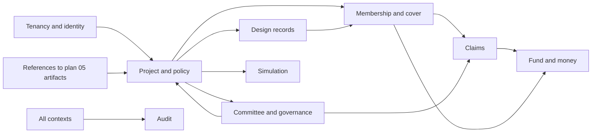

An arrow `A --> B` means "records of B refer to records of A" (for example `MC --> CL`: a
`Claim` refers to a `MemberCover`; `CL --> FM`: a `Payout` refers to a `Claim`; `CG --> PP`:
`PolicyConfiguration.applied_proposal_ids` refers to proposals). Execution of an approved
proposal (Committee and governance → Project and policy, Membership, Claims) is the only path by
which governance changes another context (section 13).

## 5. Common conventions

### 5.1 Identifiers

- Every entity has an opaque, globally unique, immutable ID: a type prefix, an underscore, and a
  UUIDv7 (RFC 9562) as a 128-bit big-endian number encoded in lower-case Crockford base32
  (26 characters, first character `0` to `7`). Test vector: UUID
  `01a210c5-d459-7c0c-a391-475ad9f03e08` (version 7, variant `10`) is
  `mcv_01m88cbn2sfg6a74a7bbcz0fg8`. The schema package holds more vectors (AT-DM-ID-1).
- Prefixes (fixed list, part of the schema package): `ten` tenant, `usr` user, `tmb` tenant
  membership, `prs` project role set, `rol` role assignment, `inv` invitation, `prj` project,
  `pol` policy, `rlm` realm, `pcf` policy configuration, `ptm` product terms, `ptv` product
  terms version, `csh` contribution schedule, `csv` contribution schedule version, `rbk`
  rulebook, `rbv` rulebook version, `gov` governance settings, `gsv` governance settings
  version, `com` committee, `cst` committee seat, `svt` synthetic voter, `prp` proposal, `vot`
  vote, `rcs` recusal, `pcm` proposal comment, `pty` party, `pdr` personal data record, `txt`
  personal text record, `prt` party representative, `pmb` policy membership, `mcv` member
  cover, `seg` cover segment, `amd` cover amendment, `itm` insured item, `sub` subscription,
  `grp` group enrolment, `fnd` fund, `ldg` ledger, `acc` ledger account, `jen` journal entry,
  `cdu` contribution due, `pay` payout, `clm` claim, `lev` loss event, `evd` evidence, `chk`
  claim check result, `aio` AI opinion, `cdc` claim decision, `dst` dataset, `lrr` legal
  readiness record, `arb` artifact realm binding, `aud` audit event.
- An ID never encodes tenant, project, or business meaning. The time part of UUIDv7 is used for
  ordering only. No logic reads it.
- `member_id` in plan 05 means `party_id` (section 6.5). The export in 14.1 uses the name
  `member_id` with the party ID as its value.
- Storage keys are composite: `(tenant_id, id)` for tenant-owned records. A lookup by `id` with
  the wrong `tenant_id` returns "not found", never "forbidden", so that it does not show that the
  ID exists (INV-1).

### 5.2 Tenancy and realm scoping

- **Tenant-owned records** carry `tenant_id`. Global records: `User` and platform role
  assignments only.
- **Project-scoped records** also carry `project_id`.
- **Realm-scoped records** also carry `realm_id`. A project has exactly one live realm, made
  when the project is made, and zero or more simulation realms (section 15).
- **Design records** (section 6.3) are project-scoped but **not** realm-scoped. A simulation
  realm and the live realm can refer to the same frozen design version. This is how a
  simulation tests exactly the versions that later go live.
- **Cross-realm references are forbidden** except references to design versions and to shared
  plan 05 artifacts (5.7, INV-2). A claim in a simulation realm cannot refer to a member cover in the live
  realm, and so on.
- Each realm has `kind: live | simulation` and `money_kind: real | dummy`. The live realm has
  `money_kind = real`. A simulation realm has `money_kind = dummy`. Payment and payout adapters
  refuse any operation in a realm with `money_kind = dummy` (INV-40).

### 5.3 Versioned records

- A versioned parent (for example `ProductTerms`) has versions (for example
  `ProductTermsVersion`). Each version has: its own ID, `parent_id`, `version_no` (1, 2, 3, ...
  with no gaps per parent), `status`, `content` (the typed body), `content_hash`, `created_by`,
  `recorded_at`, and, once frozen, `frozen_by` and `frozen_at`.
- Version status: `draft` → `frozen` → `retired` (section 9.2). Only a `draft` version can be
  edited. A `frozen` version is immutable: content and `content_hash` never change again.
- Only a frozen version (status `frozen` or `retired`) can be named by a current pointer, a
  member cover segment, a proposal, or a plan 05 artifact (INV-10). Freezing is one-way: a
  version never goes back to `draft`. So a check that reads "frozen" stays true, and a
  referring aggregate can make it without a lock on the design parent.
- `content_hash` = SHA-256 of the canonical JSON of `content` (section 5.6). It lets plan 05 and
  auditors check that a version did not change.
- `retired` means "no new schedule entry and no new proposal may name this version". It never
  makes an existing reference invalid. `SetDesignPointer` and `CreateProposal` refuse a version
  that they read as `retired`. Covers do **not** check retirement: enrolment, renewal, and
  amendments always pin the version in force from the pointer schedule (6.2), whether it is
  retired or not. So a schedule entry written at the same moment as the retirement stays valid,
  and new covers use it normally. This is safe because content never changes (section 8.2,
  race R-1).

### 5.4 Money

- `Money = {amount_minor: integer, currency: ISO 4217 code}`. The minor unit comes from ISO 4217
  for the currency (for example 2 for AUD).
- Arithmetic is only between amounts of the same currency. A mixed-currency operation is an
  error.
- Rounding of derived amounts uses the payout rounding rule of the policy (plan 05, U-10), stored
  on `ProductTermsVersion.content.rounding`. Domain code itself only adds, subtracts, and
  compares money. It does not divide money (division and allocation happen in plan 05 templates
  and plan 07 posting rules).
- Plan 05's `Money` type has the same shape. Both use the same JSON form:
  `{"amount_minor": "12345", "currency": "AUD"}` (decimal as string in canonical JSON, plan 05
  section 5.1).

### 5.5 Dates, times, periods, clocks

- `Policy.time_zone` is an IANA time zone name. It is set when the policy is created and is
  immutable once the project leaves `Draft` (INV-11).
- Business dates (`incident date`, `cover start`, `segment start`, `effective_from`) are
  calendar dates in the policy time zone, ISO 8601 `YYYY-MM-DD`.
- Points in time (`reported_at`, `cast_at`, `recorded_at`) are UTC instants with microsecond
  precision, ISO 8601 with `Z`.
- Periods are half-open `[start, end)`. A cover from 2027-01-01 to 2028-01-01 covers all of 2027
  and not 2028-01-01.
- **Realm clock.** Every command handler reads "now" for business purposes from the realm clock
  of the realm it acts in. In the live realm the realm clock is the real UTC clock, and a
  realm-clock instant that a command stores (for example `reported_at`) is the `recorded_at`
  of its commit (S-4 gives commit order). In a simulation realm it is a controlled clock
  (section 15.2).
- **Recorded time** (`recorded_at`) always comes from the real UTC clock, in every realm, so the
  audit trail shows when things really happened.
- A record that has a business time from a simulation realm clock stores it in the same field as
  in the live realm (for example `reported_at`). The realm's `kind` tells the reader which clock
  produced it.

### 5.6 Canonical JSON and hashing

The domain model uses the same canonical JSON as plan 05 section 5.1: sorted keys, UTF-8, no
insignificant whitespace, decimal numbers as strings. `content_hash` is SHA-256 of these bytes,
lower-case hex. The reference implementation and plan 05 share one test vector set for this
(AT-DM-ID-3).

### 5.7 References to plan 05 artifacts

Plan 05 artifacts have content-addressed IDs (plan 05, 5.1). The domain model stores them as
`ArtifactRef = {artifact_type, artifact_id}` and never computes or changes them. Before a domain
record stores an `ArtifactRef`, the command handler checks through the artifact registry that the
artifact exists, has the stated type, and belongs to the same `tenant_id` and `project_id`
(INV-3). Artifacts with `tenant_id = "platform"` (template releases, public fixtures) may be
referenced from any project.

The plan 05 artifact envelope has no realm. So the domain adds a realm check for artifacts that
hold realm data:

| Artifact kind | Types | Realm rule |
|---------------|-------|------------|
| Shared (design) | `dataset_version`, `source_document`, `owner_clarification`, `assumption_set`, `report_settings`, `rule_ir`, `issue_list`, `template_release`, `project_code`, `environment_lock`, `oracle_suite`, `calc_manifest`, `execution_record`, `result`, `validation_report`, `model_quality_report`, `calc_bundle`, `release_bundle`, `signoff`, `proposal_payload`, simulation reports, rulebook content and rule test runs | Any realm of the same project may refer to it. A simulation report made in a simulation realm is shared on purpose: G6 to G8 sign it for the release. |
| Realm-owned | `member_cover_set` exported by the domain, engine call results (`calculate_payout` result, `register_claim` and `finalise` results and traces), claim `llm_call_log`, evidence objects | Only records of the realm that made it may refer to it. |

- **Realm identity is part of the ID of every realm-owned artifact**, so the same bytes made in
  two realms always get two different IDs:
  - artifacts made by the domain (`member_cover_set` exports, evidence objects, proposal comment
    attachments) have `realm_id` inside the ID-defining content (for evidence: an envelope
    `{tenant_id, project_id, realm_id, claim_id, content_hash}`);
  - realm-owned artifacts made by plan 05 or the AI gateway (engine call results and traces,
    claim `llm_call_log`) must have a realm-bound artifact among the `parents` of their plan 05
    envelope (plan 05, 5.1), for example the bound `member_cover_set` or evidence object, or
    `realm_id` in the envelope. Both are part of the ID, so the ID is realm-bound. The domain
    binds such an artifact to realm X only if **all** realm proofs on it name X: the envelope
    `realm_id`, when present, equals X, and **every** parent that has a realm binding is bound
    to X; and at least one such proof exists. An artifact with no proof, or with proofs that
    name two realms (for example envelope realm A and a parent bound to realm B), is refused for
    every realm (fail closed). C-7 asks plan 05 to guarantee at least one proof for these
    types.
- For every realm-owned artifact, the domain writes a write-once `ArtifactRealmBinding`
  (`artifact_id`, `realm_id`) when the domain creates the artifact or receives it from a call
  that the domain made in that realm. The binding is unique per artifact (S-6): an artifact ID
  that is already bound to another realm is refused with `artifact_realm_conflict` (fail
  closed). A realm-scoped record may store an `ArtifactRef` of a realm-owned type only if a
  binding for the same realm exists (INV-3). A plan 05 call that takes a realm-owned artifact
  (for example `register_claim` with a `member_cover_set_id`) gets only IDs that pass this
  check.

`dataset_version_id` (plan 05) **is** the plan 05 `dataset_version` artifact ID. The domain
`Dataset` record (6.9) groups dataset versions under a stable name.

### 5.8 Field tags

Every schema field carries tags used by section 16 and by reports:

- `pii: none | direct | indirect | sensitive` (for example name and email are `direct`; date of
  birth is `indirect`; health information is `sensitive`, which this release does not store
  because life and health insurance are out of scope, plan 01 section 9).
- `retention: operational | financial | audit | evidence` (section 16.2).
- `visibility: member_self | committee | project_team | auditor | public_aggregate` (section 12).

**Storage rule.** Every text field in a schema has exactly one of two types:

| Type | Use | Storage |
|------|-----|---------|
| `display_text` | Short product or system text written by project staff for display, with `pii: none`, `retention: operational` or `audit`, and a length limit (for example a project name, a loss event area name, a dataset description, a synthetic voter label). It must not hold personal data. | Inline in the aggregate. |
| `personal_text` | Any other free text, and every field tagged `pii` other than `none` (for example a tenant name of a person tenant, a vote comment, a loss event description, a claim description). | A reference to a `PersonalData` or personal text record in the personal data store (16.1), plus a salted hash where a check needs one. Never inline. |

A text field with no type, or a `display_text` field with `pii` other than `none`, fails the
schema lint (AT-DM-PD-3).

## 6. Entity catalogue

Field tables list the fields that carry meaning for this plan. Every record also has `id`,
`recorded_at`, `created_by` (principal), and the scope fields in section 5.2. Every aggregate
root also has `aggregate_version` (an integer that increases by one with every write, used for
conditional writes).

### 6.1 Tenancy and identity

**Tenant**

| Field | Meaning |
|-------|---------|
| `name_ref` | Display name, `personal_text` (a person tenant's name is personal data, 5.8). |
| `kind` | `person` or `organisation`. |
| `status` | `active` (other states reserved, section 9.10). |
| `billing_profile_ref` | Reference to platform billing (plan 07). |

**User** (global, not tenant-owned)

| Field | Meaning |
|-------|---------|
| `auth_subjects` | List of identity provider subjects (plan 03). |
| `display_name`, `email` | `pii: direct`. Stored in a `PersonalData` record (section 16), referenced by `personal_data_id`. |
| `mfa_enrolled` | Mirror of the identity provider state, for policy checks. |
| `status` | `active` (others reserved). |

**TenantMembership**: `user_id`, `tenant_id`, `tenant_role: tenant_admin | tenant_user`,
`status: invited | active | left`.

**ProjectRoleSet** (aggregate root; one per `(tenant_id, project_id, user_id)`, INV-6): holds all
direct project-scope `RoleAssignment` records of one user in one project, so that the
role-conflict check (INV-6) is one conditional write. Platform-scope and tenant-scope
assignments are held in one `ProjectRoleSet`-like record per `(scope, user_id)`.

**RoleAssignment** (child of a role set)

| Field | Meaning |
|-------|---------|
| `user_id` | Who. |
| `scope` | `platform`, `tenant` (with `tenant_id`), or `project` (with `tenant_id`, `project_id`). |
| `role` | One of: `platform_admin`, `tenant_admin`, `project_owner`, `actuary_analyst`, `committee_member` (derived from a committee seat, never assigned directly, section 6.4), `committee_chair` (derived), `claims_assessor`, `auditor`, `code_reviewer`, `legal_specialist`. |
| `period` | `[valid_from, valid_to)` in recorded time; `valid_to` open until ended. |
| `granted_by` | Principal. After Live, who may assign project roles is part of U-DM-2; the fixture value is the owner, through `owner_live_powers`. Committee roles are never assigned (INV-5). |
| `status` | `active` or `ended`. |

The **member** role is not assigned. It is derived: a user acts as a member of a policy when the
user is linked to a party (directly or as a representative, 6.5) that has an `active`
`PolicyMembership` in that policy's live realm.

The **applicant** role is also derived, for enrolment before a membership exists: any signed-in
user may create a party linked to the user (or a business party; the creating user becomes its
first `PartyRepresentative` in the same write) and enrol it, in a realm whose `PolicyConfiguration.enrolment_open` is true. Whether an enrolment
page is public or private, and how a private link is issued, checked, and revoked, is the
channel contract of plan 08 (14.6): the channel checks the link before it sends `Enrol`. The
domain checks only `enrolment_open` and the applicant rule. The applicant does not need to be a
tenant member
(section 12.1). In a simulation realm, no user is an applicant: synthetic parties are enrolled
by the simulation driver (section 15.4).

**Invitation**: `tenant_id`, `project_id` (optional), `invited_email_ref` (`pii: direct`; a
`PersonalData` record that holds the email, 5.8),
`offered_role` or `offered_seat` (committee), `token_hash`, `expires_at`, `status`
(section 9.8). Accepting changes only the invitation (one aggregate). A process step, keyed by
`invitation_id`, then creates the `TenantMembership`, the `RoleAssignment`, or the
`CommitteeSeat` (section 8.2).

### 6.2 Project and policy

**Project**

| Field | Meaning |
|-------|---------|
| `name`, `description` | `display_text` (5.8). |
| `lifecycle_state` | Plan 01 section 6 states (section 9.1). |
| `initialisation` | `pending` or `ready`. `CreateProject` writes the project with `pending`; a process step creates the other records (11.2) and sets `ready`. Every command on the project except reads and the initialisation steps is refused with `project_initialising` until `ready`. |
| `owner_user_id` | The project owner. Change of owner is a tenant admin command before Live. After Live it is refused until U-DM-2 decides how it is governed (reserved). |
| `live_realm_id` | The project's live realm, made with the project. |
| `template_ref` | Optional. The policy template the project was cloned from (plan 01, 7.2). |
| `release_bundle_ref` | `ArtifactRef` to the plan 05 release bundle that took the project Live; empty before Live. |
| `legal_readiness_record_id` | Required for the Live transition (section 9.1). |

**Policy** (exactly one per project, INV-12; a child record of the Project aggregate)

| Field | Meaning |
|-------|---------|
| `policy_type` | `subscription` or `fixed_term`. |
| `currency` | ISO 4217. Immutable after `Draft`. |
| `jurisdiction` | Country and region code. Immutable after `Draft`. |
| `time_zone` | IANA name. Immutable after `Draft`. |
| `product_terms_id`, `contribution_schedule_id`, `rulebook_id`, `governance_settings_id` | The versioned parents of this policy's design records (one each). |

Why `Policy` is separate from `Project`: the project holds lifecycle and administration; the
policy holds the insurance identity that covers, claims, and calculations refer to. If U-DM-3
later allows several policies or funds per project, the keys do not change.

**Realm**: `project_id`, `kind: live | simulation`, `money_kind: real | dummy`, `clock`
(section 15.2), `status` (live realm: `active`; simulation realm: section 9.9),
`initialisation: pending | ready`. Simulation realms also hold the settings in section 6.8.
`CreateSimulationRealm` writes the Realm with `initialisation = pending`; a process step creates
its `PolicyConfiguration`, `Committee`, `Fund`, and `Ledger` (INV-12) and then sends
`MarkRealmReady` (8.2). Every command in the realm except reads and these steps is refused with
`realm_initialising` until `ready`. The live realm is created ready by project initialisation.

**PolicyConfiguration** (exactly one per realm, aggregate root)

This record holds the **design pointers** for one realm. It is the single place where the
versions in force are stored, so a governed change is one conditional write (section 13).

Each pointer is a **dated schedule**: an ordered list of entries `(seq, version_id,
effective_from, application_mode, set_by)`, where `seq` is a number that increases by one for
every entry of the configuration, `effective_from` is a business date, `application_mode` is
`at_renewal` or `from_effective_date` (13.3; always `at_renewal` before `governed`), and `set_by`
is the command or the proposal ID. The version **in force on business date d** is the entry with
the latest `effective_from <= d`; if two entries of one pointer have the same `effective_from`,
the one with the higher `seq` wins. An executed proposal adds a future-dated entry; it does not replace the
version in force today (section 13.1). Entries are never removed or changed. Before `governed`
is true, `SetDesignPointer` and `SetCalcBundle` add an entry with `effective_from` on or after
the realm-clock business date; a governance settings entry needs `effective_from` at least one
day after it (6.4, R-10). After `governed` is true, only an executed proposal adds an
entry.

| Field | Meaning |
|-------|---------|
| `realm_id` | The realm. |
| `product_terms_schedule` | Dated schedule of `ProductTermsVersion` IDs. Used for new covers, renewals, and amendments. |
| `contribution_schedule_schedule` | Dated schedule of `ContributionScheduleVersion` IDs. |
| `rulebook_schedule` | Dated schedule of `RulebookVersion` IDs. |
| `governance_settings_schedule` | Dated schedule of `GovernanceSettingsVersion` IDs. |
| `calc_bundle_schedule` | Dated schedule of `ArtifactRef`s to plan 05 calculation bundles. The bundle in force on a claim's report date is used for that claim's payout calls (plan 05, 26.1; section 14.2). |
| `pinned_pairs` | Every `(product_terms_version_id, rulebook_version_id)` pair that a cover segment of this realm can hold: every pair that is or was in force together, plus the **prospective pairs** of every executed `from_effective_date` change (13.2). A prospective pair is added by the execution write itself, before any amendment is made, so covers can pin only pairs in this set. This set is the complete list that a calculation bundle's version map must cover (section 13.4). Kept inside this aggregate. |
| `enrolment_open` | Whether new enrolments are accepted. |
| `governed` | `false` until the release is executed in this realm; then `true` for ever. While `true`, the schedules change only by executing an approved proposal (INV-50). This flag, not `Project.lifecycle_state`, is what the handler checks, so the check is inside this aggregate. |
| `test_release` | Simulation realms only: `state: none | released`, `release_bundle_ref`, `proposal_id`. Written by the execution of a `release` proposal in that realm (15.4). |
| `release_lock` | Empty, or the ID of the `release` proposal that holds the lock (INV-52). While set, every schedule change is refused except the execution of that proposal. |
| `applied_proposal_ids` | Proposals already executed against this configuration (idempotency, section 13). |
| `amendment_runs` | One entry per executed `from_effective_date` change: `(proposal_id, executed_at, completed_at)` (13.3). |
| `aggregate_version` | Used for conditional writes. |

"Current pointer" in this plan means the version in force on the realm-clock business date.

### 6.3 Design records

All four are versioned parents with versions as in section 5.3. They are project-scoped, not
realm-scoped (section 5.2).

**ProductTermsVersion.content**

| Field | Meaning |
|-------|---------|
| `cover_types` | List of cover types (for example `vehicle_damage`, `event_cancellation`), each with an incident type list. |
| `eligibility` | Structured eligibility criteria and underwriting questions (with answer types). |
| `cover_term` | Subscription: term length (for example P12M) and renewal mode (`auto` or `member_confirms`). Fixed term: the event period `[start, end)`. |
| `billing_frequencies` | Subscription: allowed (`monthly`, `yearly`). Fixed term: `single`. |
| `waiting_period` | Duration from cover start. |
| `excess`, `payout_limits` | Structured. The Rule IR (plan 05, section 16) is authoritative for payout calculation; these fields are display and eligibility data. They are not checked at freeze: the version is frozen first, then plan 05 builds a calculation bundle that names the frozen `(product_terms_version_id, rulebook_version_id)` pair, and the G2 sign-off on that bundle confirms that the terms match the Rule IR. A live-realm pointer entry or a governed change can name the pair only with that signed bundle (INV-18, section 13.4). |
| `insured_item_schema` | JSON Schema for insured items (for example vehicle fields). Empty if the product insures no items. |
| `max_members` | Optional. |
| `cooling_off_period` | Duration from enrolment. |
| `mid_cover_change_application` | For later changes of this design kind: `at_renewal` or `from_effective_date` (U-DM-6, plan 05 U-21). Default `at_renewal`. |
| `rounding` | Payout rounding rule and minor unit (plan 05, U-10). |
| `member_summary_ref` | Plain-language member summary document (plan 01, 7.5). |
| `source_document_refs` | Plan 05 `source_document` artifacts for the full terms text. |

**ContributionScheduleVersion.content**

| Field | Meaning |
|-------|---------|
| `rows` | List of `(rating_class, billing_frequency, amount: Money)`. A policy with no rating classes has one class `standard`. |
| `source_calc_bundle_ref` | Plan 05 calculation bundle that produced the risk-based minimum. Required before a live-realm pointer entry names the version (INV-14). |
| `fee_treatment` | `separate` or `from_contributions` (plan 05 U-8; U-DM-4). |
| `replenishment_terms` | Optional. Placeholder for FW-1; not used in this release. |

**RulebookVersion** (content owned by plan 06)

| Field | Meaning |
|-------|---------|
| `content_ref` | Artifact with the rulebook source documents and their hashes (plan 05 section 3, 06 row). |
| `rule_ir_ref` | Optional `ArtifactRef` to the plan 05 `rule_ir` artifact for this version. Required before the version can be named by a live-realm pointer (INV-15). |
| `rule_test_run_ref` | Artifact that shows the rule test cases passed for this version (plan 01, 7.5). Required before a rule change proposal can open (INV-33). |

Text inside design version content (cover type names, eligibility questions, member summary
text) is `display_text`; long documents are artifacts (`source_document_refs`,
`member_summary_ref`, `content_ref`).

Design versions have no `effective_from` field. The date from which a version is in force in a
realm is the `effective_from` of its pointer schedule entry (6.2). Rule-level effective dates
inside a Rule IR are plan 05 data (plan 05, 16.3) and are not changed by this plan.

**GovernanceSettingsVersion.content**

| Field | Meaning |
|-------|---------|
| `decision_types` | For each proposal type (section 6.4): quorum, majority threshold, discussion period, voting period, who may vote, tie-break rule, anonymous or public, notice period before effect, `min_eligible_voters`. Semantics of quorum, threshold, and tie-break are owned by plan 04. Schema rules owned here: for `claim_decision`, "who may vote" is fixed to active committee seats; `min_eligible_voters` is an integer of at least 2 for every type, so one person can never decide alone (section 12.5). |
| `committee_size` | `min`, `max`. Schema rule: `min >= 2`. |
| `premium_step_limit` | Maximum change of a contribution in one step (plan 01, 7.13; plan 05 U-14). |
| `review_frequency` | Premium review frequency and triggers (plan 01, 7.13). |
| `claim_decision_target` | Service-level target for claim decisions (plan 01, 7.12). |
| `owner_live_powers` | The list of commands the owner keeps without a vote after Live (U-DM-2). Fixture value: enrolment page text, branding, and assignment of assessor and auditor roles. It can never contain a command that changes a schedule, a seat, a cover, a claim, or money. |
| `role_conflicts` | Role pairs that one user may not hold in one project at the same time (for example `actuary_analyst` with `code_reviewer` on the same calculation, plan 05 U-7). |

### 6.4 Committee and governance

**Committee** (exactly one per realm, aggregate root with its seats)

| Field | Meaning |
|-------|---------|
| `realm_id` | The realm. |
| `seats` | Child records `CommitteeSeat`. |
| `size_limits` | A copy of the realm's governance settings schedule, reduced to `committee_size`: entries `(seq, effective_from, governance_settings_version_id, min, max)`. Written at initialisation and by `RefreshCommitteeLimits`, which a process step sends as soon as a governance entry is **added** to the configuration (not when it takes effect, 8.2). |
| `synced_seq` | The highest configuration entry `seq` of a governance entry that `size_limits` holds. |
| `below_minimum`, `above_maximum` | Derived inside this aggregate for the realm-clock date: the active seat count is below `min`, or above `max`, of the `size_limits` entry in force on that date. |

Rules for the limits (R-10):

- A governance settings entry never takes effect on the business date on which it is written:
  its `effective_from` is at least the next day (6.2, 13.2). The only exception is the first
  entry, written by initialisation before any seat exists.
- Every seat write (`AcceptSeat`, `RemoveSeat`, `ResignSeat`, `SetChair`, an executed
  `committee_change`) and `StartVoting` use the limits in force on the realm-clock date from
  `size_limits`. They are refused with `committee_limits_refresh_pending` if a configuration
  snapshot shows a governance entry with a `seq` higher than `synced_seq`. Because an entry
  never takes effect on the day it is written, an entry that the snapshot does not yet show
  cannot be in force, so the Committee never uses stale limits.
- When new limits take effect and the seat count is outside them, no seat is changed
  automatically. Count below `min`: `below_minimum` is true; seats can be added; no proposal
  can enter `voting` (9.3). Count above `max`: `above_maximum` is true; additions are refused;
  removals and resignations are allowed while the count stays at or above `min`; voting is
  allowed. Deadlock handling is FW-6.

**CommitteeSeat**: `voter_ref`, `seat_role: member | chair`, `period [from, to)` (recorded
time), `status` (section 9.3), `granted_by` (owner command while the realm's configuration is not `governed`, proposal ID
after). `voter_ref = {kind: user | synthetic_voter, id}`. In the live realm `kind` is always
`user`. A voter holds at most one active seat per committee (INV-30). A simulation realm
committee may hold seats for real project users (test votes, plan 05 G7) or for synthetic
voters (section 15.4).

**SyntheticVoter** (realm-scoped, simulation realms only, INV-41): `realm_id`, `label`
(`display_text`),
`script_ref` (how the simulation driver casts its votes). It has no personal data and no user
account. Only the simulation driver service principal of that realm acts for it (12.4).
`eligible_voters`, `Vote.voter_ref`, and `Recusal.voter_ref` use the same `voter_ref` shape.

**Proposal** (aggregate root)

| Field | Meaning |
|-------|---------|
| `realm_id` | The realm. |
| `type` | `claim_decision`, `contribution_change`, `rule_change`, `terms_change`, `governance_change`, `committee_change`, `member_removal`, `release`. Reserved: `lifecycle_change` (FW-5), `appeal` (FW-3). |
| `subject_ref` | The record the proposal is about (claim ID, membership ID, seat or user ID, or the realm's `PolicyConfiguration` ID). |
| `payload` | Typed per proposal type (section 13.2). Large payloads (for example a plan 05 `proposal_payload`) are `ArtifactRef`s. |
| `effective_from` | Business date from which the change applies (types with an effect date, 13.2). Must be at least the notice period after the realm-clock date of execution (13.1). |
| `baseline` | The versions the proposal was made against (section 13.1). |
| `governance_settings_version_id` | The settings version that governs this proposal, frozen when the proposal is created. |
| `required_consents` | For `release`: the owner's consent is required in addition to the committee vote (plan 01, section 6). Empty for other types. |
| `consents` | Recorded consents (`RecordOwnerConsent`): who, when. |
| `proposer` | Principal (user, or the actuarial engine service principal for `contribution_change`, plan 05 14.3). |
| `eligible_voters` | Frozen list of `voter_ref`s when the proposal enters `voting` (INV-31). |
| `state` | Section 9.4. |
| `outcome` | `approved`, `rejected`, or `failed` (for example no quorum), with the tally reference from plan 04. |
| `execution` | `executed_at`, `execution_result: executed | stale | expired`. |

**Vote** (child of Proposal): `proposal_id`, `voter_ref`, `choice: yes | no | abstain`,
`cast_at`, `comment_ref` (optional, `personal_text`). One vote per voter per proposal; a later vote replaces the earlier one
only while the proposal is in `voting` and only if the governance settings allow changes
(plan 04). For anonymous proposals, plan 04 decides how the link between voter and choice is
stored (U-DM-14). The domain model requires only that it can prove one ballot per eligible
voter.

**Recusal** (child of Proposal): `proposal_id`, `voter_ref`, `reason: own_claim |
representative_of_claimant | declared_conflict`, `source: automatic | declared`. Created
automatically for `own_claim` and `representative_of_claimant` when a `claim_decision` proposal
is created (INV-32). A recused voter cannot vote and is removed from `eligible_voters`.

**ProposalComment** (child of Proposal): `author`, `body` (`pii: indirect`, stored as a
personal text record, 16.1), `attachment_refs` (write-once objects), `posted_at`. Allowed in
`discussion` and `voting` (plan 01, 7.6 "discussion threads and attached evidence"). A comment
never changes the proposal payload or baseline.

### 6.5 Membership and cover

**Party** (aggregate root): `kind: person | business`, `personal_data_id`, `linked_user_id` (optional),
`synthetic` (true only in simulation realms, INV-41), `verification_status` (reserved for KYC,
U-DM-9). A party is tenant-owned and realm-scoped.

**PersonalData**: the personal fields of a user or party (name, email, phone, address, date of
birth, business registration number). Section 16.

**PartyRepresentative** (child of the Party aggregate): `party_id` (business party), `user_id`,
`role` (for example `authorised_contact`), `status: active | ended`. A representative may act
for the business party (submit claims, view covers).

**PolicyMembership** (aggregate root; one per party per policy per realm, INV-20)

| Field | Meaning |
|-------|---------|
| `party_id` | The member. |
| `policy_id`, `realm_id` | Where. |
| `status` | Section 9.5. |
| `removal` | Empty, or `proposal_id` and `effective_on` of an executed `member_removal` that is not yet in effect (13.2). |
| `joined_on` | Business date of the first cover start. |
| `enrolled_via_group_id` | Optional `GroupEnrolment`. |
| `covers` | Child records `MemberCover` (with their segments and amendments). |
| `insured_items` | Child records `InsuredItem`. |
| `subscription` | Child record `Subscription` (subscription policies only). |

Why member covers are children of the membership: the "no overlapping covers" rule (INV-22) and
member removal (one atomic write that ends every active cover, section 13.2) both need all of a
member's covers in one aggregate.

**MemberCover**

| Field | Meaning |
|-------|---------|
| `member_cover_id` | ID with prefix `mcv`. |
| `period` | `[start, end)` business dates. A cancellation or removal can move `end` earlier, never before `start` (INV-25). A cover cancelled before it starts has the empty period `[start, start)` and no segments. |
| `status` | Section 9.5. |
| `insured_item_ids` | Items covered (empty if the product insures no items). |
| `rating_class` | Used to select the contribution row. |
| `segments` | Ordered list of `CoverSegment`. |
| `acceptance` | What the member accepted: for **every** segment written at enrolment or renewal (the first one and any later one from a scheduled `from_effective_date` entry, 13.1), the product terms version ID, rulebook version ID, contribution schedule version ID, and their content hashes; the member summary versions shown; accepted-at instant; channel; and the accepting principal. |
| `renews_member_cover_id` | The previous cover, for a renewal. Empty for the first cover. |
| `schedule_seq_read` | The highest configuration entry `seq` in the `PolicyConfiguration` snapshot that `Enrol` or `RenewCover` read to choose the versions. The cover keeps the versions of that snapshot, which are the versions the member accepted. A later `from_effective_date` entry that the mid-cover process did not reach is applied by schedule reconciliation (13.3, R-13). |
| `underwriting_answers` | Answers to the eligibility questions (`pii` tags per question). |
| `amendments` | Child records `CoverAmendment`. |

**CoverSegment**: `segment_id`, `product_terms_version_id`, `rulebook_version_id`,
`contribution_schedule_version_id`, `segment_start`, `segment_end`. The first three version IDs
are the versions in force for the cover between `segment_start` and `segment_end`. The plan 05
tuple is the same record without `segment_id` and `contribution_schedule_version_id`
(section 23, C-1).

**CoverAmendment**: `effective_on` (business date), `kind: version_change | end_change`,
`reason: governed_change | schedule_reconciliation | cancellation | member_removal`
(`member_request` reserved, U-DM-6), `entry_seq` (for `governed_change` and
`schedule_reconciliation`: the configuration entry that the amendment applies),
`proposal_id` (for `governed_change` and `member_removal`), `before_period`, `before_segments`
(the full list before the change), `before_segments_hash`, `after_segments_hash`.

- `version_change` splits the segment that contains `effective_on` into two segments and
  changes version IDs in the second one and in every later segment that the change covers. If
  `effective_on` is a segment start (for example `period.start` of a pending cover), there is no
  split and the version IDs change from that segment on (13.3).
- `end_change` (cancellation or removal) moves `period.end` to `effective_on`, cuts the segment
  that contains `effective_on` at that date, and drops later segments from the current list. If
  the cover starts after `effective_on`, `period.end` moves to `period.start` (empty period, no
  segments, INV-21, INV-25). The
  dropped segments stay in `before_segments`, so history is kept.
- `version_change` amendments that apply a configuration entry are keyed `(member_cover_id,
  entry_seq)`, whether the mid-cover process (reason `governed_change`) or schedule
  reconciliation (reason `schedule_reconciliation`) sends them. So one entry is applied to one
  cover at most once.
- An amendment never changes a segment, or part of one, before `effective_on`. For a
  cancellation or removal, `effective_on` is not before the realm-clock business date when the
  amendment is recorded. A `governed_change` or `schedule_reconciliation` amendment uses the
  split date of its entry (13.3) and may be recorded after that date; the guards in 13.3 make
  sure no export, claim registration, or due used the cover in between (INV-24).

**InsuredItem**: `item_type`, `attributes` (validated against
`ProductTermsVersion.content.insured_item_schema` of the cover's first segment), `status`.

**Subscription**: `billing_frequency`, `renewal_mode`, `next_renewal_on`, `status: active |
ended`. Billing frequency is independent of the cover term: a monthly-paid subscription can have
a 12-month cover term.

**GroupEnrolment** (aggregate root): `sponsor_party_id`, `policy_id`, `realm_id`,
`member_party_ids`, `per_party_acceptance` (the `acceptance` record of each listed party, as in
a single enrolment), `per_party_result` (`pending | enrolled | refused` with reason), `status:
submitted | completed`. Happy path: `SubmitGroupEnrolment` writes this record;
`RecordGroupAcceptance` adds each party's acceptance; for each party with an acceptance, a
process step sends `Enrol` with that acceptance, keyed by `(group_enrolment_id, party_id)`, and
records the result here. A party without an acceptance is not enrolled. Who may accept for a
listed party (the party itself or the sponsor) is U-DM-16; the fixtures use acceptance by each
party.

### 6.6 Fund and money

**Fund** (exactly one per policy per realm, INV-12)

| Field | Meaning |
|-------|---------|
| `policy_id`, `realm_id` | Where. |
| `currency` | Same as the policy currency. |
| `ledger_id` | The fund ledger. |
| `beneficial_owners` | Fixed value `policy_members` (D2). Legal form is FW-4. |
| `custody_ref` | Reference to the custody account (plan 07; plan 01 section 8 "fund custody"). Empty in simulation realms. |

**Ledger** (aggregate root with its accounts and entries): `owner_kind: fund | platform`,
`fund_id` (fund ledgers only; empty for the platform ledger), `realm_id` (fund ledgers only).
Each fund has exactly one ledger. There is exactly one platform ledger, owned by the platform
tenant (`tenant_id = "platform"`), and it serves only live realms. Simulation realms have no
platform ledger; a simulated service fee is posted to a `simulated_fee_sink` account in the
dummy fund ledger (section 15.3).

**LedgerAccount**: `ledger_id`, `code`, `kind: asset | liability | equity | income | expense`,
`currency`. In a fund ledger every account has the fund currency. Minimum fund chart (plan 07
completes it): `fund_cash`, `contributions_receivable`, `claims_payable`, `refunds_payable`,
`member_equity`, `service_fee_payable` (only when `fee_treatment = from_contributions`).

**JournalEntry** (append-only)

| Field | Meaning |
|-------|---------|
| `ledger_id` | One ledger only (INV-42). |
| `entry_date` | Business date. |
| `intraday_order_key`, `tie_key` | Order of entries on one date, as in the plan 05 cash-flow event schema (plan 05, 26.2). |
| `lines` | `(account_id, side: debit | credit, amount: Money)`. Each line's currency equals its account's currency (INV-47). Debits equal credits per currency (INV-43). |
| `cause_ref` | The record that caused the entry (`contribution_due_id`, `payout_id`, refund, or `fee_charge_ref` for a fee transfer). |
| `idempotency_key` | Unique per ledger (INV-44). |
| `transfer_id` | Links the two entries of a fee transfer between a fund ledger and the platform ledger. |

**ContributionDue** (aggregate root; unique per `(member_cover_id, period.from)`, S-6):
`member_cover_id`, `period [from, to)`, `amount: Money`, `contribution_schedule_version_id`,
`due_on`, `status: due | paid` (others reserved, FW-7), `payment_ref` (plan 07). The amount
comes from the segment's contribution schedule version and the cover's rating class and billing
frequency (INV-26). The due for the first billing period of a cover is created when the cover
is enrolled, with `due_on` on or before `period.start` (9.5). Later dues are created by the
dues process step (8.2), which waits while a mid-cover application run of the realm is incomplete
(13.3). A due is never changed after it is created; billing periods never span two
contribution versions (INV-26).

**FeeCharge** (shape owned by plan 07, referenced here): `fee_charge_ref`, `fund_id`, `period`,
`amount: Money`, `fee_schedule_ref`. It is computed from the fee model (U-DM-4) and never from
claims, claim decisions, or the fund balance (D5). A fee transfer names exactly one fee charge
and moves exactly its amount (INV-45).

**Payout** (aggregate root): `claim_id`, `claim_decision_id`, `amount: Money` (the final payout
from plan 05 `finalise`), `payee_party_id`, `status` (section 9.7), `rail_ref` (plan 07),
`idempotency_key = claim_decision_id` (unique, S-6, INV-46).

### 6.7 Claims

**Claim** (aggregate root)

| Field | Meaning |
|-------|---------|
| `realm_id`, `policy_id` | Where. |
| `claimant_party_id` | Must own the cover (INV-34). |
| `member_cover_id` | Required (plan 05, 17.1 step 2). |
| `insured_item_id` | Required when the cover has insured items. |
| `incident_type` | From the cover type list of the cover's product terms. |
| `raw_dates` | Occurrence start, occurrence end, discovery date (as known), business dates. The domain does not compute the incident date; plan 05 does (plan 05, 17.1). |
| `claimed_amount` | `Money`, the member's ground-up loss estimate. |
| `description_ref`, `declaration` | Description as a personal text record (5.8), and the accepted declaration (version and accepted-at). |
| `channel` | `web`, `mcp`, `api` (plan 08). |
| `reported_at` | Instant of submission, from the realm clock. Immutable (INV-35). |
| `calc_bundle_ref` | The calculation bundle in force in the realm's `calc_bundle_schedule` on the business date of `reported_at`, read from a snapshot at the submission's recorded time and written by the registration step (14.2). |
| `loss_event_id` | Optional link to a `LossEvent`, chosen at submission (by the claimant from the realm's open loss events) or empty. This is the event ID sent to `register_claim`. |
| `proposed_loss_event_id` | Optional. A different link proposed by the assessor or chair during review. It takes effect only if the committee approves it in the decision draft (13.2, 14.2). |
| `engine_binding` | `register_id`, `calc_bundle_ref`, `member_cover_set_ref`, registered input hash, used in `register_claim` (plan 05, 26.1). Empty until registration. |
| `evidence_ids`, `check_result_ids`, `ai_opinion_ids` | Children or references. |
| `assessor_user_id` | Optional (plan 01, 7.12 step 3). |
| `open_decision_proposal_id` | Empty, or the one `claim_decision` proposal that may currently decide this claim (INV-38). Set by `OpenClaimDecision` on this aggregate; cleared when that proposal ends without a decision. |
| `decision_id` | The `ClaimDecision`, when decided. |
| `final_amount` | `Money` and the plan 05 finalise trace reference, when known. |
| `engine_issue_refs` | Plan 05 register issues about this claim (for example a late-registration issue, 14.2). Recorded only; they never change claim state. Written by `RecordEngineRegistration` (issues returned by `register_claim`) or by the issue-only form of `RecordFinalAmount` (14.2 step 5). Handling them is an exception path (FW-1, FW-3). |
| `state` | Section 9.6. |

**LossEvent** (aggregate root): `realm_id`, `policy_id`, `kind` (for example `storm`), `period
[start, end)`, `area` (optional, `display_text`), `description_ref` (`personal_text`), `status:
open | closed_for_linking`,
`created_by`. Claims link to it through `loss_event_id`. Plan 05 uses `loss_event_id` as
`event_id` (section 23, C-4). A link chosen at submission is registered with the claim. A
different link after registration is a committee decision in the decision draft, and the
process changes the registered event only through the plan 05 operation requested in C-4.

**Evidence** (child of Claim): `claim_id`, `artifact_ref` (write-once object, encrypted, 16.1),
`media_type`, `uploaded_by`, `description_ref` (personal text record), `access_policy` (section 12.3), `retention: evidence`.

**ClaimCheckResult**: `claim_id`, `check: cover_on_raw_dates | waiting_period | duplicate |
limits_preview | engine_coverage_preview`, `result: pass | flag`, `details_ref` (personal text record), `source_ref` (for
the engine preview: plan 05 `calculate_payout` result). A check never rejects a claim; a `flag`
goes to the committee (DM-6; plan 05, 17.1 step 4).

**AiOpinion**: `claim_id`, `recommendation: approve_full | approve_partial | reject |
no_opinion`, `suggested_amount` (optional), `cited_rule_ids`, `rulebook_version_id`,
`confidence`, `llm_call_log_id` (`ArtifactRef`), `summary_ref` (personal text record). It is only
an input. No command reads
`recommendation` to change claim state (INV-36).

**ClaimDecision** (child of Claim): `claim_id`, `proposal_id`, `outcome: approve_full |
approve_partial | reject`, `approved_amount` (before limits that span several claims, plan 05
26.1), `reasons_ref` (personal text record, retention `financial`), `cited_rule_ids`, `rulebook_version_id`, `loss_event_id`,
`judgement_flags` (the committee-judgement flags by rule ID, plan 05 16.3), `evidence_flags`,
`engine_preview_ref` (the `calculate_payout` result computed with these flags, 14.2),
`amount_override_reason_ref` (`personal_text`; required when `approved_amount` differs from the per-claim payout in
the preview), `decided_at`. Made only by executing an approved `claim_decision` proposal
(INV-37). The engine preview is an input; the committee decides the amount (D1).

### 6.8 Simulation

Simulation realm settings are part of `Realm` (section 15): `simulation_purpose`,
`source_calc_bundle_ref`, `seed`, `clock` (`start`, `current`, `target`, `advance_complete`,
15.2),
`ledger_source: domain_flow | engine_cash_flows` (15.3), `report_ref`, `status`. The G7 test
release result is stored on the realm's `PolicyConfiguration.test_release` (6.2, 15.4).

### 6.9 References

**Dataset**: `name`, `description` (both `display_text`), `version_refs` (ordered list of plan 05 `dataset_version`
artifact refs). Owned by the data room (plan 01, 7.3).

**LegalReadinessRecord** (aggregate root): `release_bundle_ref`, `partner_agreement_ref`,
`jurisdiction_review_ref`, `required_future_work_approvals` (list of plan IDs and approval refs),
`signatures` (one by a user with `legal_specialist` in the project and one by a
`platform_admin`; two different users), `status: draft | complete`. It is `complete` only when
both signatures exist. Plan 05 G8 needs it. The domain model checks only that it is `complete`
and names the same release bundle (INV-17); it does not judge legal readiness.

Plan 05 sign-offs, calculation bundles, release bundles, and simulation reports stay plan 05
artifacts. The domain model stores `ArtifactRef`s to them.

### 6.10 Audit

**AuditEvent** (append-only, one hash-chained stream per `(tenant_id, project_id, realm_id)`,
plus one stream per tenant for tenant-level records and one platform stream)

| Field | Meaning |
|-------|---------|
| `stream_id`, `sequence_no` | Position. `sequence_no` has no gaps. |
| `command` | Command name, idempotency key, and the principal. |
| `entity_refs` | Records changed, each with `aggregate_version` before and after. |
| `domain_events` | The domain events emitted (11.3). Event bodies hold IDs, codes, dates, money, and hashes only, never personal field values or personal free text (16.1). |
| `recorded_at` | Real UTC time. |
| `realm_time` | Realm clock time, when the command used one. |
| `prev_hash`, `hash` | `hash = SHA-256(prev_hash || canonical JSON of this event without hash)`. |

Read access to evidence is also recorded as an audit event (plan 01, 7.16 "access control on
claim evidence").

## 7. Relations

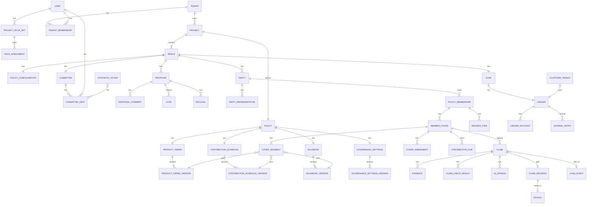

A `COMMITTEE_SEAT` names exactly one voter: a `USER`, or (simulation realms only) a
`SYNTHETIC_VOTER`. The platform ledger has no fund (`owner_kind = platform`); every fund ledger
has exactly one fund.

## 8. Aggregates and consistency

### 8.1 Aggregates

Each row is one aggregate. All invariants listed for it are checked inside its atomic
conditional write (`expected aggregate_version`). Every command writes exactly one aggregate.
A check that reads another aggregate is allowed only when the fact it reads can never become
false again (for example "version V is frozen", "cover C belongs to party P", or a write-once
field such as `rule_test_run_ref` is set). Every other rule that spans aggregates is in
section 8.2.

| Aggregate root | Children | Invariants enforced inside |
|----------------|----------|-----------------------------|
| Tenant | — | INV-1 (with storage scoping, S-5) |
| User | — | — |
| ProjectRoleSet (one per tenant, project, user) | role assignments | INV-5, INV-6 for direct roles |
| Invitation | — | INV-7 |
| Project | Policy | INV-11, INV-12 (one policy), INV-17, lifecycle guards (9.1) |
| PolicyConfiguration | pointer schedules, applied proposal set, release lock | INV-10 (referring side), INV-13, INV-14, INV-15, INV-16, INV-18, INV-19, INV-50, INV-51, INV-52 |
| Each design parent (ProductTerms, ContributionSchedule, Rulebook, GovernanceSettings) | its versions | INV-10 (content never changes after freeze) |
| Committee | seats | INV-30, size limits from governance settings (9.3) |
| SyntheticVoter | — | INV-41 |
| Proposal | votes, recusals, comments | INV-31, INV-32, INV-33, INV-53, INV-54 |
| Party | representatives | INV-41 |
| PolicyMembership | covers, segments, amendments, items, subscription | INV-13 (referring side), INV-21 to INV-25, INV-26 (split rule: no amendment changes the contribution version of a billing period whose due may exist, 13.3) |
| ContributionDue | — | INV-26 (amount equals the row of the version that the cover names for the due period, at creation) |
| GroupEnrolment | per-party results | — |
| Claim | evidence, check results, AI opinions, decision | INV-34 to INV-39 |
| LossEvent | — | — |
| Fund | — | INV-12 (one fund per realm, with S-6) |
| Ledger | accounts, journal entries | INV-42 to INV-45, INV-47 |
| Payout | — | INV-46 |
| Realm | simulation settings, clock | INV-40, clock rules (15.2) |
| LegalReadinessRecord | signatures | two-signature rule (6.9) |
| Dataset | — | — |
| ArtifactRealmBinding (write-once) | — | INV-3 (realm part) |
| AuditEvent stream | events | INV-60 |

`PersonalData` and personal text records are not aggregates in the versioned store. They live
in the personal data store (section 16.1).

### 8.2 Rules that span aggregates

A rule that touches more than one aggregate is done by a **process step**: a handler that reacts
to a domain event and sends a command to another aggregate. Every process step:

- has an idempotency key derived from its cause (for example `(member_cover_id, entry_seq)`),
  so running it twice has the same effect as running it once;
- runs as the process runner service principal with only the commands listed for it in 12.4;
- records its progress in the audit stream;
- is retried until it succeeds or a human stops it;
- never needs a lock on two aggregates at the same time.

**Races and their single guard.** Each race below has exactly one authoritative guard.

| # | Race | Authoritative guard |
|---|------|---------------------|
| R-1 | A pointer entry is written while its version is retired | None needed. Freeze is one-way and content never changes (5.3). Retirement only stops new schedule entries and new proposals that read the version as `retired`; an entry written at the same moment stays valid, and covers always pin the version in force from the schedule without checking retirement (5.3), so new covers are never blocked. |
| R-2 | Two `claim_decision` proposals for one claim | `Claim.open_decision_proposal_id`. `OpenClaimDecision` on the Claim sets it with a conditional write and reserves the proposal ID; `CreateProposal` for `claim_decision` must use that ID; `ExecuteProposal` on the Claim accepts only the proposal named in the slot (INV-38). |
| R-3 | Two conflicting roles granted at the same moment | Direct roles: one `ProjectRoleSet` per user and project, so the check is one write (INV-6). Derived committee roles (from seats) against direct roles: checked again **at use**. A command whose permission comes from either role of a conflicting pair is refused while the user holds both (fail closed, INV-6). |
| R-4 | A pointer change during a release vote | `PolicyConfiguration.release_lock`, set by `LockForRelease` on the configuration before the release proposal can enter `voting` (INV-52, 13.4). |
| R-5 | Two memberships for one party | Unique constraint on `(party_id, policy_id, realm_id)` at creation (S-6, INV-20). |
| R-6 | Two payouts for one decision | Unique `Payout.idempotency_key = claim_decision_id` (S-6, INV-46). |
| R-7 | A claim is finalised while an earlier reported claim is not yet registered | Registration barrier on a commit-ordered snapshot (14.2, S-4). |
| R-8 | Two proposals with the same baseline | Baseline check inside the target aggregate (13.1). |
| R-9 | Seat changes during voting | `eligible_voters` is frozen inside the Proposal at `StartVoting` from a snapshot of the Committee; the `min_eligible_voters` check is on that frozen list (INV-53). |
| R-10 | New committee size limits take effect while the Committee still holds the old limits | The Committee holds a dated copy of the limits, refreshed when a governance entry is added; an entry never takes effect on the day it is written; seat writes and `StartVoting` are refused with `committee_limits_refresh_pending` while a configuration snapshot shows an entry newer than `synced_seq` (6.4, INV-53). |
| R-11 | A command that adds personal data commits its aggregate but not the personal value, or the reverse | Personal values are written in the same unit-of-work commit, or by the staged protocol in 17.3; a reference never resolves to a missing value. |
| R-12 | An amendment changes the contribution version of a billing period whose due was already created | Split rule inside the PolicyMembership (13.3): a contribution split date is never inside or at the start of the cover's first billing period (its due is made at enrolment), and is always a later billing period start on or after `effective_from`. A later due is made only at its period start by the dues step, which waits while an amendment run is incomplete. So no existing due is ever repriced (INV-26). |
| R-13 | `Enrol` or `RenewCover` reads the pointer schedule, then a governed `from_effective_date` entry is executed, then the cover commits without it, after the mid-cover process took its list of covers | Two triggers cover every order. The mid-cover process lists covers from a snapshot taken after the execution commit; schedule reconciliation runs on every `CoverEnrolled` and reads the configuration after the cover commit. A cover that committed before the list snapshot is in the list; a cover that committed after it is reconciled, because its reconciliation reads the entry. Both send `AmendCover` keyed `(member_cover_id, entry_seq)`, so the cover is amended once. Only `from_effective_date` entries are applied, and only to covers they affect, which needs a valid split date (13.3); `at_renewal` entries never change an existing cover, and an entry with no valid split date for a cover needs no amendment for it. Until an affecting entry is applied, the cover is **unreconciled**, which a snapshot shows on its own, and `MaterialiseMemberCoverSet`, claim registration, and the dues step treat it like an incomplete amendment run (13.3, INV-23). |

Process steps in this plan:

| Process | Cause | Steps |
|---------|-------|-------|
| Project initialisation | `ProjectCreated` | Create live Realm, PolicyConfiguration, Committee, Fund, Ledger, and the four design parents, each keyed `(project_id, record kind)`; then `MarkProjectReady`. |
| Simulation realm initialisation | `SimulationRealmCreated` | Create the realm's PolicyConfiguration, Committee, Fund, and Ledger, each keyed `(realm_id, record kind)`; then `MarkRealmReady`. |
| Committee limits refresh | `GovernanceEntryAdded` on the configuration (from `SetDesignPointer` or an executed `governance_change`) | `RefreshCommitteeLimits` on the realm's Committee with the full governance schedule, keyed `(committee_id, entry seq)`. |
| Invitation acceptance | `InvitationAccepted` | Create the `TenantMembership`, `RoleAssignment`, or `CommitteeSeat`, keyed by `invitation_id`. |
| Claim decision slot | `ClaimDecisionSlotOpened` | `CreateProposal` with the reserved ID, then `OpenProposal`. |
| Release lock | `ReleaseVotingRequested` | `LockForRelease` on the PolicyConfiguration, then `StartVoting` on the proposal. `ReleaseLock` after `MarkProjectLive` (the lock is held from voting until Live, 13.4), or when the proposal ends without execution. |
| Proposal execution | `ProposalApproved` | One `ExecuteProposal` to the target aggregate (section 13). The proposal records the result from the target's event. |
| Proposal end on a claim | Proposal for a claim ends as `closed`, `withdrawn`, `stale`, or `expired` | `ReleaseClaimDecisionSlot` on the Claim, keyed by `proposal_id` (9.6). |
| Release completion | Realm clock reaches the `effective_from` of an executed release (`ReleaseExecuted`) | `MarkProjectLive` on the Project, on that date and not before (13.4). |
| Mid-cover change application | A governed change executed with `from_effective_date` | List the affected covers from a snapshot taken after the execution commit; one `AmendCover` per affected cover, keyed `(member_cover_id, entry_seq)` (6.5), at the split date of 13.3; then `MarkAmendmentsComplete` on the configuration. |
| Member removal effect | Realm clock reaches `removal.effective_on` | `ApplyMemberRemoval` on the membership (13.2). |
| Group enrolment | `GroupAcceptanceRecorded` | One `Enrol` for that party with its recorded acceptance, keyed `(group_enrolment_id, party_id)`; result recorded on the GroupEnrolment with `RecordGroupEnrolmentResult`. |
| Ready for committee (no assessor) | `CheckResultRecorded` or `AiOpinionAttached`/`AiOpinionSkipped` on a claim with no assessor | `MarkReadyForCommittee` when all checks and the AI step are recorded, keyed by `claim_id`. |
| First contribution due | `CoverEnrolled` (new cover or renewal) | `CreateContributionDue` for the first billing period, keyed `(member_cover_id, period.from)`. |
| Cover activation | Realm clock reaches `period.start`, or `ContributionPaid` for a first due | `ActivateCover` when both conditions in 9.5 hold. |
| Cover expiry | Realm clock reaches `period.end` of an active cover | `ExpireCover`. |
| Later contribution dues | Realm clock reaches the next billing date of an active cover | `CreateContributionDue` for that period. |
| Schedule reconciliation | `CoverEnrolled` (new cover or renewal) | Read the configuration (after the cover commit); for every `from_effective_date` entry with `seq` above the cover's `schedule_seq_read` that affects the cover (13.3), send `AmendCover` with reason `schedule_reconciliation`, keyed `(member_cover_id, entry_seq)`. |
| Claim registration | `ClaimSubmitted` | `MaterialiseMemberCoverSet` (14.1), or reuse an earlier set only under the rule in 14.2 step 1; call plan 05 `register_claim`, then `RecordEngineRegistration` (14.2). |
| Claim decision recording | `ClaimDecisionRecorded` | Plan 05 event relink if the decision changed the event (C-4), then `record_decision` (14.2). |
| Finalisation | Each `record_decision`, each cohort closing date on the realm clock, and each `retry` result | Registration barrier, `finalise`, then `RecordFinalAmount` for every claim in the result (14.2). |
| Payout | `ClaimFinalAmountRecorded` with amount > 0 | `CreatePayout`, then plan 07 posts the journal entries. |
| Claim closure | `PayoutSettled`, `ClaimFinalAmountRecorded` with amount = 0, or `ClaimDecisionRecorded` with outcome `reject` | `CloseClaim`. |

## 9. State machines

Every transition is a command (section 11). A transition not shown is refused. Each state
machine is also published as a machine-readable table in the schema package (section 17.1), and
the reference implementation is generated from or checked against that table (AT-DM-SM-1).

### 9.1 Project lifecycle

States and transitions are plan 01 section 6. Guards:

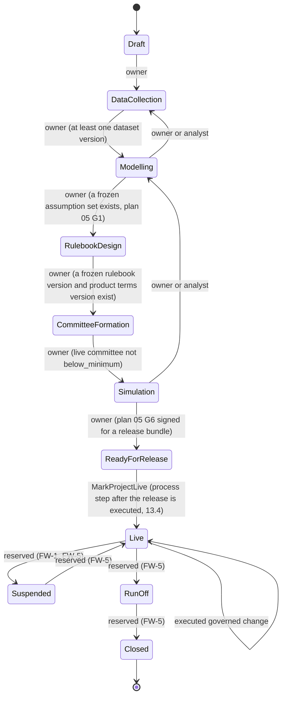

Rules:

- The live realm's `Live` transition has two steps (13.4). First, the approved `release`
  proposal is executed on the live realm's `PolicyConfiguration`: it checks the release
  evidence (INV-16, INV-18), sets `governed = true`, and clears the lock, in one write. Then the
  process step `MarkProjectLive` writes `Live`, `release_bundle_ref`, and
  `legal_readiness_record_id` on the Project (INV-17). Between the two steps the configuration
  is already governed, so no pointer can change without a vote.
- `MarkProjectLive` is accepted only from the process runner, only for the proposal ID that the
  configuration recorded as executed, and only in `ReadyForRelease`.
- In Phase 1 the live realm never reaches `Live` (plan 05, 24.5). The G7 test release is done in
  a simulation realm with its own release flag (section 15.4) and does not change the project's
  lifecycle state.
- Transitions to `Suspended`, `RunOff`, and `Closed` exist in the table but are refused by the
  reference implementation (DM-11) until FW-5 defines them.

### 9.2 Design record version

```mermaid
stateDiagram-v2
    [*] --> draft
    draft --> frozen: freeze (owner; analyst for contribution schedules)
    draft --> [*]: discard
    frozen --> retired: retire (owner; refused while in force or scheduled)
```

- Freeze checks: content valid against schema; for a rulebook version, `content_ref` present;
  for a contribution schedule version, every rating class and billing frequency allowed by the
  terms has a row. Checks against plan 05 evidence are not freeze checks (6.3, INV-18).
- `RetireVersion` is refused while the version is in force or scheduled in a pointer schedule
  that the handler reads. This is a convenience check, not an invariant: by R-1 a pointer entry
  written at the same moment stays valid.
- Write-once attachments of a rulebook version (`rule_ir_ref`, `rule_test_run_ref`) can be set
  after freeze, each at most once. They are not part of `content` and do not change
  `content_hash`.

### 9.3 Committee seat

```mermaid
stateDiagram-v2
    [*] --> invited
    invited --> active: accept
    invited --> [*]: decline or expire
    active --> ended: remove (owner while not governed; executed committee_change after) or resign
```

- Adding a seat (`accept`, or an executed `committee_change` that adds) is refused only if the
  active count would go **above** `size_limits.max` (the Committee's copy of `committee_size`,
  6.4). Seats can be added one by one while the
  count is below `min`.
- Removing a seat is refused if the count would go **below** `size_limits.min`, except a
  resignation (a person can always leave).
- The Committee sets `below_minimum = true` whenever the count is below `size_limits.min`
  (during formation, after a resignation, or when a higher minimum takes effect, 6.4). While `below_minimum` is true, no proposal of the realm can enter
  `voting` (9.4) and the project cannot leave `CommitteeFormation`. Deadlock handling after a
  resignation is FW-6.

### 9.4 Proposal

```mermaid
stateDiagram-v2
    [*] --> draft
    draft --> discussion: open
    draft --> withdrawn: withdraw (proposer)
    discussion --> voting: start voting (after discussion period; freezes eligible voters)
    discussion --> withdrawn: withdraw (proposer)
    voting --> decided: plan 04 records outcome
    decided --> executed: outcome approved and target write succeeded
    decided --> stale: outcome approved and baseline no longer matches
    decided --> expired: outcome approved and effective date no longer valid under notice period
    decided --> closed: outcome rejected or failed
    executed --> [*]
    stale --> [*]
    expired --> [*]
    closed --> [*]
    withdrawn --> [*]
```

- A governance settings version may set the discussion period to zero for a decision type (for
  example claim decisions); `open` then goes directly to `voting` in the same command, with the
  same `StartVoting` guards. This does not apply to `release`: a `release` proposal always goes
  to `discussion` first, so that `LockForRelease` (13.4) runs before `StartVoting`.
- `StartVoting` guards: the Committee (read from a snapshot) is not `below_minimum` and its
  `size_limits` are in sync with the configuration (`synced_seq`, R-10); the frozen
  `eligible_voters` list, after recusals, has at least `min_eligible_voters` entries (INV-53);
  for `release`, the configuration's `release_lock` names this proposal (13.4).
- `voting --> decided`: `RecordProposalOutcome` with `approved` is stored as `failed` with reason
  `too_few_approvers` when fewer than 2 distinct eligible voters cast `yes` (INV-54).
- `release` proposals need the owner's consent (`RecordOwnerConsent`) before the voting period
  ends. `RecordProposalOutcome` with `approved` for a `release` proposal without that consent is
  stored as `failed` with reason `owner_consent_missing`. So a release proposal never waits in
  `decided` for a consent.
- `stale` and `expired` follow plan 05 section 14.3 rules. Their check is done by the target
  aggregate during execution (section 13.1).
- When a `claim_decision` proposal ends as `closed`, `withdrawn`, `stale`, or `expired`, a
  process step releases the claim's decision slot (8.2) and the claim returns to
  `ready_for_committee` (9.6).

### 9.5 Policy membership and member cover

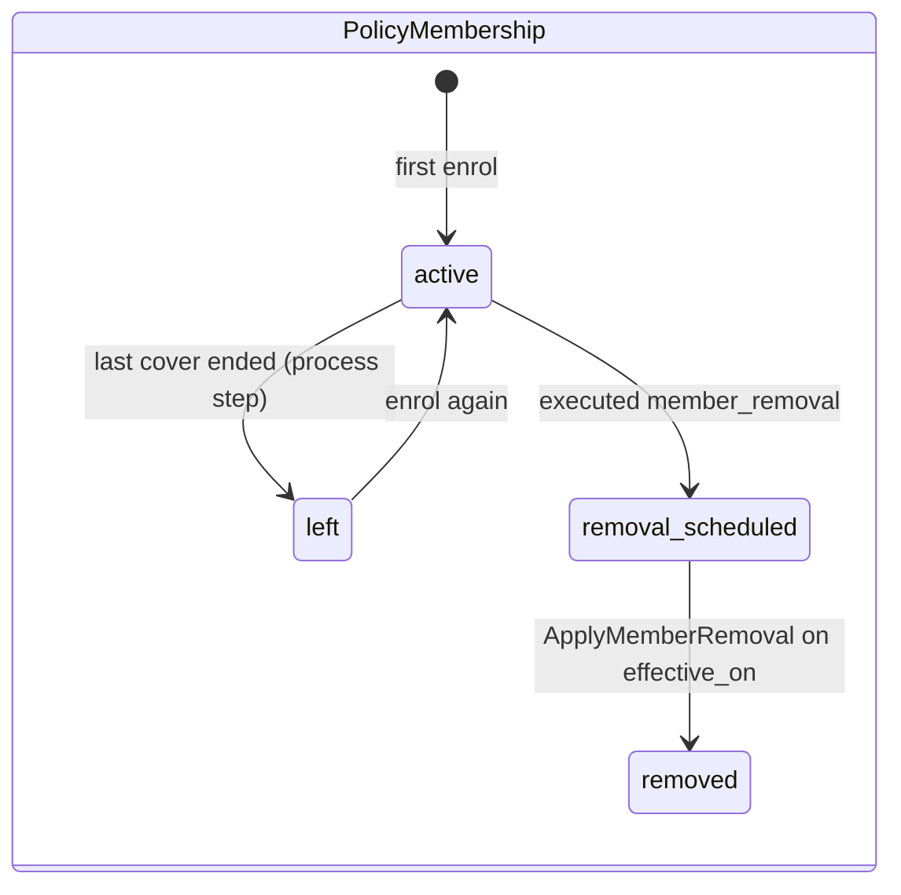

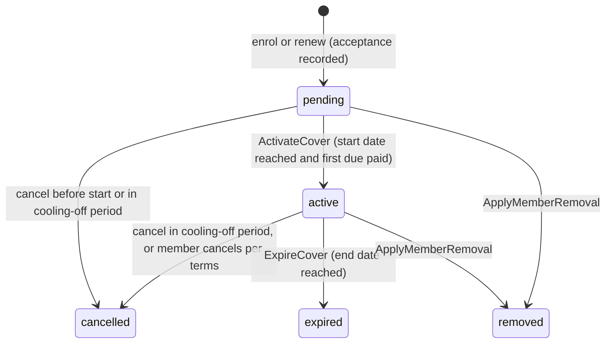

- **First due.** Enrolment (and renewal) emits `CoverEnrolled`; a process step creates the
  `ContributionDue` for the first billing period with `due_on` on or before `period.start`.
- **Activation.** `ActivateCover` succeeds when the realm-clock business date is on or after
  `period.start` **and** the first due is `paid`. Two triggers send it: the realm clock reaching
  `period.start`, and `ContributionPaid` for a first due. A first due paid on or before the end
  of the start date activates the cover from `period.start` (U-DM-17). A cover whose first due
  is not paid by the end of the start date stays `pending`; what happens next is FW-7 (reserved
  state `lapsed_unpaid`, 9.10).
- Renewal creates a **new** `MemberCover` with `renews_member_cover_id` and segments that pin the
  versions in force (6.2) on the new cover's start date. It never extends the old cover.
  Renewal is refused while the membership is `removal_scheduled`.
- **Cancellation** writes an `end_change` amendment (6.5): `period.end` moves to the
  cancellation date (or to `period.start` for a cover cancelled before it starts), the segment
  that contains that date is cut, and later segments are dropped from the current list and kept
  in the amendment (INV-25). Refunds are plan 07.
- **Removal.** Executing `member_removal` records `removal` on the membership and moves it to
  `removal_scheduled`; covers stay as they are. On `effective_on`, `ApplyMemberRemoval` writes an
  `end_change` amendment on every `active` or `pending` cover and moves the membership to
  `removed`, in one atomic write. Each cover ends at the later of `effective_on` and its
  `period.start`: a pending cover that starts after `effective_on` gets the empty period
  `[start, start)` with no segments, as a cancellation before start does (INV-25). Claims for incidents before `effective_on`
  follow the normal flow.
- `left`: a process step moves the membership to `left` when it has no `pending` or `active`
  cover. Enrolling again reuses the same membership (INV-20).

### 9.6 Claim

```mermaid
stateDiagram-v2
    [*] --> draft: start (any channel)
    draft --> submitted: submit (declaration accepted; reported_at fixed)
    submitted --> under_review: RecordEngineRegistration (registered with plan 05 limit register)
    under_review --> ready_for_committee: MarkReadyForCommittee (checks recorded; AI opinion attached or skipped with reason)
    ready_for_committee --> in_committee: OpenClaimDecision (decision slot reserved)
    in_committee --> ready_for_committee: ReleaseClaimDecisionSlot (proposal closed, withdrawn, stale, or expired)
    in_committee --> approved: executed decision approve_full or approve_partial
    in_committee --> rejected: executed decision reject
    approved --> payable: RecordFinalAmount with amount > 0
    approved --> closed: CloseClaim (final amount recorded as 0)
    payable --> paid: payout settled
    paid --> closed: CloseClaim
    rejected --> closed: CloseClaim
```

- A `claim_decision` proposal votes on a **decision draft** (outcome, amount, reasons, cited
  rules, judgement and evidence flags, engine preview, loss event link). If the vote rejects the
  draft, or the proposal ends in any other way without execution, the claim goes back to
  `ready_for_committee` for a new draft. A claim rejection is a draft with outcome `reject` that
  the vote approves. This keeps every vote a yes/no vote (plan 04 detail).
- `MarkReadyForCommittee` is sent by the assigned assessor or the chair, or by the process
  runner when no assessor is assigned and the checks and the AI step are recorded. It never
  judges the claim.
- During `under_review` and `ready_for_committee`, the assessor (if any) may request more
  information from the claimant. Answers are new evidence. This does not change state.
- At most one `claim_decision` proposal per claim is open at a time (INV-38, R-2).
- A final amount of zero (shared limit used up) is a recorded happy-path result; the member is
  told the reason (plan 01, 7.12 step 7).

### 9.7 Payout

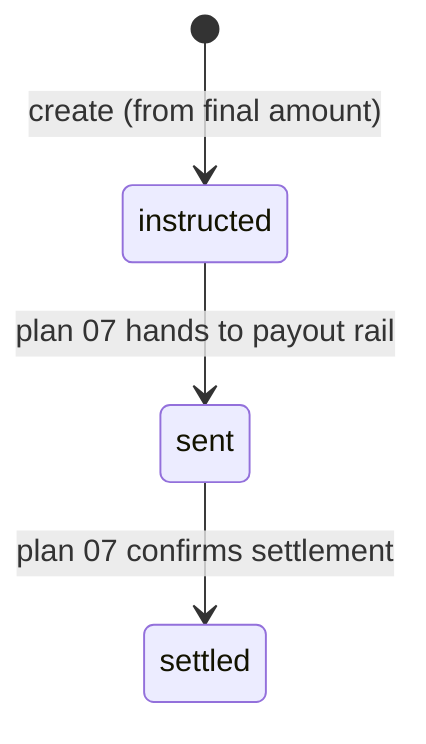

In a simulation realm, the dummy ledger settles on the realm clock with no external rail
(15.3).

### 9.8 Invitation

`issued → accepted | declined | expired | revoked`. Accepting checks the token hash, the expiry
against real time, and that the accepting user's verified email matches the email in
`invited_email_ref`. A
process step then creates the membership, role, or seat (8.2).

### 9.9 Simulation realm

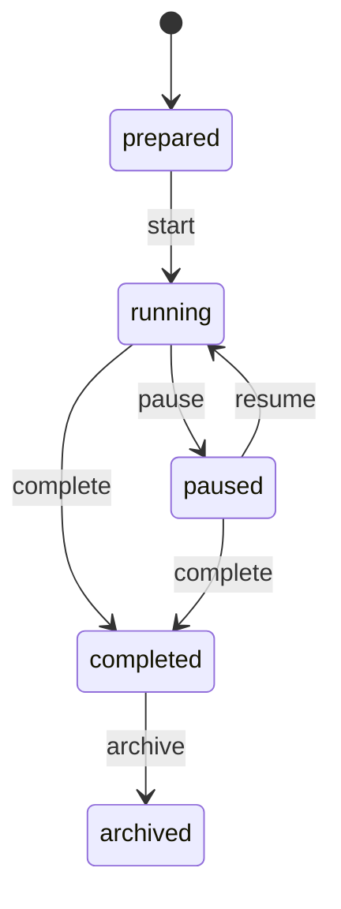

A `completed` realm accepts no command except reads and `archive`. Its data stays for the
simulation report and the audit trail. `complete` is refused while a clock advance is in
progress (15.2).

### 9.10 Reserved states

These names exist in the schema enums so that stored data and APIs do not change when future-work
plans add them. The reference implementation refuses every transition into them
(AT-DM-SM-3).

| Record | Reserved states or values | Future work |
|--------|---------------------------|-------------|
| Project | `Suspended`, `RunOff`, `Closed` transitions (states exist) | FW-1, FW-5 |
| Claim | `withdrawn`, `under_investigation`, `appealed`, `reopened` | FW-3, FW-8 |
| Payout | `failed`, `returned`, `reversed` | FW-7 |
| ContributionDue | `failed`, `in_grace`, `written_off` | FW-7 |
| MemberCover | `suspended`, `lapsed_unpaid` | FW-7 |
| CoverAmendment reason | `member_request` | U-DM-6 |
| Proposal type | `lifecycle_change`, `appeal` | FW-5, FW-3 |
| Committee | `deadlocked` (fewer eligible voters than `min_eligible_voters` for a claim) | FW-6 |
| Tenant, User | `suspended`, `closed` | platform policy |

## 10. Invariants

Each invariant has at least one acceptance test in section 20 (the test table names the
invariant). Section 8.1 names the aggregate that enforces each one.

**Isolation and references**

- **INV-1** A tenant-owned record is readable and writable only with its own `tenant_id`. A
  lookup with another tenant's ID returns "not found".
- **INV-2** No realm-scoped record refers to a realm-scoped record of another realm. References
  to design versions and shared plan 05 artifacts are allowed (5.7).
- **INV-3** Every `ArtifactRef` names an artifact that exists, has the stated type, and belongs to
  the same tenant and project (or to `platform`). An `ArtifactRef` of a realm-owned type (5.7)
  on a realm-scoped record also needs an `ArtifactRealmBinding` for the same realm.
- **INV-4** Every referenced ID exists in the same tenant (and project, where project-scoped)
  when the referring record is written.

**Roles**

- **INV-5** `committee_member` and `committee_chair` roles are never assigned directly; they are
  derived from active committee seats.
- **INV-6** A user cannot hold two direct roles in one project that the governance settings list
  as a conflict (checked in the user's `ProjectRoleSet`). If two roles of a pair that the
  governance settings **in force** list as a conflict exist at the same time, every command whose
  permission comes from either role is refused until one ends (R-3). This covers a derived
  committee role with a direct role, and two direct roles that became a conflict when a new
  governance settings entry took effect: the use-time check reads `role_conflicts` of the
  settings in force on the realm-clock date, so the block starts on that date with no write to
  the role set.
- **INV-7** An invitation is accepted at most once, and only before it expires.

**Design records and pointers**

- **INV-10** Only frozen versions (`frozen` or `retired`) are named by pointer entries, segments,
  proposals, or artifacts. A frozen version's content and `content_hash` never change.
  `SetDesignPointer` and `CreateProposal` make no new reference to a version they read as
  `retired`; cover segments pin the version in force from the schedule whether it is retired or
  not (5.3).
- **INV-11** `Policy.currency`, `jurisdiction`, and `time_zone` cannot change after the project
  leaves `Draft` (Policy is a child of the Project aggregate).
- **INV-12** Exactly one `Policy` per project, one `PolicyConfiguration`, one `Committee`, and one
  `Fund` per realm, one live realm per project.
- **INV-13** A design version named by a pointer entry or a segment belongs to a design parent of
  the same policy.
- **INV-14** A live-realm contribution schedule entry names a version with a
  `source_calc_bundle_ref`.
- **INV-15** A live-realm rulebook entry names a version with a `rule_ir_ref`.
- **INV-16** The release is executed on the live realm's configuration only if the release
  evidence matches it exactly (13.4): the four design versions and the calculation bundle in the
  proposal payload equal the entries in force from the release date; every schedule entry with
  `effective_from` after the business date of execution is listed in the payload
  (`future_entries`), so the committee and the owner approve it with the release (an unlisted owner-staged future entry
  would otherwise take effect after Live without a vote, plan 05 24.4); the release bundle pins
  that calculation bundle; the contribution version's `source_calc_bundle_ref` is that bundle;
  the release bundle has valid G6 sign-offs (owner and analyst) for **this** release bundle, not
  for another bundle that passed G6 when the project entered `ReadyForRelease` (plan 05, 24.1,
  24.2); and a G7 test release of the same release bundle is recorded (15.4). `OpenProposal`
  and the execution write both check this.
- **INV-17** `MarkProjectLive` needs a `complete` `LegalReadinessRecord` that names the same
  release bundle.
- **INV-18** A live-realm `calc_bundle_schedule` entry, and every governed change that adds a
  product terms, rulebook, or contribution entry, names a calculation bundle that has valid
  G1 to G5 sign-offs, and whose version map contains every pair in `pinned_pairs` after the
  change (13.4).
- **INV-19** A `contribution_change` is opened and executed only if its `effective_from` is after
  every existing contribution entry, the plan 05 payload names the baseline version (the version
  of the last contribution entry, as recorded in the proposal baseline) as its baseline, its new contribution version has the same rows as the
  baseline version, every row changes by no more than `premium_step_limit` of the governance
  settings in force against every billable version (13.2), and every row equals the plan 05
  step-limited value. At a split date that two entries share, a cover takes the version of the
  eligible entry with the highest `seq`, whatever the order in which the amendments arrive
  (13.3).

**Membership and cover**

- **INV-20** At most one `PolicyMembership` per `(party, policy, realm)`.
- **INV-21** A cover's segments are ordered, do not overlap, have no gaps, start at
  `period.start`, and end at `period.end`. A cover with an empty period has no segments.
- **INV-22** Two covers of one membership do not overlap in time for the same insured item (or,
  for products with no insured items, at all).
- **INV-23** Every segment names versions that were frozen before the segment was written. Every
  segment written at enrolment or renewal names exactly the versions and content hashes that the
  member accepted for it (`acceptance`): the first segment the versions in force on
  `period.start`, and each later one the versions of its scheduled `from_effective_date` entry
  (6.2, 13.1), both as shown by the schedule snapshot that the command read
  (`schedule_seq_read`). Segments written later come only from amendments. An `at_renewal`
  entry written after that snapshot never changes the cover. A `from_effective_date` entry that
  was in that snapshot is already in the enrolment segments and needs no amendment. Every
  `from_effective_date` entry with a `seq` above the cover's `schedule_seq_read` that affects the
  cover by the full rule of 13.3 (the cover was active or pending at the entry's execution, or
  at its own enrolment if it committed later; its retained period ends after the split date; the terms that the cover holds at the split date in the seq-order
  result allow mid-cover changes, and a valid split date exists) is applied by exactly one
  amendment, from the mid-cover process or from schedule reconciliation (R-13); while one is
  missing the cover is unreconciled, and no export, claim registration, or due uses it. An entry
  that does not affect the cover by that rule (for example one whose split date falls where the
  cover's terms say `at_renewal`) needs no amendment, and the cover is not unreconciled by it.
- **INV-24** An amendment never changes a segment, or a part of a segment, before the
  amendment's `effective_on`. For a cancellation or removal, `effective_on` is not before the
  realm-clock business date at which the amendment is recorded. For a `governed_change` or
  `schedule_reconciliation` amendment, `effective_on` is the split date of its entry (13.3),
  which is always after the business date on which the entry was written (the execution date),
  so no amendment changes a business date on or before execution. The amendment may be
  recorded after its split date only if the entry was written before it; the
  guards in 13.3 (incomplete run, unreconciled cover) make sure no export, claim registration,
  or due used the cover in between.
- **INV-25** A cancellation or removal only moves `period.end` earlier, never before
  `period.start`. It cuts or drops segments at the new end and never changes the version IDs of
  any part that stays. The full previous segment list is kept in the amendment.
- **INV-26** Every billing period of a cover lies inside segments that all name one contribution
  schedule version, and every `ContributionDue.amount` equals the row of that version for the
  cover's rating class and billing frequency. A due never changes after it is created, and no
  amendment changes the contribution version of a billing period whose due exists: the first
  billing period always keeps the version pinned at enrolment (13.3, R-12).

**Governance**

- **INV-30** A voter has at most one active seat per committee.
- **INV-31** Votes are accepted only from voters in the proposal's frozen `eligible_voters` list,
  only while the proposal is in `voting`. For `claim_decision`, `eligible_voters` contains only
  active committee seats of the realm.
- **INV-32** A `claim_decision` proposal has automatic recusals for the claimant's linked user
  and the claimant's representatives; they are not in `eligible_voters`.
- **INV-33** A `rule_change` proposal cannot open unless the proposed rulebook version has a
  `rule_test_run_ref`.
- **INV-53** A proposal enters `voting` only if its frozen `eligible_voters` list, after
  recusals, has at least `min_eligible_voters` entries (never less than 2), the committee is
  not `below_minimum` for the realm-clock date, and the committee's `size_limits` are in sync
  with the configuration's governance schedule (`synced_seq`, R-10).
- **INV-54** A proposal outcome is stored as `approved` only if at least 2 distinct eligible
  voters cast a `yes` ballot. A tie-break (for example a chair's casting vote) never counts as a
  second person. `RecordProposalOutcome` with `approved` and fewer than 2 distinct `yes` ballots
  is stored as `failed` with reason `too_few_approvers`. For anonymous proposals the check uses
  the ballot count by choice, which plan 04 must provide (U-DM-14). So no single person can
  decide a claim or approve a governed change.

**Claims**

- **INV-34** The claimant party owns the claim's member cover, and the cover is in the same
  policy and realm.
- **INV-35** `reported_at` is set once at submission and never changes.
- **INV-36** No command changes claim state, decision, or amount because of an `AiOpinion`.
- **INV-37** A `ClaimDecision` exists only as the result of an executed, approved
  `claim_decision` proposal for that claim.
- **INV-38** At most one open `claim_decision` proposal per claim; only the proposal named in
  `open_decision_proposal_id` can be executed on the claim.
- **INV-39** A claim is registered with the calculation bundle in force on its report date and
  the loss event link chosen at submission. The registered event changes only after an executed
  decision that names a different `loss_event_id` (C-4).

**Money**

- **INV-40** Payment and payout adapters refuse any operation in a realm with
  `money_kind = dummy`.
- **INV-41** `synthetic = true` parties and synthetic voters exist only in simulation realms.
  Simulation realms contain no party with real personal data. Real project users take part in a
  simulation realm only through committee seats and owner consent (G7, 15.4), never as parties.
- **INV-42** A journal entry has lines in one ledger only. A fund ledger and the platform ledger
  never share an entry.
- **INV-43** Each journal entry balances: total debits equal total credits per currency.
- **INV-44** `idempotency_key` is unique per ledger. A journal entry is never changed or deleted.
- **INV-45** No fund ledger entry moves money from a fund to the platform except a fee transfer
  allowed by `fee_treatment = from_contributions`. A fee transfer names one `fee_charge_ref`,
  moves exactly its amount, and never refers to a claim or a claim decision (D5). A fund ledger
  holds at most one fee transfer per `fee_charge_ref` (checked inside the Ledger aggregate).
- **INV-46** At most one payout per claim decision. When the payout is created, its amount equals
  the final amount recorded on the claim and the claim is `payable`.
- **INV-47** Each journal line's currency equals its account's currency, and every account of a
  fund ledger has the fund currency (which is the policy currency).

**Governed changes**

- **INV-50** While `PolicyConfiguration.governed` is true, its schedules change only by executing
  an approved proposal whose baseline matches the current values, and only by appending entries
  whose `effective_from` is after every existing entry of the same schedule (13.1).
- **INV-51** A proposal ID is executed at most once (`applied_proposal_ids`).
- **INV-52** While `release_lock` is set, every schedule change of the configuration is refused
  except the execution of the locking proposal.

**Audit**

- **INV-60** Every successful command writes exactly one audit event in the same atomic write as
  its state change. The stream has no gaps, and every `hash` checks against `prev_hash`.

## 11. Commands, queries, and domain events

### 11.1 Command envelope

Every command carries:

| Field | Meaning |
|-------|---------|
| `command_type` | Name. |
| `idempotency_key` | Caller-chosen. Unique per `(tenant_id, principal, command_type, target aggregate ID)`. |
| `principal` | Authenticated user or service principal (plan 03). |
| `tenant_id`, `project_id`, `realm_id` | Scope. |
| `expected_version` | Optional `aggregate_version` for conditional writes from user interfaces. |
| `payload` | Typed body. |

Idempotency rules:

- The handler checks authentication and authorization **before** it looks up the key. A
  principal that is not allowed to send the command gets the normal refusal, never a stored
  result.
- A repeat by the same principal, in the same scope, on the same target, with the same key and
  the same payload hash, returns the first result. With a different payload hash it is refused.
  The same key from another principal or on another target is a different key.
- The idempotency record is written in the same atomic commit as the state change (S-1).

**Atomicity.** A command writes exactly one aggregate. It either succeeds fully (state change,
audit event, domain events, idempotency record, in one commit) or has no effect. Work that
needs several aggregates is a process (8.2): each step is its own command with its own commit,
and the process makes the steps visible through a state field (for example
`Project.initialisation = pending`) until all steps are done.

### 11.2 Command catalogue

Main commands per context. Roles are in section 12.1; process runner commands are in 12.4.

| Context | Commands |
|---------|----------|
| Tenancy | `CreateTenant`, `InviteUser`, `AcceptInvitation`, `RevokeInvitation`, `AssignRole`, `EndRole` |
| Project | `CreateProject` (writes the Project with its Policy, `initialisation = pending`), `MarkProjectReady` (process), `AdvanceLifecycle`, `SetDesignPointer` (adds a schedule entry; only while `governed = false`), `SetCalcBundle` (only while `governed = false`), `LockForRelease` (process), `ReleaseLock` (process), `MarkProjectLive` (process), `OpenEnrolment`, `CloseEnrolment` |
| Legal readiness | `CreateLegalReadinessRecord`, `SignLegalReadiness` (legal specialist or platform admin) |
| Design | `CreateVersionDraft`, `EditVersionDraft`, `FreezeVersion`, `AttachRulebookArtifact` (write-once `rule_ir_ref`, `rule_test_run_ref`), `RetireVersion` |
| Committee | `InviteCommitteeMember`, `AcceptSeat`, `RemoveSeat` (before `governed`), `ResignSeat`, `SetChair` (before `governed`), `RefreshCommitteeLimits` (process), `CreateSyntheticVoter` (simulation only) |
| Governance | `CreateProposal`, `OpenProposal`, `StartVoting`, `CastVote`, `DeclareRecusal`, `AddProposalComment`, `RecordOwnerConsent`, `RecordProposalOutcome` (plan 04 only), `WithdrawProposal`, `ExecuteProposal` (process), `RecordExecutionResult` (process) |
| Membership | `CreateParty`, `AddRepresentative`, `EndRepresentative`, `Enrol` (creates or reuses membership, creates pending cover, records acceptance), `AddInsuredItem`, `RenewCover`, `ActivateCover` (process), `ExpireCover` (process), `CancelCover`, `AmendCover` (process only), `MarkAmendmentsComplete` (process), `MaterialiseMemberCoverSet` (process runner, actuarial engine, owner, analyst; 14.1), `ApplyMemberRemoval` (process), `MarkMembershipLeft` (process), `SubmitGroupEnrolment`, `RecordGroupAcceptance`, `RecordGroupEnrolmentResult` (process) |
| Money | `CreateContributionDue` (process), `RecordContributionPaid` (plan 07), `CreatePayout` (process), `RecordPayoutSent`, `RecordPayoutSettled` (plan 07), `PostJournalEntry` (plan 07 only) |
| Claims | `StartClaim`, `UpdateClaimDraft`, `SubmitClaim`, `AttachEvidence`, `AssignAssessor`, `RecordEngineRegistration` (process), `RecordCheckResult`, `AttachAiOpinion` (AI gateway), `SkipAiOpinion`, `ProposeLossEventLink`, `MarkReadyForCommittee`, `OpenClaimDecision`, `ReleaseClaimDecisionSlot` (process), `CreateLossEvent`, `CloseLossEventForLinking`, `RecordFinalAmount` (process), `CloseClaim` (process) |
| Simulation | `CreateSimulationRealm` (writes the Realm with `initialisation = pending`), `MarkRealmReady` (process), `StartSimulation`, `AdvanceClock`, `AdvanceClockCursor` (process), `PauseSimulation`, `CompleteSimulation`, `ArchiveSimulation`, `GenerateSyntheticMembers` |

The schema package lists, for every command, its target aggregate, payload schema, allowed
principals, guards, and emitted events (17.1).

### 11.3 Domain events

Each successful command emits one or more domain events, named in past tense (for example
`ProjectCreated`, `VersionFrozen`, `CoverEnrolled`, `CoverActivated`, `CoverAmended`,
`ClaimSubmitted`, `ClaimDecisionSlotOpened`, `ProposalApproved`, `ProposalExecuted`,
`ProposalStale`, `ReleaseExecuted`, `ClaimDecisionRecorded`, `ClaimFinalAmountRecorded`,
`PayoutSettled`). Each event has `event_id`, `event_type`, `schema_version`, scope fields,
`aggregate_id`, `aggregate_version`, `causation_id` (the command), `correlation_id` (the business
flow, for example the claim ID), and a typed body. Event bodies hold IDs, codes, dates, money,
and hashes only, never personal field values or personal free text (16.1). Events are stored in
the audit event of their command (6.10) and delivered at least once to subscribers (plan 03
transport, S-7). Subscribers must be idempotent on `event_id`.

Notifications (plan 01, 7.15) and reports (7.14) are built from domain events.

### 11.4 Queries

Queries read state. They never change it. Important queries:

- `GetMemberCoverSet(project_id, realm_id, as_of_recorded_at)` — section 14.1. Read-only: it
  returns the set content, and the artifact ID if the set was already materialised. The command
  `MaterialiseMemberCoverSet` does the writes.
- `GetPolicyConfiguration(realm_id, as_of_recorded_at)` — schedules as recorded at that time.
- `GetVersionsInForce(realm_id, business_date, as_of_recorded_at)` — the version per pointer in
  force on a business date (6.2).
- `GetCoverAt(member_cover_id, business_date)` — the segment in force on a business date.
- `GetEligibleVoters(proposal_id)`.
- `GetClaimForCommittee(claim_id)` — claim, evidence list (per access policy), checks, AI
  opinions, engine preview, cited rulebook version.
- `GetFundLedger(fund_id, from, to)`.
- `VerifyAuditStream(stream_id)` — recomputes the hash chain.

Every query that names `as_of_recorded_at` reads a commit-ordered snapshot at that instant
(S-4), so a result can be reproduced later.

## 12. Authorization

### 12.1 Permissions

Every command handler checks the principal's roles in the command's scope. Main rules (✓ =
allowed; "own" = only for records the principal is linked to; "both" = both signatures are
required, by two different users):

| Command group | Platform admin | Tenant admin | Owner | Actuary / analyst | Legal specialist | Committee member | Chair | Assessor | Applicant | Member | Auditor |
|---------------|:-:|:-:|:-:|:-:|:-:|:-:|:-:|:-:|:-:|:-:|:-:|
| Create project | | ✓ | | | | | | | | | |
| Advance lifecycle (before Live) | | | ✓ | some (9.1) | | | | | | | |
| Edit or freeze design drafts | | | ✓ | ✓ (contribution, assumptions) | | | | | | | |
| Set design pointers, set calc bundle (while `governed = false`) | | | ✓ | | | | | | | | |
| Invite committee (before Live) | | | ✓ | | | | | | | | |
| Create proposal (not `claim_decision`) | | | ✓ | ✓ (contribution) | | ✓ | ✓ | | | | |
| Open claim decision (draft for a claim) | | | | | | ✓ | ✓ | ✓ (assigned) | | | |
| Cast vote | | | | | | ✓ (if eligible) | ✓ (if eligible) | | | | |
| Add proposal comment | | | ✓ | ✓ | | ✓ | ✓ | | | | |
| Record owner consent (`release`) | | | ✓ | | | | | | | | |
| Create party, enrol (realm with `enrolment_open`) | | | | | | | | | own | own | |
| Renew, cancel | | | | | | | | | | own | |
| Start claim, update claim draft, attach evidence, submit claim | | | | | | | | | | own | |
| Assign assessor | | | ✓ | | | | ✓ | | | | |
| Record check result, create loss event, propose loss event link, mark ready for committee | | | | | | | ✓ | ✓ | | | |
| Read claim for committee | | | | | | ✓ | ✓ | ✓ (assigned) | | own (no committee notes) | ✓ (read) |
| Sign legal readiness record | both | | | | both | | | | | | |
| Read audit stream | ✓ | ✓ (tenant) | ✓ | | | | | | | | ✓ |

- Simulation realms: user commands that need a member or applicant (enrol, submit claim) are
  sent by the simulation driver for synthetic parties (12.4). No real user is a member or
  applicant in a simulation realm (INV-41).
- A user who acts as assessor on a claim and also holds a seat is subject to `role_conflicts`
  (INV-6, U-DM-11).

Service principals (12.4) have their own narrow permissions.

### 12.2 Owner powers after release

After `Live`, the owner keeps only the commands listed in
`GovernanceSettingsVersion.content.owner_live_powers` (U-DM-2). All governed changes go through
proposals. The owner can still create proposals.

### 12.3 Evidence access

`Evidence.access_policy` default: readable by the claimant party's linked users and
representatives, the assigned assessor, active committee seats of the realm **except recused
users** for this claim, auditors of the project, and the AI gateway service principal while it
produces an opinion. Every read is audited (6.10). No one else can read evidence, including the
tenant admin and the platform admin (break-glass access is platform policy, plan 03). In the
live realm the AI gateway may send evidence to an external AI provider only after U-DM-15
(plan 05 U-13) is decided; until then it uses no external provider for live evidence.

### 12.4 Service principals

Each service principal is scoped: it acts for one `(tenant_id, project_id, realm_id)` per call,
and the handler re-checks that every record it touches belongs to that scope.

| Principal | Allowed |
|-----------|---------|
| Actuarial engine (plan 05) | Read design versions, member cover sets, claims for payout calls; `MaterialiseMemberCoverSet` (writes only the artifact and its realm binding, 14.1); create `contribution_change` proposals; no write to pointers, covers, or claims (plan 05 AT-GOV-1). |
| Voting engine (plan 04) | `StartVoting` timers, `RecordProposalOutcome`. |
| AI gateway (7.7) | Read claim evidence while producing an opinion; `AttachAiOpinion`. |
| Ledger and payments (plan 07) | `RecordContributionPaid`, `RecordPayoutSent`, `RecordPayoutSettled`, `PostJournalEntry`. |
| Process runner (this plan) | Only the process commands of section 8.2: `MarkProjectReady`, `MarkRealmReady`, initialisation creates, invitation-acceptance creates, `RefreshCommitteeLimits`, `LockForRelease`, `ReleaseLock`, `ExecuteProposal`, `RecordExecutionResult`, `MarkProjectLive`, `CreateProposal`/`OpenProposal` for a reserved claim decision slot, `ReleaseClaimDecisionSlot`, `MarkAmendmentsComplete`, `MaterialiseMemberCoverSet`, `MarkReadyForCommittee` (only for a claim with no assessor, when all checks and the AI step are recorded), `Enrol` (only for a party listed in a GroupEnrolment, with that party's recorded acceptance), `AmendCover`, `ApplyMemberRemoval`, `MarkMembershipLeft`, `ActivateCover`, `ExpireCover`, `CreateContributionDue`, `RecordGroupEnrolmentResult`, `RecordEngineRegistration`, `RecordFinalAmount`, `CreatePayout`, `CloseClaim`, `AdvanceClockCursor`. Each call names the cause (event ID) that the handler checks against the command's narrow rule. It cannot send any other user command, cast a vote, or record an outcome. |
| Simulation driver (one per simulation realm) | In its realm only: `GenerateSyntheticMembers`, `CreateParty`/`Enrol`/`StartClaim`/`UpdateClaimDraft`/`AttachEvidence`/`SubmitClaim` for synthetic parties, `CastVote` for synthetic voters, `AdvanceClock` when the owner or analyst started it. Refused in the live realm. |

A process runner command never makes a decision: it only executes a recorded human decision or
a time or payment fact (DM-6).

### 12.5 No single actor decides

- A claim is decided only by executing a `claim_decision` proposal approved by a vote of the
  committee (INV-37). AI, the assessor, the platform, and the process runner cannot decide.
- A vote cannot start with fewer than `min_eligible_voters` eligible voters after recusals, and
  this value is never less than 2 (INV-53). If recusals leave too few voters, the claim waits in
  `ready_for_committee`; the fallback is FW-6 (reserved `deadlocked`, 9.10).
- Eligible voters alone do not stop a one-ballot decision, because plan 04 quorum could be 1.
  So the domain also checks the outcome: `approved` needs `yes` ballots from at least 2 distinct
  eligible voters, and a tie-break never counts as a second person (INV-54). Plan 04 must report
  the ballot count by choice with every outcome, also for anonymous votes. A governance settings
  version whose quorum or tie-break rule could approve with one `yes` ballot fails schema
  validation.
- Quorum and majority rules are plan 04. The `release` proposal also needs the owner's consent
  (9.4). The owner cannot release without the committee, and the committee cannot release
  without the owner.

## 13. Governed changes and proposal execution

### 13.1 Execution rule

Plan 05 section 14.3 requires one atomic conditional update when a vote result is executed. This
plan meets that requirement with the `PolicyConfiguration` aggregate (and, for other proposal
types, the target aggregate):

1. When a proposal is created, its `baseline` records the target aggregate ID and the values it
   depends on. For changes to the configuration: every entry (by `seq`) of each schedule it
   adds to and of the governance settings schedule, the baseline versions derived from them
   (for example the last contribution entry, 13.2), and the `PolicyConfiguration.aggregate_version`
   for information. The baseline holds schedule **entries**, not "the version in force today",
   so a scheduled entry that takes effect during the vote does not change the baseline.
2. When the proposal is `decided` with outcome `approved`, the process step sends
   `ExecuteProposal` to the target aggregate.
3. The target aggregate, in one atomic conditional write:
   - checks that `proposal_id` is not in `applied_proposal_ids` (if it is, returns the earlier
     result: idempotent);
   - checks that each baseline value still equals the current value (if not: result `stale`,
     no change). For the configuration this compares the schedule entries named in the
     baseline; a write to the configuration that adds no entry to those schedules (for example
     `MarkAmendmentsComplete` or another realm-clock date passing) does not make the proposal
     stale. The write itself is conditional on the `aggregate_version` read in the same command
     and is retried on a conflict;
   - checks that `effective_from` is on or after the realm-clock business date of execution plus
     the notice period in the governance settings **in force at execution** (if not: result
     `expired`, no change);
   - for a change of the configuration, checks that `effective_from` is **after** the
     `effective_from` of every existing entry of each schedule it adds to (the pointer it changes
     and `calc_bundle_schedule`). A governed change only appends at the end of a schedule; it
     never inserts an entry before a scheduled one and never replaces one on the same date (if
     not: result `stale`, no change). `OpenProposal` makes the same check, so such a proposal
     cannot open;
   - otherwise applies the effect in 13.2, adds `proposal_id` to `applied_proposal_ids`, and
     emits `ProposalExecuted`.
4. The proposal records the result (`executed`, `stale`, or `expired`) from the target's event
   with `RecordExecutionResult`.

**Why governed changes only append.** Because every new entry starts after all scheduled
entries of its schedule, each governed step goes from the last scheduled version to the new one,
and no later entry is ever changed by an earlier insertion. So the step limit (13.2) holds for
every real step, and a calculation bundle that covers the pairs at its own date is never
followed by an entry it was not checked against (INV-18). To change a scheduled future entry,
the committee approves a new change with a later `effective_from`.

**Execution is not effect.** Execution happens when the vote result is applied. The business
effect starts on `effective_from`, which is in the future when a notice period applies. For the
configuration, execution adds a dated schedule entry (6.2); the version in force does not
change before `effective_from`. For member removal, execution schedules the removal (9.5).

**Which version a cover pins:**

| Event | Versions pinned |
|-------|-----------------|
| Enrolment | First segment: the versions in force on the new cover's `period.start`. For each schedule entry that starts later inside the cover period with application mode `from_effective_date` (allowed by the pinned terms, 13.3), `Enrol` adds a segment from that entry's split date (13.3). Entries with `at_renewal` do not split the cover. The scheduled change is shown to the member at acceptance. |
| Renewal | The versions in force on the new cover's `period.start`. |
| Amendment (`from_effective_date`) | The new version from `effective_from` (13.3). |
| Removal or cancellation | No version change; the period ends (INV-25). |

Two proposals with the same baseline can never both execute, because the first execution changes
the values the second one checks (plan 05 AT-GOV-4).

### 13.2 Proposal types and their execution

| Type | Payload | Target aggregate | Effect on execution |
|------|---------|------------------|---------------------|
| `claim_decision` | Decision draft: outcome, approved amount, reasons, cited rule IDs, rulebook version, judgement and evidence flags, engine preview ref, amount override reason, loss event link | Claim | Checks that the proposal is the one in `open_decision_proposal_id`. Writes `ClaimDecision`; claim to `approved` or `rejected`; emits `ClaimDecisionRecorded`; the process calls plan 05 `record_decision` (14.2). Baseline: claim `aggregate_version` and evidence count, so new evidence after voting starts makes the proposal stale. No notice period. |
| `contribution_change` | New contribution schedule version ID, plan 05 `proposal_payload` ref, calculation bundle ref, `effective_from` (at least one day after the execution date, even with a zero notice period; execution with an earlier date is `expired`), application mode | PolicyConfiguration | Checks the step limit (below, INV-19). Adds a contribution entry and a calculation bundle entry from `effective_from` (INV-18); mid-cover application if `from_effective_date` (13.3). |
| `rule_change` | New rulebook version ID, calculation bundle ref, `effective_from` (with application mode `from_effective_date`: at least one day after the execution date, even with a zero notice period), application mode | PolicyConfiguration | Adds a rulebook entry and a calculation bundle entry from `effective_from` (INV-15, INV-18, INV-33). Execution with a `from_effective_date` `effective_from` on or before the execution date is `expired`. |
| `terms_change` | New product terms version ID, calculation bundle ref, `effective_from` (with application mode `from_effective_date`: at least one day after the execution date, even with a zero notice period), application mode | PolicyConfiguration | Adds a terms entry and a calculation bundle entry from `effective_from` (INV-18). Execution with a `from_effective_date` `effective_from` on or before the execution date is `expired`. |
| `governance_change` | New governance settings version ID, `effective_from` (at least one day after the execution date, even with a zero notice period, 6.4) | PolicyConfiguration | Adds a governance entry and emits `GovernanceEntryAdded` (Committee refresh, 8.2). Proposals already created keep the settings version they were created with. |
| `committee_change` | Add voter, remove seat, or change chair | Committee | Seat change within size limits (9.3). |
| `member_removal` | Membership ID, reason, `effective_from` (after notice) | PolicyMembership | Records `removal` and moves the membership to `removal_scheduled`. On `effective_from`, `ApplyMemberRemoval` ends all `active` or `pending` covers (9.5). |
| `release` | Release bundle ref, calculation bundle ref, the four design version IDs, `future_entries` (every schedule entry dated after the proposal's open date, by `seq`; the lock stops new entries until execution), legal readiness record ID, G7 evidence (simulation realm ID and its test release proposal ID), `effective_from` | PolicyConfiguration of the live realm | Section 13.4. Needs owner consent (9.4). |

**Pairs after a change.** For `rule_change` and `terms_change`, the pairs that covers can hold
after the change are computed inside the configuration, from data it holds:

- the pairs of the schedules in force together, with the new entry added; and
- for `from_effective_date` only, the **prospective pairs**: for a `rule_change` with rulebook
  R, the pair `(T, R)` for every terms version T in `pinned_pairs`; for a `terms_change` with
  terms T, the pair `(T, R)` for every rulebook version R in `pinned_pairs`. This is a superset
  of the pairs that the amendments in 13.3 can write, because an amended cover keeps its other
  version, and every version a cover holds is in `pinned_pairs`.

`OpenProposal` for `contribution_change`, `rule_change`, and `terms_change` checks that the
payload calculation bundle has valid G1 to G5 sign-offs and that its version map contains every
pair after the change. The same check is repeated at execution, inside the configuration write,
and that write adds the new pairs to `pinned_pairs` before any amendment is sent (INV-18).

**Step limit for `contribution_change` (plan 01, 7.13; plan 05, 14.3).** `OpenProposal`, and
again the execution write inside the configuration, check the new contribution schedule version
row by row against the **baseline version**: the contribution version of the last entry of
`contribution_schedule_schedule`, as recorded in the proposal baseline (13.1). Because a governed
change only appends (13.1), this is also the version in force just before `effective_from`, and
each executed step is between two consecutive entries.

- The baseline contribution version ID named in the plan 05 `proposal_payload` equals the
  baseline version. This matters when a contribution entry is already scheduled for a future
  date: the step must be calculated from the version that will be in force on `effective_from`,
  not from the version in force today (C-9). A payload calculated from another version is
  refused.
- The new version has exactly the same row keys `(rating_class, billing_frequency)` as the
  baseline version. A change of rating classes or billing frequencies is a `terms_change`, not a
  step.
- For each row, the change `d = |new amount - old amount|` (same currency, 5.4) is within
  `premium_step_limit` of the governance settings version in force (on the open date at
  `OpenProposal`, and on the execution date in the execution write), for **every billable
  version** as the old amount. The limit is a percentage in basis points (an integer `bp`) or an
  absolute `Money` amount. Percentage check, in integers with no division:
  `d * 10000 <= old amount * bp`. Absolute check: `d <= limit amount`.
- **Billable versions.** Plan 01 7.13 limits how much a premium changes in one step, and a
  member sees a step at a billing period start. A cover's contribution changes only at a billing
  period start (13.3), so two entries less than one billing period apart can reach a cover at
  the same billing date. The billable versions are therefore the baseline version and every
  contribution version that is in force on any date in `[effective_from - L, effective_from)`,
  where `L` is the longest billing period that any product terms version in `pinned_pairs`
  allows (for example one year when yearly billing is allowed). Every cover's last billing date
  before the new version reaches it lies in that window, so the version it is billed under just
  before the step is one of them. Example: with a 10% limit, 100 to 110 from June 10 and then
  110 to 121 from June 20 is refused, because a monthly cover billed on the first of each month
  is still on 100 until July 1. The check reads only the configuration's own schedules and
  frozen terms content (8.1).
- For each row, the new amount equals the step-limited value for that row in the plan 05
  `proposal_payload` (plan 05, 14.3; C-9).

A failed check at `OpenProposal` refuses the open. A failed check in the execution write gives
the result `stale` with no change, like any other baseline mismatch (13.1).

### 13.3 Mid-cover application

If a change uses `from_effective_date`, the process step sends `AmendCover` to every membership
with a cover that is `active` or `pending` at execution and whose period ends after
`effective_from`, keyed `(member_cover_id, entry_seq)` (6.5). This includes pending covers that
start on or after `effective_from` (they were enrolled before execution, so their segments do
not yet show the change). A cover is amended only if the product terms version of its segment
at the split date allows it (`mid_cover_change_application = from_effective_date`); other covers
keep their versions until renewal. The proposal's application mode can only narrow this, never
widen it (U-DM-6).

**Where the split is (`effective_on` of the amendment).** Let `S` = the later of
`effective_from` and the cover's `period.start`.

| Change | Split date |
|--------|------------|
| `terms_change`, `rule_change` | `S`. `effective_from` is always at least one day after the execution date (13.2), so `S` is after it too, and a claim registered on or before the execution date never has its incident date's segment changed. If `S = period.start` (a pending cover that starts on or after `effective_from`), there is no split: the amendment replaces the version in the segments from `period.start`. The contribution version is unchanged, so the first due stays valid. |
| `contribution_change` | The first billing period start of that cover that is on or after `S`, **on or after the end of the cover's first billing period** (that end is exclusive, so it is the start of the second billing period, and the second period's start is allowed), and **strictly after the business date on which the entry was written** (the execution date for a governed change). Because a governed contribution entry has `effective_from` at least one day after execution (13.2), this last condition always holds, so each cover's application date depends only on `effective_from` and the cover's billing data, and plan 05 can compute it before the vote (C-6). The first billing period always keeps the contribution version pinned at enrolment, because its due was made at enrolment and may already be paid. A billing period that starts on the execution date may already have its due (the dues step can run earlier that day), so it also keeps the old version; with a zero notice period the split moves to the next billing period start. So no billing period has two contribution versions, and no existing due is repriced (INV-26, R-12). If the cover has no such date (single billing, or `effective_from` falls in its last billing period), there is **no valid split date**: the entry does not affect the cover, the cover keeps its contribution version until renewal, needs no amendment, and is not unreconciled. |

**Order-independent result (seq-order rule).** The segments of a cover are defined as the
result of starting from its enrolment segments and applying its `from_effective_date` entries
**in `seq` order**, whatever order the amendments arrive in. For each entry in that order, the
eligibility test of this section (including "the pinned terms allow it") uses the terms that the
cover holds at the entry's split date **after all lower-`seq` entries are applied**. Every
`AmendCover` (from either trigger, and on every retry) recomputes the cover this way from the
enrolment segments and the set of entries already applied plus its own, and writes the result;
an entry that is not eligible in that order records only its key. Because governed entries only
append (13.1), a higher `seq` also has a later or equal split date, so the result is: from each
split date on, the version of the eligible entry with the highest `seq` whose split date is on
or before that date. Examples: (1) a July rule amendment arrives first and changes the rulebook
from July 1; the June rule amendment that arrives later changes it only from June 1 to July 1.
(2) A June terms change switches the cover's terms to `at_renewal`, and a July rule change
follows: in `seq` order the July rule change is not eligible (the cover's terms at July 1 say
`at_renewal`), so the cover keeps its rulebook, whether the July amendment arrives before or
after the June one; if it arrived first, the June amendment's recomputation removes it again.
The same rule decides whether a cover is unreconciled.

**Two entries at one split date.** Two contribution entries can resolve to the same split date
of a cover. The version from that date is the version of the **eligible** entry with the
highest `seq` among the entries that resolve to that split date for this cover. Eligible means a
`from_effective_date` entry that affects the cover (above); an `at_renewal` entry is never
eligible for an existing cover, even if it is the version in force on that date by the full
schedule. An `AmendCover` for an eligible entry whose split date already starts a segment that
names a version from an eligible entry with a higher `seq` changes nothing and records only its
key. So the result is the same
in every delivery order, for both triggers (mid-cover process and reconciliation), and after any
retry. The step limit above makes sure the step that the cover is billed at that date stays
within the limit.

Each amendment puts the new version ID in the part from the split date. `Enrol` uses the same
split dates for scheduled entries (13.1).

**Which entries change an existing cover.** `Enrol` and `RenewCover` read the configuration from
a snapshot and record its highest entry `seq` as `schedule_seq_read`. The cover keeps the
versions of that snapshot: they are the versions the member accepted.

- An `at_renewal` entry written later never changes the cover, also when its `effective_from`
  is before `period.start`. It applies from the cover's renewal. So a later `SetDesignPointer`
  (always `at_renewal`, 6.2) never changes an existing cover and never makes it unreconciled.
- A `from_effective_date` entry (only from an executed governed change) **affects** a cover when
  the cover was `active` or `pending` at the entry's execution (or, for a cover that committed
  later, at its enrolment), its retained period (after any cancellation or removal) ends after
  the split date, its pinned terms allow it (rule at the top of 13.3), **and** the table above gives a valid split
  date for that cover. An entry with no valid split date does not affect the cover: no
  amendment, and the cover is not unreconciled. The cover's later status does not end the
  obligation: a cover that expires before its reconciliation runs still gets the amendment for
  the part of its period from the split date to its end, because claims for incidents in that
  part use it; until then it is unreconciled (claim registration waits). An affecting entry
  applies with the split date of the table, which is the same for every trigger. For a contribution entry that split is never in
  the first billing period and never at a period start on or before the entry's write date, so a
  due that already exists is never repriced (INV-26, R-12).

**Schedule reconciliation (R-13).** On every `CoverEnrolled`, a process step reads the
configuration after the cover commit and sends `AmendCover` (reason `schedule_reconciliation`,
keyed `(member_cover_id, entry_seq)`) for every `from_effective_date` entry with `seq` above
`schedule_seq_read` that affects the cover. The mid-cover process lists covers from a snapshot
taken after the execution commit. Every pair of a cover and an entry is reached: a cover that
committed before that snapshot is in the mid-cover list; a cover that committed after it reads
the entry in its own reconciliation. Both use the same key (6.5), so the cover is amended once.
A reconciliation amendment recorded after its split date uses the split date anyway (INV-24).

A cover is **unreconciled** in a snapshot when the snapshot holds a `from_effective_date` entry
with `seq` above the cover's `schedule_seq_read` that affects it under the seq-order rule above,
and no amendment with key `(member_cover_id, entry_seq)`. This is decided from the snapshot alone. Because both triggers
always run (8.2), an unreconciled cover is always repaired by a pending process step, never
left waiting for a step that does not exist.

A member of a pending cover whose versions change before the cover starts (by the mid-cover
process or by reconciliation) is told about the change (notification, plan 01 7.15).

**Guards while amendments run.** The configuration records each run as `amendment_runs`
entries `(proposal_id, executed_at, completed_at)`; the process sets `completed_at` with
`MarkAmendmentsComplete` after the last `AmendCover`.

- `GetMemberCoverSet` and `MaterialiseMemberCoverSet` refuse with `incomplete_amendments` every
  `as_of_recorded_at` in `[executed_at, completed_at)` of any run, also after the run completed,
  and every `as_of_recorded_at` whose snapshot holds an unreconciled cover. So no export ever
  shows a half-amended set (AT-DM-GOV-6, AT-DM-MEM-12).
- Claim registration (14.2 step 1) and the dues step (8.2) of the realm wait while any run of
  the realm is incomplete or any cover of the realm is unreconciled.

**Late amendments.** The process starts at execution and the split date is in the future, so
amendments are normally complete before they take effect. If the process is delayed past the
split date, `AmendCover` still uses the proposal's split date (INV-24). This is safe: no export
covers the run interval, every claim submitted after execution waits for completion (any claim
with an incident on or after the split date was submitted after execution, because the split
date is at least the notice period after execution), and no due for a period after the split
date was created in between (AT-DM-GOV-15).

### 13.4 Release and calculation bundle binding

A plan 05 release bundle names a calculation bundle, sign-offs, and reports, but not the design
versions (plan 05, 24.2). A calculation bundle's version map names `(product_terms_version_id,
rulebook_version_id)` pairs. This plan binds all four design versions as follows:

| Design record | Bound by |
|---------------|----------|
| Product terms, rulebook | The pair is in the calculation bundle's version map; G2 signed it. |
| Contribution schedule | `source_calc_bundle_ref` of the version equals the calculation bundle. |
| Governance settings | Named in the `release` proposal payload; the committee and the owner approve it with the release. |
| Calculation bundle | Pinned by the release bundle; named in the payload. |

Release steps:

1. The owner sets the live realm's schedule entries (while `governed = false`) and opens the
   `release` proposal in `ReadyForRelease`. `OpenProposal` checks INV-16 in advance (a failed
   check is refused, so a vote is not wasted).
2. Before voting, the process runner sends `LockForRelease` to the configuration. It sets
   `release_lock = proposal_id` with a conditional write and returns the configuration's
   `aggregate_version`. `StartVoting` for the `release` proposal then records that value in the
   proposal baseline. `StartVoting` for a `release` proposal is refused until the lock names it
   (R-4). A `release` proposal always passes through `discussion` (9.4), so the lock is always
   taken before voting.
3. The committee votes and the owner consents (9.4).
4. `ExecuteProposal` on the configuration, in one write: checks the lock names this proposal,
   checks the baseline `aggregate_version`, checks INV-16 and INV-18 against the entries in
   force from `effective_from`, checks that every schedule entry dated after the business date
   of execution is in the payload's `future_entries` list (by `seq`); this covers every entry
   that takes effect after execution, including those between execution and the Live transition
   on `effective_from` (step 5); sets `governed = true`,
   **keeps the lock** (it is cleared only after the Live transition, step 6), and emits
   `ReleaseExecuted`. While the lock is held, every schedule change is refused (INV-52), so no
   approved change can take effect between execution and Live, and the project enters Live with
   exactly the binding approved for the release date. So every owner-set entry that takes effect after
   Live was approved by the committee and the owner with the release. `OpenProposal` makes the
   same check in advance, and the lock (R-4) stops new entries during the vote. Each listed future
   contribution, rulebook, or terms entry must also meet INV-18 (its calculation bundle covers
   the pairs).
5. The process runner sends `MarkProjectLive` to the Project **on the release `effective_from`
   date** (a time-driven step; at once if execution happens on that date), never earlier.
   `MarkProjectLive` itself refuses with `release_not_yet_effective` while the realm-clock
   business date is before the release `effective_from` (command guard). So the
   versions in force from the Live transition are exactly the versions that the payload names
   as in force from the release date. It checks INV-17 (a `complete` legal readiness record for
   the same release bundle) and writes `Live`. If the record is
   missing, the project stays `ReadyForRelease` and the step waits; the configuration is already
   governed, so nothing can change without a vote. `OpenProposal` checks the record in advance,
   so this wait is not a happy-path case.
6. `ReleaseLock` clears the lock after `MarkProjectLive` has written `Live`, or when the proposal
   ends without execution. Proposals that try to change a schedule while the lock is held are
   refused at open or become `stale` at execution; they can be made again after Live. In a
   simulation realm (G7 test release, 15.4) there is no Live transition, so the lock is cleared
   in the execution write itself.

Every later governed change that adds a product terms, rulebook, or contribution entry also adds
a calculation bundle entry for the same `effective_from` (INV-18), so claims reported on or after
that date are registered with a bundle whose version map covers every cover's pair (plan 05,
24.4 and 26.1).

## 14. Integration contracts

### 14.1 Member cover set export (plan 05)

Two operations, one read and one write:

- **Query `GetMemberCoverSet(project_id, realm_id, as_of_recorded_at)`** — read-only (11.4). It
  returns the set content below, and the artifact ID if that set was already materialised. It
  writes nothing.
- **Command `MaterialiseMemberCoverSet(project_id, realm_id, as_of_recorded_at,
  schema_version)`** — builds the same content, writes it as a plan 05 `member_cover_set`
  artifact (write-once, content-addressed, plan 05 section 5.1), writes the
  `ArtifactRealmBinding` (5.7), and returns the artifact ID. It is a normal command (11.1): it
  writes one audit event, and its idempotency key is `(realm_id, as_of_recorded_at,
  schema_version)`, so a repeat returns the same artifact ID. The artifact is content-addressed,
  so the same arguments always give the same bytes and the same artifact ID (AT-DM-INT-1).
  Allowed principals: the process runner (claim registration), the actuarial engine service
  principal (plan 05 `get_member_covers`, C-2), the owner, and the analyst (12.4).

Rules for both:

- They read a commit-ordered snapshot of the realm at `as_of_recorded_at` (S-4). They are
  refused with `not_yet_stable` if `as_of_recorded_at` is later than the realm's committed
  watermark, so a later commit can never change a result that was already returned.
- The set holds all member covers of the realm as recorded at that instant (covers made later
  are absent; amendments recorded later are absent).
- Content: `schema_version`, `realm_id`, `realm_kind`, `as_of_recorded_at`, and one record per
  cover: `member_cover_id`, `member_id` (= party ID), `period`, `status`, `rating_class`,
  `billing_frequency` (from the cover's subscription, or `single`), `billing_period_starts` (the
  cover's billing period start dates inside `period`, as the domain computes them, 13.3), the
  contribution row key `(rating_class, billing_frequency)`, `insured_item_ids`, and `segments`
  as objects with **named** fields
  `{product_terms_version_id, rulebook_version_id, contribution_schedule_version_id,
  change_application, segment_start, segment_end}`, ordered by `(member_cover_id,
  segment_start)`. `change_application` is the `mid_cover_change_application` of the segment's
  product terms version (C-6).
- Schema versions: version 1 is the plan 05 shape today (segments without the two added
  fields). Version 2 is the shape above (C-1). Until plan 05 accepts C-1, the export also offers
  version 1 through an adapter that drops the added fields (AT-DM-INT-2). The version-1
  payload has no `realm_id`, so the adapter writes the version-1 artifact with the version-2
  artifact of the same export as its envelope parent (plan 05, 5.1). The parent is part of the
  ID and carries the realm, so two identical version-1 exports from two realms of one project get
  two different IDs and each can be bound to its own realm (5.7).
- Personal data is never in the export. Member attributes that plan 05 needs (for example rating
  attributes) are listed by name in the claim data dictionary (plan 05, 16.3) and exported only
  if listed, without `pii: direct` fields.
- Both refuse with `incomplete_amendments` for any `as_of_recorded_at` inside the interval of a
  mid-cover application run, during and after the run, and for any `as_of_recorded_at` whose
  snapshot holds an unreconciled cover (13.3).

### 14.2 Claim payout calls (plan 05)

The claim process uses these plan 05 calls (plan 05, 26.1). One limit register exists per realm
(`register_id` is recorded on the Realm when the first claim is registered).

| Step | Trigger | What the process does |
|------|---------|-----------------------|
| 1. Register | `ClaimSubmitted` | Reads a snapshot at the submission's recorded time. Takes the calculation bundle in force on the business date of `reported_at` (6.2). Sends `MaterialiseMemberCoverSet` for that instant. It may instead reuse an earlier materialised set only if the claim's cover in that set has the same `period`, `status`, and segments as in the submission-time snapshot (no amendment, cancellation, or removal of the cover was recorded in between); otherwise it materialises a new set, because plan 05 selects the segment from the bound set (plan 05, 26.1). If it returns `incomplete_amendments`, the step waits until the mid-cover application completes and every cover is reconciled, and materialises the set at the recorded time of the last of these writes: that set is complete and still contains the claim's cover, and later amendments change only segments from their future `effective_from`. The calculation bundle stays the one chosen from the submission-time snapshot. Calls `register_claim` with the original `ClaimInput`: claim ID, member cover ID, raw dates, report date and time, incident type, ground-up loss, event ID (`loss_event_id` or empty), listed member attributes. Judgement and evidence flags are sent as not set. Then `RecordEngineRegistration` stores `calc_bundle_ref` and `engine_binding` (claim to `under_review`). Registrations of one realm run in one ordered queue, in `reported_at` order. |
| 2. Preview | `MarkReadyForCommittee` and each new decision draft | A cover set can hold segments that start after the report date (a scheduled change). An incident is never after its report, so such segments can never match; plan 05 must skip them when it selects the segment and must not need their Rule IR (C-11). So the bound calculation bundle (in force on the report date) covers every segment that can match. Calls `calculate_payout` with the claim's `calc_bundle_ref`, its bound member cover set, and the `ClaimInput` (plus, for a draft, the draft's judgement and evidence flags). Plan 05 resolves the incident date and selects the rules (plan 05, 17.1); the domain stores the result as a check result (`engine_coverage_preview`) or as the draft's `engine_preview_ref`. The domain never computes the incident date. |
| 3. Record decision | `ClaimDecisionRecorded` | If the decision's `loss_event_id` differs from the registered event, first calls the plan 05 event relink requested in C-4. Then calls `record_decision` with outcome, `approved_amount`, and `decision_ref = proposal_id`. |
| 4. Finalise | Each completed step 3, each cohort closing date reached on the realm clock, and each `retry` | Applies the **registration barrier**: reads a snapshot at the current committed watermark W, and waits until every claim of the realm that is `submitted` in that snapshot is registered. Claims submitted after W have `reported_at` after W. With a `limit_consumption_order` by report time they are later claims for plan 05. With an order by incident date (plan 05, 18.4), such a claim can have an earlier key than a claim that is already final; plan 05 then records a late-registration issue. The domain stores the issue in `Claim.engine_issue_refs` and does not change claim state; handling it is an exception path (FW-1, FW-3). Then calls `finalise` with `as_of` = the realm-clock business date at W. |
| 5. Persist | `finalise` or `register_claim` result | For every claim in a `finalise` result that has a final payout **and an executed decision with outcome `approve_full` or `approve_partial`** (claim state `approved`), sends `RecordFinalAmount` (amount and trace ref), keyed `(register_id, claim_id)`. A result for a rejected claim (plan 05 records rejections with a zero amount) is not routed: a rejected claim closes on its `ClaimDecisionRecorded` with outcome `reject` (8.2), with no amount transition. A claim with `waiting_on_earlier_claim` or `pending_cohort_close` stays `approved` and is finalised by a later trigger. A result of `retry` repeats step 4. An issue in any result is recorded in `Claim.engine_issue_refs` and left for a human (exception path, FW-1, FW-3): issues returned by `register_claim` go into the payload of `RecordEngineRegistration`; issues in a `finalise` result go through the **issue-only form** of `RecordFinalAmount`, whose payload has issue refs and no amount or trace. The issue-only form is accepted in any claim state after `submitted` except `closed`, changes no state, and is keyed `(register_id, register_version, claim_id)`. The amount form is the one that drives the transitions in 9.6. |
| 6. Recover | Every finalise trigger (step 4), before calling `finalise` again | A crash after plan 05 committed but before every `RecordFinalAmount` was written must not leave a claim `approved` for ever. Before each `finalise` call, the process reads back from plan 05, for every `approved` claim of the realm without a final amount, the committed register state of that claim (final amount and trace ref, or still pending) through the readback operation requested in C-10, and sends `RecordFinalAmount` for each committed one (same key as step 5). The readback is the source of truth; the lost `finalise` response is not needed. |

Bindings and plan 05 versions:

- **Phase 1 (simulation realms, current plan 05 contract).** `finalise` needs one calculation
  bundle and one member cover set for all pending claims. A simulation realm has one calculation
  bundle. Whenever step 1 needs a set whose ID differs from the register's bound set (a new
  cover, or a cover in the bound set whose period, status, or segments changed, for example
  `pending` to `active`), the process materialises the later set and calls `rebind_pending` with
  reason `cover_set_growth` before `register_claim`. After the rebind, the register's bound set
  is the one binding for **all** pending claims of the realm, and the register is the source
  of truth for it: later previews (step 2) and `finalise` (step 4) read the claim's effective
  binding from the plan 05 register itself (readback, C-10), not from
  `Claim.engine_binding`, which keeps the original registration as history and is not
  rewritten. The domain writes nothing to the moved claims. Plan 05 allows
  `rebind_pending` without a vote outside live policies (plan 05, 26.1).
- **Phase 2 (live realm).** Live covers join every day, and rule changes add new calculation
  bundles. `rebind_pending` on a live policy needs an approved committee change, so it cannot be
  the daily path. The live realm needs per-claim bindings (C-3) before live claims are
  registered. This is a Phase 2 release dependency (section 21).
- Plan 05 finalises with the committee's `approved_amount` as the per-claim amount before shared
  limits. The registered `ClaimInput` does not carry committee-judgement flags (C-8 asks plan 05
  to confirm this).

### 14.3 Voting engine (plan 04)

Plan 04 reads `Proposal`, `eligible_voters`, `Vote`, `Recusal`, and the frozen governance
settings version, computes the outcome, and calls `RecordProposalOutcome` with the outcome, the
tally reference, and the ballot count by choice (`yes`, `no`, `abstain`), also for anonymous
votes. The domain applies INV-54 to that count. Plan 04 must not write
any other domain record. Plan 04 also provides the test mode used for G7 votes in a simulation
realm (15.4).

### 14.4 Rulebook (plan 06)

Plan 06 creates rulebook version drafts through the design commands, attaches `content_ref`
before freeze and `rule_ir_ref` and `rule_test_run_ref` after freeze (`AttachRulebookArtifact`,
write-once), and produces `AiOpinion` records through the AI gateway.

### 14.5 Ledger and payments (plan 07)

Plan 07 reads `ContributionDue` and `Payout`, posts `JournalEntry` records with the invariants in
section 10, and reports payment and payout status with the commands in 11.2.

Each realm has exactly **one posting source**, so no money is posted twice:

| Realm | `ledger_source` | What plan 07 posts into the fund ledger |
|-------|-----------------|------------------------------------------|
| Live | `domain_flow` (fixed) | Only domain records: paid `ContributionDue`, settled `Payout`, refunds, fee transfers. |
| Simulation, end-to-end run with committee | `domain_flow` | Same as live, in the dummy fund ledger. Plan 05 `generate_claims` output is used only to create domain claims and dues; its cash-flow events are not posted. |
| Simulation, engine-only run | `engine_cash_flows` | Only the plan 05 cash-flow events (plan 05, 26.2), with `intraday_order_key` and `tie_key`. No domain claims, dues, or payouts are created in this realm. |

Plan 05 AT-SIM-1 (balances agree) runs on an `engine_cash_flows` realm.

### 14.6 Claim channels (plan 08)

All channels call `StartClaim`, `UpdateClaimDraft`, `AttachEvidence`, and `SubmitClaim` with the
member's principal in a live realm. In simulation the driver uses those commands for synthetic
parties under 12.4. The channel is recorded in `Claim.channel`. No channel has extra commands.

Plan 08 also owns the enrolment page contract: whether a page is public or private, and the
issue, check, expiry, and revocation of private enrolment links. The channel checks the link
before it sends `CreateParty` and `Enrol` with the applicant's principal; the domain checks only
`enrolment_open` and the applicant rule (6.1).

## 15. Simulation realms

### 15.1 Purpose

A simulation realm runs the real domain logic with dummy members, dummy claims, and a dummy fund
(plan 01, 7.8). It uses the same commands and invariants as the live realm, so a simulation tests
the real behaviour.

### 15.2 Clock

- The realm clock of a simulation realm starts at `clock.start` (a business instant chosen at
  creation). It changes only through `AdvanceClock(to)` from the simulation controller (owner or
  analyst, or the simulation driver acting for them). It never goes backwards (AT-DM-SIM-2).
- At creation `clock.current = clock.target = clock.start` and `clock.advance_complete = true`.
- `AdvanceClock(to)` is one write on the Realm: it sets `clock.target = to` and
  `clock.advance_complete = false`. It is refused if `advance_complete` is false (a previous
  advance is not complete), or if `to` is not after `clock.current`.
- The process runner then runs every step in `(current, target]`: time-driven steps (cover
  activation and expiry, dues, member removal effect, voting period ends, cohort closing dates,
  payout settlement) and every process step that those steps cause (8.2). A caused process step
  gets the instant of the step that caused it.
- A step has a **step key** `(instant, step kind rank, target record ID)`. The target record ID
  is the ID of the record that the step acts on (for example the member cover ID for
  `ActivateCover`, the due's cover and period for `CreateContributionDue`), not the aggregate
  ID, so two covers of one membership that activate at the same instant get two keys. The step
  kind rank is
  fixed in the schema package (for example: payment and settlement facts, then activation, then
  expiry, then dues, then voting ends, then cohort closes, then caused process steps). A step is
  **due** when its condition holds and no action with its step key has committed yet.
- **Algorithm, one instant at a time.** `clock.current` is the instant being processed.
  1. The runner reads a snapshot and takes the due step with the smallest key at instant
     `clock.current`. It sends that step's **action** command to its target aggregate, with the
     step key as idempotency key and `clock.current` as realm time.
  2. It repeats step 1 with a new snapshot until no step is due at `clock.current`. A step made
     by another step at the same instant is found by the next scan, whatever its rank, so no
     step is skipped.
  3. If `clock.current < clock.target`, it sends `AdvanceClockCursor(next)` to the Realm, where
     `next` is the smallest instant after `clock.current` and not after `clock.target` that has a
     due step, or `clock.target` if there is none. The command sets `clock.current = next`. It is
     refused if `next` is not after `clock.current` or is after `clock.target`. Then the runner
     goes back to step 1.
  4. If `clock.current = clock.target` and no step is due at that instant, it sends
     `AdvanceClockCursor(clock.target)` with the flag `complete`. This is the only form accepted
     when `next = clock.current`; it is refused unless `clock.current = clock.target`, and it sets
     `clock.advance_complete = true`.
- The action and the clock are in different aggregates (8.1), so they are separate commits.
  **Recovery:** after a crash, the runner reads the Realm. If `advance_complete` is false, it
  restarts at step 1 for `clock.current` (also when `clock.current = clock.target`, so steps at
  the target instant are not lost). Actions that already committed are not due (their step key
  has an idempotency record), so they do not run twice.
- While `advance_complete` is false, every user command in the realm is refused with
  `clock_advancing`.
- Voting periods and notice periods are measured on the realm clock.

### 15.3 Money and fees

- The dummy fund ledger uses the same accounts and posting rules as a live fund ledger. Its
  money is labelled `dummy` by the realm's `money_kind`.
- `ledger_source` decides the one posting source of the realm (14.5).
- A simulated service fee (when `fee_treatment = from_contributions`) goes to a
  `simulated_fee_sink` account in the dummy ledger, because no platform ledger exists in
  simulation realms.
- Payment and payout adapters refuse dummy realms (INV-40). The dummy ledger records payments
  and settlements through the simulation driver on the realm clock.

### 15.4 Participants and the G7 test release

- Synthetic parties are created by `GenerateSyntheticMembers` from plan 05 output and have
  `synthetic = true` and generated, non-real personal data.
- The committee of a simulation realm has seats for real project users (for the G7 test
  release) or for `SyntheticVoter`s driven by the simulation driver. A real user never becomes a
  party in a simulation realm (INV-41).
- Notifications from a simulation realm go only to real project users with roles, never to
  synthetic contact data.
- **G7 test release** (plan 05, 24.1; Phase 1):
  1. The owner creates a simulation realm for the test release. Its committee seats are created
     for exactly the users with active seats in the live realm committee at that time (only
     `user` voters; no synthetic voters).
  2. The owner opens a `release` proposal in that realm with the same payload shape as a live
     release (13.2), including the release bundle. The realm's `PolicyConfiguration` must name
     the versions and calculation bundle of that release bundle (INV-16 without the G7 and legal
     readiness parts).
  3. The committee votes in plan 04 test mode and the owner consents (9.4).
  4. Execution on the simulation realm's configuration records
     `PolicyConfiguration.test_release = {state: released, release_bundle_ref, proposal_id}` in
     the same write (no other aggregate is written). The project's lifecycle state does not
     change.
- A live `release` proposal names this simulation realm and proposal as its G7 evidence. The
  check (INV-16) needs `test_release.state = released` for the **same** release bundle, and the
  eligible voters of the test proposal equal the live committee seats at the time of the test.
  The G7 sign-off artifact of plan 05 names the release bundle and this proposal ID.

## 16. Personal data, retention, erasure

### 16.1 Separation

- Personal fields of users and parties live in `PersonalData` records, referenced by
  `personal_data_id`. Financial, governance, and audit records refer to `party_id` or
  `user_id`, never copy personal fields (DM-10).
- Every field tagged `pii` other than `none` and every free-text field follows the storage rule
  in 5.8. Examples: invitation email (`invited_email_ref`), claim description, evidence
  description, check result details, AI opinion summary, decision reasons, proposal comments,
  underwriting answers, assessor notes. Free text is stored as a **personal text record**
  (`txt_` ID) in the personal data store. The aggregate holds only the ID and a salted hash.
- The **personal data store** is separate from the versioned aggregate store. It keeps only the
  current value of each record (no old versions) plus an `erased_at` marker. So old aggregate
  versions kept for snapshot reads (S-4) never contain personal values.
- Domain events and audit events hold IDs, codes, dates, money, and hashes only (6.10, 11.3).
- **Write-once objects** that can hold personal data (evidence files, claim `llm_call_log`
- **Write-once objects** that can hold personal data (evidence files, claim `llm_call_log`
  artifacts, proposal comment attachments) are encrypted with a data key. The key is held in the
  personal data store, not in the object (S-8). **Key scope:** objects share a key only if they
  have the same subject and the same retention end. In practice: one key per claim for that
  claim's evidence and claim AI logs (they all follow the claim retention period, 16.2), and one
  key per object for everything else (for example a comment attachment).

### 16.2 Retention classes

| Class | Holds | Retention rule |
|-------|-------|----------------|
| `operational` | Drafts, invitations, settings | Deleted when no longer needed (period per jurisdiction, U-DM-12). |
| `financial` | Covers, dues, ledger, payouts, decisions | Kept for the legal financial-record period of the jurisdiction (U-DM-12). Not erasable on request. |
| `audit` | Audit stream | Kept as long as the longest retained record it refers to. |
| `evidence` | Claim evidence files and their derived copies (AI logs that contain them) | Kept for the claim retention period (U-DM-12). |

### 16.3 Erasure

An erasure request (where the law allows it, plan 01 7.16):

1. Deletes the values of the subject's `PersonalData` and personal text records whose retention
   allows it, and sets `erased_at`.
2. Destroys a data key only when **every** object that shares it may be deleted (evidence, claim
   AI logs, attachments); otherwise the key is kept and its destruction is scheduled for the
   latest retention end of the objects that share it. The objects stay in write-once storage but
   can no longer be read. This
   reaches every copy, because every copy is encrypted with the same key.
3. Records an `ErasureCompleted` audit event with the IDs it touched (no values).

After erasure:

- A read that resolves an erased reference returns the marker `erased` (with `erased_at`), not
  an error. Reports and exports show the marker.
- Financial and audit records keep working because they hold only IDs and hashes.
- The audit hash chain still verifies, because it never contained the erased values.
- Snapshot reads of old aggregate versions still work, because those versions hold only IDs.
- Hashes of erased free text stay in aggregates. They are SHA-256 over the text with a random
  salt kept with the text, and the salt is erased with the text, so a hash cannot be used to
  guess the text.

## 17. Implementation deliverables

### 17.1 Schema package

- JSON Schema (2020-12) for every entity, version content, command payload, domain event, and
  export in this plan, with field tags (section 5.8).
- Machine-readable state machine tables (state, command, guard ID, target state, emitted events)
  for every state machine in section 9.
- A command table: for every command, its target aggregate, allowed principals, guards, error
  codes, and emitted events (11.2).
- The ID prefix list, ID test vectors, and the canonical JSON test vectors (shared with plan 05).
- The `member_cover_set` export schemas, version 1 and version 2 (14.1).
- Versioned with semantic versioning. A breaking change needs a new major version and a migration
  note.

### 17.2 Reference domain core

- A Python 3.12 package (same language as the plan 05 engine) that implements every aggregate,
  command handler, invariant, state machine, process step, and query in this plan.
- It is the **executable specification**. Plan 03 decides whether production uses it directly
  or reimplements it (U-DM-8). Either way, production must pass the conformance suite (17.4).
- No framework dependency in the core. Storage, clock, artifact registry, and engine calls are
  ports (interfaces) with adapters.

### 17.3 Ports and adapters

The core writes through **one** persistence port, the unit of work, so that S-1 has one commit
boundary:

`UnitOfWork.commit(aggregate_write{id, expected_version, new_state}, audit_event,
domain_events, idempotency_record) -> committed{recorded_at, sequence_no} | conflict`

It commits all four parts or none. Domain events are published from the committed audit event
(outbox), so an event is never published for a write that did not commit.

Personal values (16.1) are written with the same command:

- **Preferred:** `commit` also takes `personal_writes` (new or changed `PersonalData` and
  personal text records) and commits them in the same atomic commit.
- **If plan 03 cannot put both stores in one commit:** a staged protocol. (1) The handler writes
  each personal value as `staged`, keyed by the command's idempotency key. (2) It commits the
  aggregate that references the values. (3) A value becomes readable only when a committed
  aggregate version references it; a reader never resolves a reference to a missing value
  because step 1 completes before step 2. (4) A repeat of the command reuses the staged values.
  (5) A sweeper deletes staged values that no committed aggregate references after a fixed time.
- Either way the command is all-or-nothing as seen by readers (11.1), and AT-DM-PD-6 tests it
  with `fail_at`.

| Port | In-memory adapter (this plan) | Production adapter |
|------|-------------------------------|--------------------|
| Unit of work (aggregate state, audit append, events, idempotency record) | Yes, with an option to fail at named points (17.4) | Plan 03 |
| Snapshot reader (commit-ordered, S-4) | Yes | Plan 03 |
| Personal data store and data keys (16.1) | Yes | Plan 03 |
| Artifact registry | Local file system (same as plan 05 M0) | Plan 03 |
| Realm clock | Real and controlled clocks | — |
| Actuarial engine | Fake engine with fixed responses, plus a real adapter to the plan 05 library in fixture mode | Plan 03 transport |
| Voting tally | Simple majority stub for tests | Plan 04 |
| Payments and payouts | Refusing adapter for dummy realms; fake adapter for tests | Plan 07 |

### 17.4 Conformance suite

- Language-neutral scenario files (JSON): given (initial records), when (steps), then
  (expected results, records, domain events, refusals with error codes).
- Step kinds:
  - `command` — one command with principal, run to completion;
  - `clock` — a clock move in a simulation realm;
  - `concurrent` — a set of commands that all read the same starting state and then commit;
    the runner tries every commit order and checks that each order gives one of the allowed
    outcomes listed in the scenario (for example "exactly one succeeds, the other gets
    `conflict`");
  - `fail_at` — makes the unit of work or a process step fail at a named point (before commit,
    after commit and before event delivery, inside a process step), then lets the runner retry;
    the scenario checks that the end state is the same as with no failure.
- One or more scenarios per invariant, per state machine transition, per race in 8.2, and per
  refusal.
- A runner for the reference core. Any other implementation runs the same files through a thin
  driver that exposes the same step kinds. A real-storage adapter (plan 03) also runs the
  `concurrent` scenarios with real parallel writes.

### 17.5 Fixtures

- One subscription fixture project (car-like) and one fixed-term fixture project (event-like),
  each with design versions, committee, simulated members, claims through every happy-path state,
  one governed change, one member removal, and one G7 test release.
- These fixtures are also given to plan 05 as `member_cover_set` and claim inputs, so plan 05
  M2 can use real domain exports (AT-DM-INT-3).

## 18. Storage properties required from plan 03

| ID | Property |
|----|----------|
| S-1 | Atomic conditional commit of one aggregate together with its audit event, domain events, and idempotency record: succeeds only if `aggregate_version` is the expected one (17.3). |
| S-2 | Append-only audit stream per stream ID with gapless sequence numbers. |
| S-3 | Write-once object storage for artifacts and evidence (plan 05 section 3, row 03). |
| S-4 | **Commit-ordered snapshot reads** across all aggregates of a realm: every commit gets a `recorded_at` that is strictly increasing per realm; a read "as of T" sees exactly the commits with `recorded_at <= T`; a read for T is allowed only when T is at or before the realm's committed watermark, so no later commit can get a `recorded_at <= T`. Old aggregate versions are kept, or rebuilt from the event stream, for these reads. |
| S-5 | Tenant scoping enforced in the storage layer as well as in handlers (defence in depth), for example by row-level security or separate key spaces. |
| S-6 | Unique constraints for: idempotency keys; one Policy per project, one PolicyConfiguration, Committee, and Fund per realm, one live realm per project (INV-12); one membership per `(party, policy, realm)` (INV-20); one `ContributionDue` per `(member_cover_id, period.from)`; one `Payout` per `claim_decision_id` (INV-46); one `ArtifactRealmBinding` per artifact. |
| S-7 | At-least-once delivery of domain events to subscribers, in aggregate order per aggregate, from the committed audit events (outbox). |
| S-8 | A key store for data keys scoped per claim or per object (objects that share a key have the same subject and retention end), with secure key destruction (16.1, 16.3). |

## 19. Milestones

**Exit rule.** A milestone's exit is every test case that section 20 assigns to it in the
Milestone column. A test whose cases need commands from a later milestone names each milestone
with the cases it runs there (for example "DM2 (pointer entry); DM3 (segment)"), so no exit
needs a command that the milestone does not deliver. Tests marked "each milestone" (AT-DM-SM-1
to AT-DM-SM-3, AT-DM-AUTH-1, AT-DM-AUTH-7, AT-DM-PD-3) run in every milestone on the state
machines, commands, and schemas that the milestone delivers. Scenarios may start from given
initial records (17.4), which does not need the commands that would make them.

### 19.1 DM0 — Foundations

Schema package skeleton; ID library; canonical JSON and hashing with shared test vectors; `Money`,
business date, period, and clock types; in-memory unit of work with failure injection; audit
stream with hash chain; command envelope with idempotency; conformance runner with `concurrent`
and `fail_at` steps. Exit (exit rule above): AT-DM-ID-1..3, AT-DM-AUD-1..4, AT-DM-CMD-1..3 on
test-only aggregates of the runner.

### 19.2 DM1 — Tenancy and access

Tenant, User, TenantMembership, ProjectRoleSet, Invitation; permission checks (12.1); service
principals (12.4); tenant isolation; the personal data store. Exit (exit rule above):
AT-DM-TEN-1..4, AT-DM-AUTH-2..4, the DM1 cases of AT-DM-AUTH-5, AT-DM-PD-6, and the
"each milestone" tests for the invitation and tenancy commands.

### 19.3 DM2 — Policy design

Project with initialisation and lifecycle up to `Simulation`; Policy; live Realm;
PolicyConfiguration with dated schedules (`governed = false` only); the four design parents and
versions; committee formation; artifact references and realm bindings with the local-file
registry. Exit (exit rule above): AT-DM-CMD-4, AT-DM-PRJ-1, PRJ-3, PRJ-4, AT-DM-DES-1, DES-4,
DES-5, AT-DM-COM-1, COM-2, and the DM2 cases of AT-DM-AUTH-5, PRJ-2, DES-2, DES-3, COM-3,
COM-4; "each milestone" tests for the project lifecycle up to `Simulation`, the design
version, and the committee seat.

### 19.4 DM3 — Membership and cover (simulation realm)

Simulation realms with the controlled clock and persisted progress; synthetic parties and
`PersonalData`; PolicyMembership; MemberCover with segments, acceptance, first due and
activation, renewal, cancellation, amendment; contribution dues; the member cover set export in
schema versions 1 and 2. Exit (exit rule above): AT-DM-AUTH-6, AT-DM-PRJ-5, AT-DM-SIM-7,
AT-DM-MEM-1..5, MEM-7, MEM-9, MEM-11, AT-DM-INT-1..2, and the DM3 cases of AT-DM-DES-2,
DES-3, SIM-1..4, MEM-6, MEM-8, MEM-12; "each milestone" tests for the membership, the cover, and the
simulation realm. Plan 05 M2 can start using domain exports
here, in schema version 1 through the adapter until plan 05 accepts C-1 and C-2 (section 21).

### 19.5 DM4 — Claims, committee decisions, and the G7 test release (simulation realm)

Claim lifecycle; evidence with access policy; check results; AI opinion records; loss events;
proposals, votes, recusals, comments; claim decision execution with the decision slot; plan 05
payout calls with the Phase 1 binding rule (14.2) in fixture mode; payouts and dummy fund ledger
postings (with a stub of plan 07 posting rules for the two fixture flows); `ledger_source`;
the `release` proposal in a simulation realm for the G7 test release (15.4). Exit (exit rule
above): AT-DM-CLM-1..12, AT-DM-GOV-1..4, AT-DM-GOV-14, AT-DM-MON-1..3, MON-5..7,
AT-DM-SIM-5, SIM-6, AT-DM-INT-3, AT-DM-REL-1, and the DM4 cases of AT-DM-PRJ-2, DES-2, DES-3,
COM-4, SIM-1..4; "each milestone" tests for the claim, the proposal, and the payout. AT-DM-INT-4 (second fixture type) joins the exit when plan
05 M4 (second coverage type) is done. This completes the domain support for plan 01 Phase 1,
including plan 05 G7.

### 19.6 DM5 — Governed changes and live readiness

All proposal types on the live realm configuration; `governed` mode; mid-cover application;
live release with the lock, the binding checks, and the legal readiness record; member removal
with notice; governance change; live-realm guards (INV-40 adapters, INV-50 to INV-52); personal
data erasure. Exit (exit rule above): AT-DM-GOV-5..13, GOV-15, AT-DM-COM-5, AT-DM-CLM-13,
AT-DM-PRJ-6..9, AT-DM-MON-4, AT-DM-MEM-10, AT-DM-PD-1, PD-2, PD-4, PD-5, and the DM5 cases of
AT-DM-PRJ-2, COM-3, MEM-6, MEM-8, MEM-12; AT-DM-CLM-14 when plan 05 accepts C-4. Required before the Phase 2
live pilot, not passed live in Phase 1. Live claim registration also needs plan 05 to accept
C-3 (section 21).

## 20. Acceptance tests

All tests run in the conformance suite against the reference core unless marked `integration`
(needs the plan 05 library in fixture mode) or `adapter` (runs against a storage adapter).
Tests marked `concurrent` or `fail_at` use those scenario step kinds (17.4).

| ID | Test | Milestone |
|----|------|-----------|
| AT-DM-ID-1 | IDs have the right prefix and format and match the ID test vectors (5.1); 1,000,000 generated IDs have no duplicates. | DM0 |
| AT-DM-ID-2 | No code path parses meaning from an ID (static check: no use of the ID time part). | DM0 |
| AT-DM-ID-3 | Canonical JSON and `content_hash` match the shared test vectors used by plan 05. | DM0 |
| AT-DM-AUD-1 | Every successful command writes exactly one audit event in the same commit; a failed command writes none (INV-60). | DM0 |
| AT-DM-AUD-2 | Changing any stored audit event makes `VerifyAuditStream` fail at that event. | DM0 |
| AT-DM-AUD-3 | Audit events and domain event bodies contain no personal field values or personal free text (scan with the `pii` tags). | DM0 |
| AT-DM-AUD-4 | (`fail_at`) A commit that fails publishes no domain event; a failure after commit and before delivery still delivers the event once the runner retries (outbox, S-7). | DM0 |
| AT-DM-CMD-1 | Same principal, scope, target, key, and payload returns the first result; same key with another payload is refused. | DM0 |
| AT-DM-CMD-2 | (`concurrent`) Two commands on one aggregate with the same `expected_version`: in every order, one succeeds and one gets `conflict`; no partial state. | DM0 |
| AT-DM-CMD-3 | A repeat of a key by another principal, or by a principal that lost its permission, gets the normal authorization result, never the stored result. | DM0 |
| AT-DM-CMD-4 | (`fail_at`) `CreateProject` with a failure inside initialisation: commands on the project are refused with `project_initialising`; after retry, exactly one of each record exists and the project is `ready`. | DM2 |
| AT-DM-TEN-1 | A record of tenant A read with tenant B's scope returns "not found" (INV-1). | DM1 |
| AT-DM-TEN-2 | A command in tenant A that refers to an ID from tenant B is refused (INV-4). | DM1 |
| AT-DM-TEN-3 | One user with owner role in project A and auditor role in project B gets only the matching permissions in each. | DM1 |
| AT-DM-TEN-4 | (`adapter`) Storage-layer scoping refuses a cross-tenant read even when the handler check is bypassed (S-5). | DM1 |
| AT-DM-AUTH-1 | Every row of the permission table (12.1) has an allow test and a deny test. | Each milestone, for its commands |
| AT-DM-AUTH-2 | `committee_member` cannot be assigned through `AssignRole` (INV-5). | DM1 |
| AT-DM-AUTH-3 | A direct role pair listed in `role_conflicts` is refused (INV-6). | DM1 |
| AT-DM-AUTH-4 | An invitation accepted twice or after expiry is refused (INV-7). | DM1 |
| AT-DM-AUTH-5 | (`concurrent`) Two conflicting direct roles assigned at the same time: exactly one succeeds. A seat and a conflicting direct role held together: every command that needs either role is refused (R-3, INV-6). Two direct roles held together that become a conflict when a new governance settings entry takes effect: from that date, every command that needs either role is refused. | DM1 (direct roles); DM2 (seat and direct role) |
| AT-DM-AUTH-6 | A signed-in user with no membership can create a party and enrol while `enrolment_open` is true; the same is refused when it is false; a user cannot enrol a party that the user is not linked to and does not represent. (Private enrolment links are plan 08, 14.6.) | DM3 |
| AT-DM-AUTH-7 | The process runner can send only its listed commands and only with a matching cause; it cannot cast a vote, record an outcome, or send a user command. The simulation driver is refused in the live realm. | Each milestone, for its process commands; DM3 (simulation driver case) |
| AT-DM-PRJ-1 | Project initialisation creates exactly one Policy, live Realm, PolicyConfiguration, Committee, Fund, Ledger (INV-12). | DM2 |
| AT-DM-PRJ-2 | Each lifecycle transition succeeds with its guard met and is refused without it. | DM2 (transitions up to `Simulation`); DM4 (transitions out of `Simulation`); DM5 (`Live`) |
| AT-DM-PRJ-3 | Currency, jurisdiction, and time zone changes are refused after `Draft` (INV-11). | DM2 |
| AT-DM-PRJ-4 | An `ArtifactRef` to a missing artifact, a wrong type, or another project's artifact is refused; a `platform` artifact is accepted (INV-3). | DM2 |
| AT-DM-PRJ-5 | A realm-owned artifact (for example a `member_cover_set`) bound to a simulation realm is refused on a live-realm record of the same project; a shared artifact is accepted; the same bytes exported in two realms give two artifact IDs; an artifact already bound to one realm cannot be bound to another (`artifact_realm_conflict`); an engine artifact with no realm proof is refused; an artifact whose envelope names realm A and whose parent is bound to realm B is refused for both realms (INV-3, 5.7). | DM3 |
| AT-DM-PRJ-6 | Live release refused when: a payload version differs from the entry in force; the terms and rulebook pair is not in the bundle's version map; the contribution version's `source_calc_bundle_ref` differs; the release bundle pins another calculation bundle; the G7 evidence is missing or names another release bundle (INV-16). Release is also refused when a schedule (contribution, rulebook, terms, governance, calculation bundle) holds an owner-set entry dated after the release date that the payload's `future_entries` does not list; with the entry listed, the release executes and the entry takes effect after Live as approved; so no owner-staged future premium or rule takes effect after Live without a vote. Release executed before its `effective_from` (executed June 1 for a July 1 release): an owner-set entry dated June 15 that `future_entries` omits makes execution refused; with the entry listed, execution succeeds, the project stays `ReadyForRelease` through June 30 (`MarkProjectLive` before July 1 is refused with `release_not_yet_effective`), and becomes `Live` on July 1. A release proposal that names bundle B is refused at open and at execution when B has no valid G6 sign-off, even though bundle A passed G6 when the project entered `ReadyForRelease`. An approved rule change with `effective_from` June 20, executed after the June 1 release execution, is `stale` because the release lock is held until Live; the project enters `Live` on July 1 with exactly the approved release binding, and the lock is released after that. | DM5 |
| AT-DM-PRJ-7 | `MarkProjectLive` refused when the legal readiness record is missing, has only one signature, has two signatures by one user, or names another bundle (INV-17). | DM5 |
| AT-DM-PRJ-8 | While `release_lock` is set (proposal in `voting` or `decided`), `SetDesignPointer` and `SetCalcBundle` are refused. (`concurrent`) `LockForRelease` and `SetDesignPointer` at the same time: in every order, either the pointer change is in the baseline or it is refused (INV-52, R-4). | DM5 |
| AT-DM-PRJ-9 | After the release is executed (`governed = true`), a schedule change without an executed proposal is refused, also before `MarkProjectLive` (INV-50); after `Live`, the owner's allowed commands are exactly `owner_live_powers`. | DM5 |
| AT-DM-DES-1 | A frozen version cannot be edited; its `content_hash` never changes. | DM2 |
| AT-DM-DES-2 | A draft version cannot be named by a pointer entry, segment, or proposal (INV-10). | DM2 (pointer entry); DM3 (segment); DM4 (proposal) |
| AT-DM-DES-3 | Retiring a version in force is refused; a retired version is refused for a new pointer entry or a new proposal; an enrolment pins the version in force even if it was retired at the same moment. (`concurrent`) `RetireVersion` and `SetDesignPointer` at the same time: every order leaves a valid state and the next enrolment pins the entry in force (R-1). | DM2 (retire and pointer cases); DM3 (enrolment case); DM4 (proposal case) |
| AT-DM-DES-4 | A version of another policy cannot be named (INV-13). | DM2 |
| AT-DM-DES-5 | A live-realm contribution entry without `source_calc_bundle_ref`, or rulebook entry without `rule_ir_ref`, is refused (INV-14, INV-15); a write-once rulebook attachment cannot be set twice. | DM2 |
| AT-DM-COM-1 | A voter cannot hold two active seats (INV-30). | DM2 |
| AT-DM-COM-2 | Seats can be added one by one up to `min` and beyond; an addition above `max` is refused; a removal below `min` is refused; a resignation below `min` succeeds and sets `below_minimum`. | DM2 |
| AT-DM-COM-3 | Before `governed` the owner can add and remove seats; after, only an executed `committee_change` can. | DM2 (before `governed`); DM5 (after `governed`) |
| AT-DM-COM-4 | While `below_minimum` is true, `StartVoting` and the exit from `CommitteeFormation` are refused. | DM2 (`CommitteeFormation` exit); DM4 (`StartVoting`) |
| AT-DM-COM-5 | A `governance_change` with a lower `max` and a higher `min`: a governance entry with `effective_from` on its own write date is refused; before `RefreshCommitteeLimits` runs, seat writes and `StartVoting` are refused with `committee_limits_refresh_pending`; after it runs and before `effective_from`, the old limits apply; from `effective_from`, an addition above the new `max` is refused, no seat is removed automatically, and `below_minimum` blocks voting when the count is below the new `min` (R-10, INV-53). | DM5 |
| AT-DM-SM-1 | Every transition in the reference core matches the published state machine tables, and no other transition is possible. | Each milestone, for its machines |
| AT-DM-SM-2 | Every refused transition returns the documented error code. | Each milestone, for its machines |
| AT-DM-SM-3 | Every transition into a reserved state (9.10) is refused. | Each milestone, for its machines |
| AT-DM-SIM-1 | A command in simulation realm S that refers to a cover, claim, or party in the live realm or in realm T is refused (INV-2). | DM3 (cover and party cases); DM4 (claim case) |
| AT-DM-SIM-2 | `AdvanceClock` to an earlier time is refused; advancing runs steps in key order (cover activation before the due of the next period on the same day; cover activation before a claim submitted later on the same day). | DM3 (cover and due cases); DM4 (claim case) |
| AT-DM-SIM-3 | Payment and payout adapters refuse every call in a dummy realm (INV-40); synthetic parties and synthetic voters are refused in the live realm (INV-41). | DM3 (payment adapter, synthetic parties and voters); DM4 (payout adapter) |
| AT-DM-SIM-4 | (`fail_at`) A clock advance interrupted after any action commit or before any `AdvanceClockCursor` commit restarts at `clock.current` and ends in the same state as an uninterrupted advance; two steps at the same instant always run in the same order; a step created at the same instant with an earlier rank than its creator (for example a dummy payout settlement made by a cohort close) still runs; two covers of one membership that activate at the same instant both activate (distinct step keys); a crash after `clock.current` reached `clock.target` but before the `complete` flag still runs the steps at the target instant, and only then sets `advance_complete`; user commands are refused with `clock_advancing` during the advance. | DM3 (DM4 for the settlement case) |
| AT-DM-SIM-5 | A synthetic voter seat is accepted in a simulation realm and its votes are accepted only from the simulation driver. | DM4 |
| AT-DM-SIM-7 | (`fail_at`) `CreateSimulationRealm` creates exactly one PolicyConfiguration, Committee, Fund, and Ledger for the realm; commands are refused with `realm_initialising` until `MarkRealmReady` (INV-12). | DM3 |
| AT-DM-SIM-6 | In a `domain_flow` realm no plan 05 cash-flow event is posted; in an `engine_cash_flows` realm no domain claim, due, or payout exists, and balances agree with the engine (plan 05 AT-SIM-1). | DM4 |
| AT-DM-MEM-1 | (`concurrent`) A second membership for the same party, policy, realm is refused, also when two enrolments race (INV-20, R-5). | DM3 |
| AT-DM-MEM-2 | Segments with a gap, an overlap, or wrong ends are refused (INV-21). | DM3 |
| AT-DM-MEM-3 | Overlapping covers for the same insured item are refused; for different items they are accepted (INV-22). | DM3 |
| AT-DM-MEM-4 | Enrolment pins the versions in force on `period.start` and records the accepted content hashes (INV-23). | DM3 |
| AT-DM-MEM-5 | Renewal makes a new cover that pins the versions in force on its start; the old cover is unchanged. | DM3 |
| AT-DM-MEM-6 | An amendment that would change the past is refused (INV-24); a valid amendment splits exactly one segment. | DM3 (cancellation amendments); DM5 (governed version changes) |
| AT-DM-MEM-7 | Cancelling an active cover moves `period.end` earlier and cuts the segments there; cancelling a pending cover before start gives `[start, start)` with no segments; version IDs of remaining parts are unchanged; the amendment keeps the previous segments (INV-25). | DM3 |
| AT-DM-MEM-8 | Contribution dues match the schedule row for each segment (INV-26), including after an amendment that changes the schedule version. | DM3 (without amendment); DM5 (after a contribution amendment) |
| AT-DM-MEM-9 | Enrolment creates the first due. Paid before start: the cover activates at start. Paid on the start date: it activates at payment. Not paid by the end of the start date: it stays `pending`. | DM3 |
| AT-DM-MEM-10 | Enrolment when a `from_effective_date` entry with a valid split date (13.3) starts inside the cover period gives two segments, and `acceptance` records the versions and hashes of both; a scheduled contribution entry with no valid split date for the cover (single billing, or `effective_from` in the cover's last billing period) gives one segment with the earlier contribution version; with an `at_renewal` entry it gives one segment (INV-23). | DM5 |
| AT-DM-MEM-11 | A membership with no pending or active cover moves to `left`; enrolling again reuses it. A group enrolment enrols only parties with a recorded acceptance and records one result per party. | DM3 |
| AT-DM-MEM-12 | (`concurrent`) Schedule changes and existing covers (INV-23, R-13): (a) a later `SetDesignPointer` entry (`at_renewal`), also one effective before a pending cover starts, does not change the cover and does not make it unreconciled, both when it commits before and after that cover's reconciliation step; (b) `Enrol` races with `ExecuteProposal` of a `from_effective_date` change in every order, including the order where the cover commits after the mid-cover list snapshot: the cover is amended exactly once (key `(member_cover_id, entry_seq)`); (c) a pending cover whose first due already exists gets a `from_effective_date` contribution change only from its second billing period, and the existing due is unchanged; (d) (`fail_at`) a reconciliation delayed past the split date still splits at the split date, and until it is done `MaterialiseMemberCoverSet` is refused with `incomplete_amendments` and claim registration and the dues step wait; (e) a `from_effective_date` contribution change whose `effective_from` falls in a cover's last billing period, and one for a single-billing (fixed-term) cover, give no amendment for that cover; the cover keeps its contribution version until renewal, is not unreconciled, and `MaterialiseMemberCoverSet`, claim registration, and the dues step do not wait for it. (f) A cover that commits after the mid-cover list snapshot, receives a claim before it expires, and is reconciled only after it expires: the claim's registration waits, and the registered set shows the amended segment for the incident date. | DM3 (case a); DM5 (cases b to e) |
| AT-DM-INT-1 | `MaterialiseMemberCoverSet` twice with the same arguments gives the same artifact ID and one artifact; with a later `as_of_recorded_at` after a new enrolment, a different ID that contains the new cover; an `as_of_recorded_at` after the committed watermark is refused with `not_yet_stable`; `GetMemberCoverSet` returns the same content and writes nothing (no audit event, no artifact, no binding). | DM3 |
| AT-DM-INT-2 | The export contains no `pii: direct` field; version 2 passes the domain schema; version 1 from the adapter passes the plan 05 `member_cover_set` schema validation. Version 2 records carry `billing_frequency`, `billing_period_starts`, and the row key; a monthly and a yearly cover with the same period and terms show different billing period starts. Two identical version-1 exports from two realms of one project get two different artifact IDs (version-2 parent in the envelope) and each binds to its own realm. | DM3 |
| AT-DM-INT-3 | (integration) Plan 05 selects rules (plan 05, 17.1) correctly for a cover with two segments exported by the domain (the cover is given as initial scenario records), and `calculate_payout` / `register_claim` / `record_decision` / `finalise` run end to end for the first fixture project. | DM4 |
| AT-DM-INT-4 | (integration) The same as AT-DM-INT-3 for the second fixture type. Needs plan 05 M4 (second coverage type). | DM4, after plan 05 M4 |
| AT-DM-CLM-1 | A claim on a cover the claimant does not own, or in another realm, is refused (INV-34). | DM4 |
| AT-DM-CLM-2 | `reported_at` cannot be changed after submission (INV-35). | DM4 |
| AT-DM-CLM-3 | Attaching an AI opinion with any recommendation does not change claim state, decision, or amount (INV-36). | DM4 |
| AT-DM-CLM-4 | A claim decision cannot be written except by executing an approved `claim_decision` proposal (INV-37). | DM4 |
| AT-DM-CLM-5 | (`concurrent`) Two `OpenClaimDecision` commands for one claim: exactly one succeeds; a proposal not named in the slot cannot execute on the claim (INV-38, R-2). | DM4 |
| AT-DM-CLM-6 | Check result `flag` does not reject the claim; the claim still reaches `ready_for_committee`. | DM4 |
| AT-DM-CLM-7 | Evidence is readable by the allowed principals only; a recused committee member and the tenant admin are refused; every read is audited. | DM4 |
| AT-DM-CLM-8 | Full happy path for each fixture: submit, register, review, AI opinion, preview, vote, decision, finalise, payout, settled, closed; and the zero-final-amount path. | DM4 |
| AT-DM-CLM-9 | A claim decision proposal that is rejected, fails, is withdrawn, or becomes stale returns the claim to `ready_for_committee` and frees the slot; a new draft can then be voted and executed. | DM4 |
| AT-DM-CLM-10 | Registration uses the calculation bundle in force on the report date and the event chosen at submission; before plan 05 accepts C-4, a decision draft with another `loss_event_id` is refused (INV-39). | DM4 |
| AT-DM-CLM-11 | A submitted but unregistered claim blocks `finalise`; after it is registered, one `finalise` result that settles three claims gives `RecordFinalAmount` for all three; a `retry` result repeats the call (registration barrier, R-7). A `finalise` result with only an issue for an approved claim is stored through the issue-only form of `RecordFinalAmount` in `engine_issue_refs`, with no state change. (`fail_at`) A crash after plan 05 commits a `finalise` that settles three claims, and after only one `RecordFinalAmount` is written: the next trigger reads back the register (C-10) and records the other two final amounts with their trace refs; no claim stays `approved`. A `finalise` result that includes a rejected claim with a zero amount sends no `RecordFinalAmount` for it; the rejected claim closes on its decision. | DM4 |
| AT-DM-CLM-13 | A claim submitted while a mid-cover application is incomplete is registered after the application completes, with a set exported at the completion time that contains its cover and every amendment; until then it blocks `finalise`. The same holds for a cover that missed the mid-cover list and expires before its reconciliation runs (AT-DM-MEM-12 case f). A claim reported before a scheduled rule change is registered with the bundle in force on its report date, and the set's future segment does not need that bundle (C-11). | DM5 |
| AT-DM-CLM-14 | After plan 05 accepts C-4: an executed decision with another event makes the process call the event relink before `record_decision` (fake engine records the call order) (INV-39). | DM5, after C-4 |
| AT-DM-CLM-15 | (integration) After plan 05 accepts C-3, live-realm per-claim bindings: claims are registered over several days while new covers join (later member cover sets) and after a governed change adds a later calculation bundle; one `finalise` call accepts the mixed bindings, applies shared limits in key order, and leaves the amounts and traces of claims that were already final unchanged. | DM5, after plan 05 accepts C-3 (Phase 2 release dependency, section 21) |
| AT-DM-CLM-12 | Phase 1 binding: a claim whose cover is not in the register's bound set causes `MaterialiseMemberCoverSet`, `rebind_pending` with reason `cover_set_growth`, then `register_claim`. Registration reuses an earlier set only when the claim's cover has the same period, status, and segments as in the submission snapshot; a set in which the cover has superseded segments (before an amendment or a cancellation) is not reused. A cover already in the bound set as `pending` that becomes `active` before its first claim makes the process materialise a new set and rebind; with another claim still pending, previews and `finalise` then use the rebound set and `finalise` succeeds. | DM4 |
| AT-DM-GOV-1 | Votes from voters not in the frozen eligible-voter list, or outside `voting`, are refused; for `claim_decision`, the list holds only active committee seats (INV-31). | DM4 |
| AT-DM-GOV-2 | The claimant's linked user and representatives get automatic recusals and cannot vote (INV-32). | DM4 |
| AT-DM-GOV-3 | New evidence attached while a claim decision is in `voting` makes the executed result `stale`. | DM4 |
| AT-DM-GOV-4 | `StartVoting` is refused when fewer than `min_eligible_voters` remain after recusals; a governance settings version with `min_eligible_voters < 2` or `committee_size.min < 2` fails schema validation; a `release` outcome `approved` without owner consent is stored as `failed` (INV-53). A `release` proposal goes to `discussion` even when the settings give a zero discussion period, and `StartVoting` waits for the lock. | DM4 |
| AT-DM-GOV-5 | Two approved proposals with the same baseline: the first executes, the second becomes `stale` (plan 05 AT-GOV-4). A proposal opened before a scheduled contribution or governance entry takes effect, and executed after that date with no new entry added, is not `stale`; `MarkAmendmentsComplete` of another run between open and execution does not make it `stale`. | DM5 |
| AT-DM-GOV-6 | A late approval whose `effective_from` breaks the notice period in force at execution becomes `expired` (plan 05 AT-GOV-5). | DM5 |
| AT-DM-GOV-7 | During a mid-cover application, `GetMemberCoverSet` and `MaterialiseMemberCoverSet` after execution return `incomplete_amendments`; after completion it returns a set where every affected cover has the split segment; covers whose pinned terms say `at_renewal` are not amended. Pending covers: a pending cover that starts after `effective_from` gets the new terms or rulebook from `period.start` with no split; a pending cover whose first due is already paid keeps its first billing period on the old contribution version and changes from the next billing period start; no existing due changes (INV-26, R-12). Shared split date: two contribution entries with different `effective_from` dates (for example June 10 and June 20) that resolve to one billing period start of a monthly cover (July 1), applied in both delivery orders and with a retry of the older one, give the same segment from July 1 (the version in force on July 1) and the same due amount; the step limit is checked against every billable version, so a pair of steps that would bill 100 to 121 at once under a 10% limit is refused at open. Eligible winner: when two `from_effective_date` contribution entries share a split date and a later `at_renewal` entry is in force on that date by the full schedule, the cover takes the version of the higher-`seq` eligible entry, not the `at_renewal` version. Seq-order rule: a June terms change that switches the cover's terms to `at_renewal`, followed by a July rule change, delivered in both orders and with retries, gives the same segments (the July rule change is not applied) and the same reconciliation state (not unreconciled). | DM5 |
| AT-DM-GOV-8 | Executing the same proposal twice changes nothing the second time (INV-51). | DM5 |
| AT-DM-GOV-9 | Execution adds a future-dated entry: the version in force is unchanged before `effective_from` and changed from it; a cover enrolled before and one enrolled after `effective_from` pin the right versions; two entries of one pointer with the same `effective_from` resolve to the higher `seq`. A `terms_change` or `rule_change` with mode `from_effective_date`, zero notice, and `effective_from` on the execution date is `expired` at execution (no entry is added); with `effective_from` on the next day it executes, and a claim registered earlier on the execution date keeps a binding whose segment for its incident date is unchanged by the amendment. A `from_effective_date` contribution change with `effective_from` on the execution date is `expired`; with the next day, each cover's application date is the same whether execution happens on any earlier date. | DM5 |
| AT-DM-GOV-10 | A terms, rulebook, or contribution change is refused at open and at execution when its calculation bundle lacks a G1 to G5 sign-off or its version map misses a pair after the change, including a prospective pair (a cover on terms T1 amended to rulebook R2 while the schedule has terms T2); execution adds the prospective pairs before the first amendment (INV-18). Step limit (INV-19): a contribution change whose row changes by more than `premium_step_limit` (percentage in basis points, checked by integer cross-multiplication, and absolute), whose rows differ from the plan 05 step-limited values, or whose row keys differ from the baseline version, is refused at open; a governance change that lowers the limit between open and execution makes the execution `stale`. Scheduled baseline: with a contribution entry already scheduled for a future date, a contribution change whose `effective_from` is after that date is refused at open when the plan 05 payload names the version in force today as its baseline, and is accepted when the payload names the scheduled version and its rows are calculated from it. The accepted scheduled-baseline case is also executed while the scheduled baseline is still in the future, and executes. The ID check is isolated with two baseline versions that have different IDs and identical row amounts: the payload that names the wrong ID is refused. Append-only (13.1, INV-50): a change with the same `effective_from` as a scheduled entry (same-date replacement, for example 100 to 110 then 110 to 121 on one date) and a change with an earlier `effective_from` than a scheduled entry (for example 90 in June before an approved July step from 100 to 110), for contribution, terms, and rulebook changes, are refused at open and `stale` at execution; so no executed step exceeds the limit and no later calculation bundle misses a pair. | DM5 |
| AT-DM-GOV-11 | An executed `member_removal` moves the membership to `removal_scheduled` with covers unchanged; renewal is refused; on `effective_from` every active or pending cover ends and the membership is `removed`; a pending cover that starts after `effective_from` gets the empty period `[start, start)` with no segments (INV-25). | DM5 |
| AT-DM-GOV-12 | A `governance_change` does not change the settings of proposals created before it. | DM5 |
| AT-DM-GOV-14 | Tally checks (INV-54): an `approved` outcome with one `yes` ballot (quorum 1) is stored as `failed` with `too_few_approvers`; a tie broken by the chair's casting vote with one `yes` ballot is `failed`; an anonymous proposal with two `yes` ballots by count is `approved`; a governance settings version whose quorum or tie-break could approve with one `yes` fails schema validation. | DM4 |
| AT-DM-GOV-13 | A `rule_change` proposal whose rulebook version has no `rule_test_run_ref` cannot open (INV-33). | DM5 |
| AT-DM-GOV-15 | (`fail_at`) A mid-cover application delayed past its split date: `AmendCover` still splits at the proposal's split date; until `MarkAmendmentsComplete`, claim registration and the dues step wait; after completion, an export for any recorded time inside the run interval is refused with `incomplete_amendments`; a contribution change with a valid future `effective_from` splits at the next billing period start after it, no due spans two contribution versions, and a due that already exists stays unchanged (INV-24, INV-26). (The same-day contribution case is in AT-DM-GOV-9: it expires.) | DM5 |
| AT-DM-MON-1 | An unbalanced journal entry is refused (INV-43). | DM4 |
| AT-DM-MON-2 | A journal entry with lines in two ledgers is refused (INV-42). | DM4 |
| AT-DM-MON-3 | A repeated idempotency key in one ledger is refused; entries cannot be changed or deleted (INV-44). | DM4 |
| AT-DM-MON-4 | A fund-to-platform transfer is refused unless `fee_treatment = from_contributions`, unless it names one fee charge and moves exactly its amount, if it refers to a claim, and if the same fee charge was already transferred with another idempotency key (INV-45). | DM5 |
| AT-DM-MON-5 | A payout for a claim that is not `payable`, or with an amount different from the final amount, is refused; a created payout stays valid after the claim becomes `paid` (INV-46). | DM4 |
| AT-DM-MON-6 | A journal line whose currency differs from its account's currency, or a fund account in another currency than the fund, is refused (INV-47). | DM4 |
| AT-DM-MON-7 | (`concurrent`) Two `CreatePayout` commands for one decision: exactly one succeeds (INV-46, R-6). | DM4 |
| AT-DM-REL-1 | G7 test release: a simulation realm with seats for exactly the live committee users runs a `release` proposal with owner consent; execution sets `test_release` for the release bundle; the project lifecycle state is unchanged; no party record holds a real user's personal data (INV-41). | DM4 |
| AT-DM-PD-1 | Erasure removes the values of `PersonalData` and personal text records, including the invitation email, claim and evidence descriptions, check details, AI summaries, and erasable decision text; covers, ledger, decisions, and the audit chain still verify; reads of erased references return `erased`; no snapshot of an old aggregate version shows an erased value. | DM5 |
| AT-DM-PD-2 | Financial records are not deleted by an erasure request. | DM5 |
| AT-DM-PD-3 | Schema lint: every schema field has `pii`, `retention`, and `visibility` tags; every text field is typed `display_text` or `personal_text` (5.8); a `display_text` field with `pii` other than `none`, an untyped text field, or a `personal_text` or `pii`-tagged field stored inline in an aggregate schema (not as a reference) fails the lint. | Each milestone, for its schemas |
| AT-DM-PD-4 | No old aggregate version kept for snapshot reads and no stored domain event contains a personal value (scan). | DM5 |
| AT-DM-PD-6 | (`fail_at`) A command that adds personal data and fails at any point leaves either both the aggregate and the value readable, or neither; a staged value with no committed reference is deleted by the sweeper (17.3, R-11). | DM1 |
| AT-DM-PD-5 | After erasure, evidence files and claim AI logs of the subject cannot be decrypted; the audit chain still verifies. | DM5 |

Invariant to test map (every invariant has a test): INV-1 TEN-1; INV-2 SIM-1; INV-3 PRJ-4,
PRJ-5; INV-4 TEN-2; INV-5 AUTH-2; INV-6 AUTH-3, AUTH-5; INV-7 AUTH-4; INV-10 DES-2, DES-3;
INV-11 PRJ-3; INV-12 PRJ-1, SIM-7; INV-13 DES-4; INV-14, INV-15 DES-5; INV-16 PRJ-6; INV-17 PRJ-7;
INV-18 GOV-10; INV-19 GOV-10; INV-20 MEM-1; INV-21 MEM-2; INV-22 MEM-3; INV-23 MEM-4, MEM-12; INV-24 MEM-6, GOV-15; INV-25
MEM-7; INV-26 MEM-8, GOV-15; INV-30 COM-1; INV-31 GOV-1; INV-32 GOV-2; INV-33 GOV-13; INV-34 CLM-1;
INV-35 CLM-2; INV-36 CLM-3; INV-37 CLM-4; INV-38 CLM-5; INV-39 CLM-10; INV-40, INV-41 SIM-3,
REL-1; INV-42 MON-2; INV-43 MON-1; INV-44 MON-3; INV-45 MON-4; INV-46 MON-5, MON-7; INV-47
MON-6; INV-50 PRJ-9; INV-51 GOV-8; INV-52 PRJ-8; INV-53 GOV-4, COM-5; INV-54 GOV-14; INV-60 AUD-1.

## 21. Risks and limitations

| Risk | Effect | Response |
|------|--------|----------|
| Plans 03, 04, 06, 07 change the assumed interfaces | Rework of commands and contracts | Ports and adapters (17.3); contracts in section 14 are the review checklist for those plans. |
| Plan 05 does not accept C-1 and C-2 before DM3 | DM3 export and plan 05 M2 use different shapes | The export offers schema version 1 through an adapter (14.1); DM3 and the DM4 fixture integration (AT-DM-INT-2, AT-DM-INT-3) run on version 1 until plan 05 accepts. `realm_id` and `as_of_recorded_at` stay domain-side arguments. |
| Plan 05 does not accept C-3 | Live claims cannot be registered and finalised daily | Phase 1 uses `rebind_pending` in simulation realms (14.2). Acceptance of C-7, C-8, and C-10 is needed for the DM4 integrated claim (section 23 and plan 03 §10). C-3 and C-4 are **Phase 2 release dependencies**. |
| Plan 05 does not accept C-4 | A committee cannot change a claim's event after registration | Until accepted, a decision draft must keep the registered `loss_event_id`; a different link is refused. Event links chosen at submission still work. |
| Process steps leave work half done (for example mid-cover application) | Inconsistent reads | Idempotent retry; `incomplete_amendments` refusal; `fail_at` tests; monitoring of open processes. |
| The reference core is mistaken for production | Production without plan 03 hardening | Status stated in 17.2; production readiness is plan 03's gate. |
| Over-modelling for future work | Extra complexity now | Reserved names only (9.10); no behaviour for them. |
| Jurisdiction later needs fields (KYC, tax) | Schema change | Schema versioning (17.1); `verification_status` reserved. |
| Simulation realms grow large | Storage cost | Archive state; plan 03 decides storage tiers. |
| One audit stream per realm serialises all commits of a realm | Write throughput limit for large live policies | Acceptable for the pilot; plan 03 may shard streams per aggregate group if it keeps S-1, S-2, and S-4. |

## 22. Unresolved decisions

"Fixture value" means the value the fixtures and tests use. It is not a decision for live
policies; the named decision owner sets the live value.

| # | Decision | Who decides | Blocks |
|---|----------|-------------|--------|
| U-DM-1 | First jurisdiction (plan 01, section 13; plan 05 U-2) | Owner with legal | KYC fields, retention periods, data residency, legal readiness content. Does not block DM0 to DM4. |
| U-DM-2 | Owner rights after release (plan 01, section 13) | Owner / product | Default `owner_live_powers`, who may assign project roles after Live, and how a change of owner is governed after Live. Modelled as configuration; fixture value: enrolment page text, branding, and assignment of assessor and auditor roles. |
| U-DM-3 | One fund per project always? (plan 01, section 13) | Owner / product | INV-12 relaxation. Keys already allow change. |
| U-DM-4 | Service fee model (per policy, per member, mix) and source (plan 05 U-8) | Owner / platform | Platform ledger accounts, fee charge computation, and fee transfer rules (plan 07). |
| U-DM-5 | Pilot policy type (plan 01, section 13; plan 05 U-1) | Owner / product | Which fixture is completed first in DM3 and DM4. Both are planned. |
| U-DM-6 | Whether governed changes may apply mid-cover (`from_effective_date`) and for which design kinds; whether a member may request a mid-cover change (`member_request`, reserved) (plan 05 U-21) | Owner with legal | Fixture value `at_renewal`; build and test section 13.3 before enabling it. |
| U-DM-7 | Whether committee members may also be fund members (FW-6) | Owner, FW-6 | Live committee composition rules. Fixture value: allowed, with automatic recusal on own claims. |
| U-DM-8 | Production language and storage (plan 03) | Platform engineering | Whether the reference core becomes production code. |
| U-DM-9 | KYC and sanctions screening requirements | Legal | `verification_status` use and enrolment guards. |
| U-DM-10 | Cover term length and renewal mode defaults for subscriptions | Owner / product | Product templates. Modelled per product terms version. |
| U-DM-11 | Whether a claims assessor may also hold a committee seat in the same project (FW-6) | Owner, FW-6 | Live `role_conflicts` content. Fixture value: listed as a conflict. |
| U-DM-12 | Retention periods per class | Legal, per jurisdiction | Section 16.2 values. |
| U-DM-13 | Whether the owner may also be the analyst on their own project (plan 05 U-7) | Legal and platform governance | Live `role_conflicts` content. Fixture value: not listed. |
| U-DM-14 | How anonymous votes are stored so that one ballot per voter is provable but the choice is not linked to the voter | Plan 04 | Vote record shape for anonymous proposals. |
| U-DM-15 | Whether live claim evidence (personal data) may be sent to an external AI provider, and where (plan 05 U-13) | Legal (privacy) | AI second opinion on live claims through an external provider (12.3). Simulation realms use synthetic data only. |
| U-DM-16 | In a group enrolment, who may accept the terms for each listed person: the person or the sponsor | Owner with legal | Live group enrolment acceptance rule (6.5). Fixture value: each person accepts. |
| U-DM-17 | Whether a first payment made during the start date gives cover for the whole start date, and what happens to a cover whose first payment is late (FW-7) | Owner with legal | Activation rule in 9.5. Fixture value: payment by the end of the start date activates from `period.start`. |
| U-DM-18 | Default `min_eligible_voters` and `committee_size.min` per decision type (the schema floor of 2 is fixed by D1) | Owner with the committee (governance settings) | Fixture values: `committee_size.min = 3`, `min_eligible_voters = 2`. |
| U-DM-19 | What `premium_step_limit` limits: (a) each schedule step that the committee votes on, or (b) each change that a member is billed, including covers still pinned to an older price under `at_renewal` and the jump at renewal after several steps (plan 01, 7.13 "limits on how much a premium can change in one step") | Owner with the committee (and legal for member notice) | The step-limit check in 13.2 and INV-19, and the step-limited value that plan 05 computes (C-9). The current text checks a partial form of (b) (versions in force within one billing period before the change); it is not final until this is decided. |

The review recommends U-DM-19(a). Compare each proposed row with its last scheduled predecessor
using the applicable limit at proposal opening and execution. With a 10% cap, 100 to 110 and
110 to 121 can each pass. A member still paying 100 could later pay 121 at renewal. Keep the
draft guard until the owner and committee decide. If they adopt (a), update §13.2, INV-19,
AT-DM-GOV-7/10 and Plan 05 §14.3 and C-9 together. A separate member-billed cap would need
legal approval, cover-level price history, renewal terms, amendment simulation and member notice.

## 23. Changes requested to plan 05

| # | Change | Reason | Needed by |
|---|--------|--------|-----------|
| C-1 | Version the `member_cover_set` wire schema. Version 2 has segments as objects with named fields and adds `contribution_schedule_version_id` and `change_application` per segment, `billing_frequency`, `billing_period_starts`, and the contribution row key per cover, plus `schema_version`, `realm_id`, `realm_kind`, and `as_of_recorded_at` per set. Version 1 (today's shape) stays readable. The domain supplies version 1 through an adapter until plan 05 reads version 2. | A contribution change applied mid-cover is an amendment (13.3); recalculation cash flows need the schedule per segment. A positional tuple cannot take new fields safely. | DM3 (adapter until then) |
| C-2 | Change `get_member_covers(project_id, as_of)` to `get_member_covers(project_id, realm_id, as_of_recorded_at)`, with `as_of` meaning recorded time on a commit-ordered snapshot. | Realms (5.2); reproducible exports (14.1). | DM3 (adapter until then) |
| C-3 | For the **live** limit register, use **per-claim bindings**: each registered claim keeps its own `(calc_bundle_id, member_cover_set_id)`. `finalise(project_id, register_id, as_of)` takes no bundle or set argument and uses each claim's own binding for its per-claim facts. Committed amounts per member period and per event stay in the register and are never recomputed for final claims. A claim may be bound to a later cover set of the same realm. Claims that share a limit but are bound to bundles whose limit or allocation rules differ raise a register issue (exception path, FW-1). `rebind_pending` stays for audited moves of pending claims. | Covers join every day and rule changes add bundles (13.4); with the current rule in plan 05 26.1, `finalise` refuses pending claims bound to different sets or bundles. | Phase 2 release |
| C-4 | Use the domain `loss_event_id` as `event_id` in `ClaimInput`. Add an operation `relink_event(project_id, register_id, claim_id, new_event_id, decision_ref)`, allowed only while the claim is not final; it is idempotent on `(claim_id, decision_ref)`: an exact repeat returns the original result **even after the claim is final** (so a retry of the decision step after `record_decision` and `finalise` succeeded does not fail), a repeat with another payload under that key is refused, and a new relink after the claim is final is refused; it keeps the original input in the register history, recomputes the claim's effective key, and raises a late-registration issue if another claim of the old or new event is already final. | One ID for shared events. Events are often recorded after the first claims are reported, and the committee approves the link in the decision (13.2, INV-39). | Phase 2 release (Phase 1: drafts must keep the registered event) |
| C-5 | In the recalculation proposal baseline (plan 05, 14.3), also name the `PolicyConfiguration.aggregate_version` and the calculation bundle that the change adds (13.2). | Section 13.1 uses one conditional check; INV-18 needs the bundle with the change. | DM5 |
| C-6 | Read change application per cover from the export: the `change_application` of the segment's product terms version, narrowed by the proposal's application mode (13.3). For a contribution change, take each cover's application date from its exported `billing_period_starts` with the 13.3 split rule (first billing period start on or after the later of the effective date and `period.start`, after the first billing period, after the execution date), and its row from the exported row key, instead of a model-level `contribution_basis`; a monthly and a yearly cover with the same period then get their own change dates. These dates depend only on the effective date and the exported cover data (13.3), not on the execution date, so they are fixed when plan 05 calculates before the vote. Represent a mixed set (some covers `at_renewal`, some `from_effective_date`) per cover in the recalculation cash flows, and validate that the assumption set's `premium_change_application` matches the export when all covers agree. | One source of truth for how changes apply to covers; covers may pin terms with different rules. | DM5 |
| C-7 | Make realm identity part of the ID of every realm-owned artifact type that plan 05 or the AI gateway makes (engine call results and traces, `register_claim` and `finalise` results, claim `llm_call_log`): either add `realm_id` to the artifact envelope for these types, or guarantee that each such artifact lists among its envelope `parents` the realm-bound input it was made from (the `member_cover_set` or evidence object). Until plan 05 accepts, the domain refuses to bind any such artifact that has no realm-bound parent (5.7). | The plan 05 envelope (plan 05, 5.1) has no realm, so identical outputs made in two realms of one project would get one ID; the domain must stop simulation outputs from reaching live records. | DM4 |
| C-8 | Confirm that `finalise` uses the committee's `approved_amount` from `record_decision` as the per-claim amount before shared limits, and that the registered `ClaimInput` may carry committee-judgement and evidence flags as not set. | The committee sets these flags after registration; `register_claim` refuses a changed input hash (14.2). | DM4 |
| C-9 | In plan 05 section 14.3, calculate the step-limited contribution from the contribution version **scheduled to be in force on the proposed effective date** (the last entry of the domain's dated contribution schedule, 6.2, 13.1), not from the current live contribution. In the `proposal_payload`, give that baseline contribution schedule version ID, and the unconstrained and the step-limited contribution for each row `(rating_class, billing_frequency)`. In the execution rule of 14.3, replace the comparison with the **live** contribution version and the **in-force** governance settings version by a comparison of the schedule entries named in the baseline (the domain makes this check in its execution write, 13.1); a scheduled entry that takes effect during the vote must not make the proposal stale. | When a contribution entry is already scheduled for a future date, the current live contribution is not the version that the change replaces, and a valid proposal would otherwise become stale when executed before that entry takes effect. The domain checks the baseline version ID and the step limit row by row (13.2, INV-19). | DM5 |
| C-10 | Add a register readback operation for both phases, for example `get_register_claims(project_id, register_id, claim_ids)`, that returns for each claim its committed state (final payout and trace reference if final, or its pending status) and its **effective binding** (the calculation bundle and member cover set that the register uses for that claim now, after any rebind). The finaliser must commit the trace reference in the same conditional write as the final amount, so the readback can return both after a lost `finalise` response. | After a lost `finalise` response, the domain must recover committed final amounts and their trace references (14.2 step 6); plan 05 26.1 returns results only for the claims a call touched. Previews after a rebind must use the claim's effective binding: one register-wide binding in Phase 1, per-claim bindings in Phase 2 (C-3). | DM4 |
| C-11 | In rule selection (plan 05, 17.1) for `calculate_payout`, `register_claim`, and `finalise`, skip candidate segments whose start is after the claim's report date, and do not require their pairs in the bound calculation bundle's version map. | An incident is never after its report. A member cover set can already hold a future segment from a scheduled change, whose pair is only in the later calculation bundle; the claim stays bound to the bundle in force on its report date (14.2). | DM5 |

For DM4, redeliver the original finalisation trigger after a worker fails between the register
commit and the last domain amount write. Recover every committed amount and trace using the
original operation keys, then settle and journal each positive payout once. Use the tests in §20
and the [Plan 05 handoff gates](05-actuarial-engine-and-simulation.md#263-phase-1-handoff-and-later-gates).
