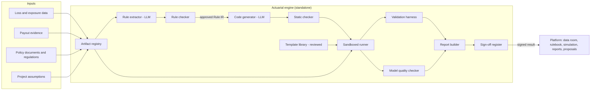
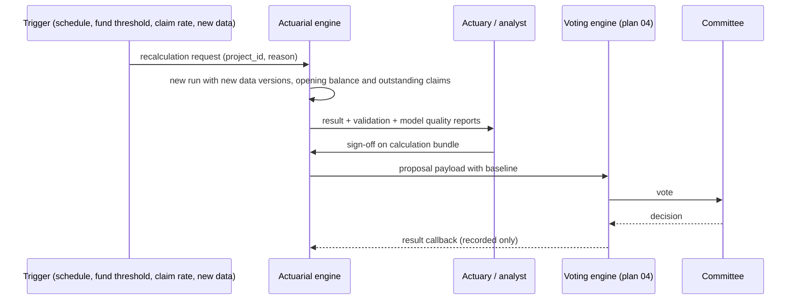
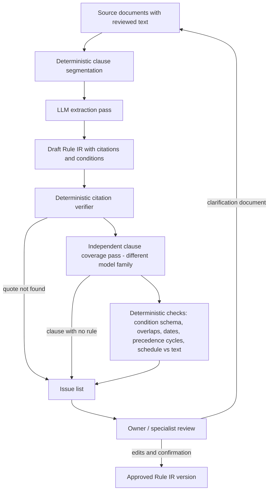
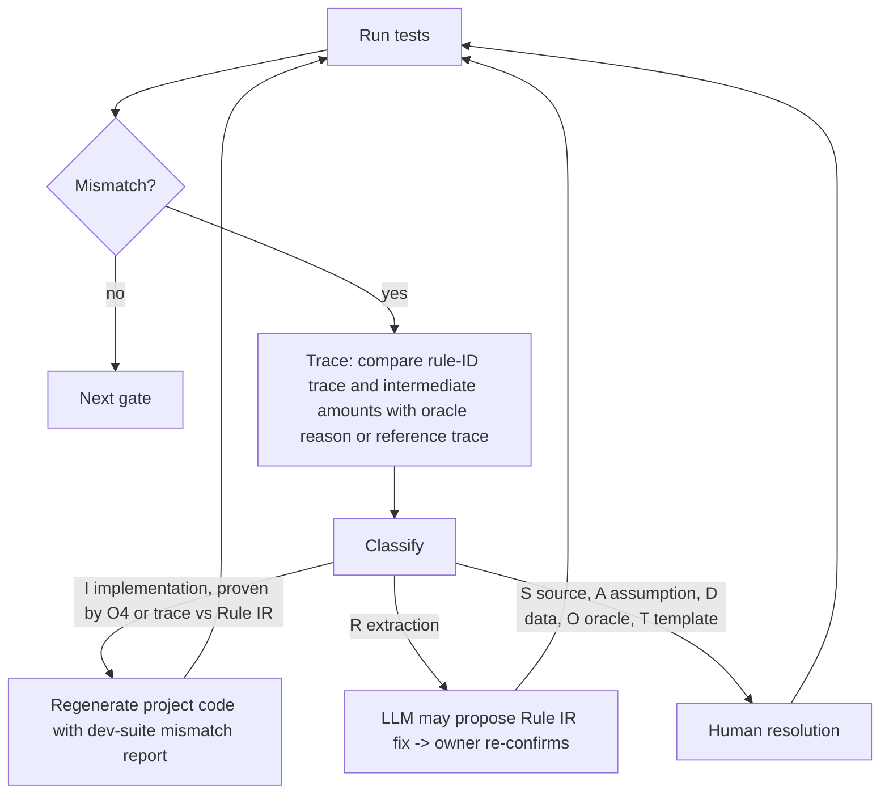
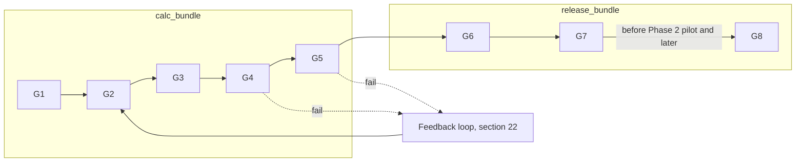

# Plan 05 — Actuarial Engine and Simulation

| Field      | Value |
|------------|-------|
| Status     | Draft |
| Created    | 2026-11-24 |
| Type       | Implementation plan |
| Depends on | [01 Platform overview](01-platform-overview.md) (drafted against v0.2) and the draft interfaces in Plans 02, 03, 04, 06 and 07 (§3). |
| Handoff review | Cursor approved all four scoped items on 26 November 2026. Implementation and verification remain open under [§26.3](#263-phase-1-handoff-and-later-gates). |

## 1. Context

### 1.1 Purpose

This plan defines the **actuarial engine** (plan 01, section 7.4) and the parts of the
**simulation sandbox** (7.8) that the engine supplies. It defines **how** the engine is built,
tested, and approved. It is the first implementation plan for Phase 1 "Design and simulate"
(plan 01, section 12).

The engine is a **standalone module**. It runs on its own against fixtures. It connects to the
rest of the platform only through the interfaces in section 26.

### 1.2 Facts from plan 01 that this plan keeps

- One project = one policy = one fund = one rulebook = one committee (plan 01, sections 2, 4).
- Project, product terms, fund, and **member cover** are separate concepts (plan 01, section 4,
  decision D6). A claim is judged against the terms of the claimant's member cover that applied
  on the incident date (plan 01, sections 4 and 7.5).
- Full tenant isolation (7.1).
- Two policy types: **subscription** (for example car) and **fixed term** (for example a sports
  event) (7.2).
- The pilot policy type and the first jurisdiction are **open** (plan 01, section 13). This plan
  does not choose them.
- Phase 1 uses no real money. Simulation data and dummy money are separate from live data and
  real money (plan 01, sections 7.8 and 12).
- AI is never the only source of numbers. AI never approves or rejects a claim. Every AI output
  is logged with model, prompt version, inputs, and output (7.7, decision D4).
- The rulebook is versioned, rules have IDs, and rule test cases exist (7.5).
- An actuary or analyst signs off actuarial results before release (7.4).
- Once a policy is live, the committee governs changes to premiums, rules, and limits by vote
  (7.6, 7.13, R15). The engine proposes. It never decides.
- Binding solvency and shortfall rules are future work FW-1. Independent model validation and
  stress tests are future work FW-9. Run-off and late claims are FW-5. This plan does not
  design them. It leaves clear inputs for them (sections 9, 11, 30).
- README: "validated mathematical and actuarial models provide the foundation for financial
  calculations". saas-insur is not a licensed insurer. Phase 2 (live pilot) needs a licensed
  partner (plan 01, section 12).

### 1.3 What this plan does not cover

- Claim decisions for real claims (plan 06, 7.12). The committee decides claims.
- The voting engine (plan 04).
- Payments and the real fund ledger (plan 07).
- The platform tech stack, other than Python for engine execution (plan 03).
- Solvency policy (FW-1) and independent model validation (FW-9). The engine produces solvency
  **indicators** only (ruin probability, required fund balance, replenishment-call
  probability). It sets no binding solvency threshold and triggers no action. FW-1 decides how
  the indicators are used.
- Policy suspension, run-off, and closure (FW-5). The engine's `runoff_cutoff` (section 9) is a
  modelling horizon for paying claims already incurred. It is not the lifecycle state RunOff.
- Claim disputes and appeals (FW-3), payment exceptions such as failed payments and reversals
  (FW-7), and fraud investigation (FW-8). Plan 01 decision D7 limits this round to happy paths.
  The engine models approved claims being paid. A contribution default rate exists only as a
  stress input that FW-9 asks for (section 9); it does not model payment exception handling.
- No-claim bonus. It is out of scope (plan 01, section 9). The Rule IR has no rule kind for it,
  and the engine does not model it.

### 1.4 Terms used in this plan

| Term | Meaning |
|------|---------|
| Artifact | An immutable, versioned file or record that the engine reads or writes. Section 5. |
| Rule IR | The structured, source-cited form of the policy rules (rule intermediate representation). Section 16. |
| Template | Reviewed, human-owned Python code that does actuarial mathematics or common payout steps. Section 18. |
| Project code | Python code generated by an LLM for one project. It applies that project's coverage, exclusions, deductibles, limits, and payout schedules by calling templates. Section 18. |
| Run | One deterministic execution of templates plus project code on pinned inputs, in the sandbox. |
| Calculation manifest | The stable record of everything that determines a run's result: artifact IDs, code IDs, environment ID, configuration, seeds. Section 5.3. |
| Execution record | The record of how a run was executed: job, workers, times, checkpoints. It does not affect the result. Section 5.3. |
| Release bundle | One artifact that lists every artifact a release decision depends on. Section 24.2. |
| Oracle | A test case with an expected result that is used to accept or reject the engine's output. |
| Sealed oracle | An oracle whose expected result was recorded (and hashed) before any generated code was run against it, and that the code generator never sees. |
| Depletion | The fund balance falls below a defined level within a defined horizon. Section 11.4. |
| Material result | Any number that is shown to an owner, actuary, committee, or member, or that feeds a gate or proposal. |

## 2. Scope and design principles

The engine must follow these principles. Later sections refer to them as DP-1 to DP-10.

| ID | Principle |
|----|-----------|
| DP-1 | **Deterministic publication.** A published number comes only from a deterministic Python run with pinned inputs, pinned code, a pinned environment, and recorded random seeds. An LLM never types a published number. |
| DP-2 | **Split of responsibility.** Shared, reviewed templates do all mathematics. Generated project code only applies project terms, and only through template functions. |
| DP-3 | **Source citation.** Every structured rule cites the exact source text it comes from. A citation is checked by code, not trusted. |
| DP-4 | **Independent acceptance.** Expected results that accept or reject the engine are made independently of the generated code and of the LLM that generated it (section 20). |
| DP-5 | **Full provenance.** Every material result names its method, inputs, assumptions, and uncertainty (section 15). |
| DP-6 | **Surface, do not guess.** Missing, conflicting, or unclear terms are raised as issues for a human. The engine never picks a reading silently. |
| DP-7 | **Isolation.** Generated code runs in a sandbox with no network, fixed resource limits, and access to one project's pinned inputs only (section 19). |
| DP-8 | **Human sign-off.** The owner confirms policy intent. An actuary or analyst signs off results. The committee governs live changes (section 24). |
| DP-9 | **Correctness first.** In this phase, compute and LLM cost are not limits. Stopping rules exist only to stop loops that do not converge (section 25). |
| DP-10 | **Open decisions stay open.** Pilot type and jurisdiction are inputs, not built-in choices. |

## 3. Assumptions about plans 02, 03, 04 and 06

These are the engine's interface requirements. The Phase 1 review checkpoint tracks the
remaining differences with the other plans. Plan 02's v1 export adapter is the first platform
handoff while the v2 schema is reviewed.

| Plan | Assumption | Interface this plan needs |
|------|-----------|---------------------------|
| 02 Domain model | Tenant, Project, Policy, ProductTerms version, RulebookVersion, Dataset, DatasetVersion, Member, **MemberCover**, Claim, Proposal exist as entities with stable IDs. | Stable `tenant_id`, `project_id`, `dataset_version_id`, `rulebook_version_id`, `member_cover_id` that the engine can store in its manifests. |
| 02 Domain model | A member cover pins the product terms and rulebook version that the member accepted (plan 01, section 4). A cover can change during its period only through a recorded amendment. | A `MemberCover` record: `member_cover_id`, `member_id`, cover period `[start, end)`, and an ordered list of segments `(product_terms_version_id, rulebook_version_id, segment_start, segment_end)`. One segment if there is no amendment. The engine uses it to select rules (section 17). |
| 03 Architecture | The platform can run a Python process in an isolated environment with the properties in section 19. The platform provides durable object storage and a job runner. | (a) Object storage with write-once semantics or an equivalent. (b) A way to start a sandboxed Python run with a pinned image. (c) A job API with status and cancel. The engine does not assume a specific cloud, queue, or database. |
| 03 Architecture | Identity and authorization are done by the platform. | Each call to the engine carries an authenticated principal, `tenant_id`, `project_id`, and role. The engine re-checks that every artifact it reads belongs to that project. |
| 04 Voting | A generic proposal and vote API exists. | `create_proposal(project_id, type, payload_artifact_id, baseline)` and a result callback (section 26). The engine only creates proposal payloads. |
| 06 Rulebook | The rulebook has documents, versions, rule IDs, effective dates, and rule test cases. | A rulebook export that contains source documents with version hashes, for **every** rulebook version that any member cover still refers to, so old claims can be replayed. Plan 06 uses the Rule IR in section 16 and preserves the same rule IDs. |
| 07 Ledger | The simulation sandbox uses a dummy ledger with the real ledger logic (plan 01, section 7.8). | A cash-flow event schema (date, time order key, type, amount, member cover, claim) that both the engine simulation and the dummy ledger use (section 26.2). |

Language: the engine, its templates, and generated project code are Python. Other platform
parts may use any language. They call the engine through the contracts in section 26.

## 4. Module boundaries

### 4.1 Components

| Component | Responsibility | Uses LLM? | Produces published numbers? |
|-----------|---------------|-----------|-----------------------------|
| Artifact registry | Store and version all inputs and outputs. | No | No |
| Input validators | Check input files against the contracts in sections 6–9. | No | No |
| Rule extractor | Turn source documents into a draft Rule IR with citations. | Yes | No |
| Rule checker | Check citations, coverage of source text, date ranges, and conflicts. Raise issues. | Partly (second-pass coverage check only) | No |
| Template library | Reviewed actuarial and payout mathematics. | No (human-owned) | Yes, inside a run |
| Code generator | Write project code from approved Rule IR and the template API. | Yes | No |
| Static checker | Check generated code before it runs (section 19.3). | No | No |
| Sandboxed runner | Execute templates plus project code deterministically. | No | Yes |
| Validation harness | Compare run output with oracles, outside the sandbox. Classify mismatches. | No (LLM may suggest a class; a human or a deterministic check confirms) | No |
| Model quality checker | Statistical fit and backtest checks, separate from payout checks. | No | Yes (diagnostics) |
| Report builder | Build result reports from run artifacts. | Optional, for plain-language text only (section 15.4) | No new numbers |
| Job orchestrator | Run long jobs with progress, checkpoints, retry, and resume. | No | No |
| Sign-off register | Record who approved which artifact, and when. | No | No |

### 4.2 Diagram



### 4.3 What the engine does not do

- It does not decide claims. It calculates the payout that the rules give for a claim input.
- It does not change any live policy setting. It writes proposal payloads only.
- It does not hold money or write to the fund ledger. The simulation sandbox (7.8) uses its
  outputs with a dummy ledger owned by plan 07.
- It does not authenticate users. The platform does (section 3).

## 5. Versioned artifacts and identifiers

### 5.1 Rules for all artifacts

- Every artifact is immutable. A change creates a new artifact.
- `content_hash` = SHA-256 of the artifact's canonical bytes. Canonical JSON uses sorted keys,
  UTF-8, no insignificant whitespace, and decimal numbers as strings.
- `artifact_id` = SHA-256 of a canonical **envelope**: `{type, schema_version, tenant_id,
  project_id, content_hash, parents}` (`parents` sorted). Ownership is part of the ID, so the
  same bytes uploaded to two projects give two different artifact IDs. Template releases and
  public fixtures use `tenant_id = "platform"` and `project_id = "platform"`.
- A separate, append-only metadata record holds `created_at`, `created_by` (person, job, or LLM
  call ID), and labels. It is not part of the ID, so identical inputs give identical IDs.
- Storage may remove duplicate bytes only inside one project. It never removes duplicates
  across projects or tenants, so storage behaviour cannot show one tenant that another tenant
  holds the same file.

### 5.2 Artifact types

| Type | Made by | Contents |
|------|---------|----------|
| `dataset_version` | Data room (7.3) or fixture | Data file, schema, quality report, lineage. |
| `source_document` | Owner, specialist, or regulator source | Original file, extracted text, text hash, jurisdiction, source, effective dates. |
| `owner_clarification` | Owner or specialist | Written answer to a raised issue. Treated as a source document with its own citation target. |
| `assumption_set` | Owner and analyst | Project assumptions (section 9). |
| `report_settings` | Owner and analyst | Presentation-only settings read by the report builder (section 9). |
| `member_cover_set` | Platform (plan 02) or fixture | Member cover records used by a run (real, fixture, or simulated). |
| `rule_ir` | Rule extractor, then edited by humans | Structured rules with citations (section 16). |
| `issue_list` | Rule checker, validation harness | Open and closed issues with resolutions. |
| `template_release` | Template maintainers | Template package version, its tests, its review record. |
| `project_code` | Code generator | Generated Python module and its generation log reference. |
| `environment_lock` | Platform engineering | Python version, all package versions with hashes, image digest, runtime settings (19.2). |
| `oracle_suite` | Owner, analyst | Oracle cases, each with basis, author, seal time, and seal hash (section 20). |
| `calc_manifest` | Runner | Everything that determines the result (5.3). |
| `execution_record` | Runner | How the run was executed (5.3). |
| `result` | Runner | Numbers, with provenance per number (section 15). |
| `validation_report` | Validation harness | Oracle results and mismatch classes. |
| `model_quality_report` | Model quality checker | Fit, backtest, convergence diagnostics. |
| `calc_bundle` | Sign-off register | All calculation artifacts that gates G1–G5 sign (section 24.2). |
| `release_bundle` | Sign-off register | The calculation bundle ID, its G1–G5 sign-off IDs, the simulation report ID, and the report settings ID; signed by G6–G8 (section 24.2). |
| `signoff` | Sign-off register | Who signed, role, bundle ID, the artifact IDs signed, decision, comment, time. |
| `llm_call_log` | AI gateway (7.7) | Model, model version, prompt template version, inputs (artifact IDs), output, time. |
| `proposal_payload` | Report builder | A proposed change for a vote (sections 14, 24). |

### 5.3 Calculation manifest and execution record

The **calculation manifest** holds only what determines the result:

- the `environment_lock` ID,
- the `template_release` ID,
- the **version map**: for each `(product_terms_version_id, rulebook_version_id)` pair used by
  the member cover set, the `rule_ir` ID and the `project_code` ID (section 18.4),
- every other input artifact ID (datasets, assumption set, member cover set),
- the run configuration (number of outer and inner paths, chunk size, horizon, scenarios),
- the root seed and the seed-derivation scheme version (section 19.5).

It does not hold times, worker counts, job IDs, host names, or checkpoint IDs. The result
artifact contains the calculation manifest ID. So R-1, R-2, and R-3 (section 23) can compare
results byte for byte.

The **execution record** holds the job ID, worker count, start and end times, host and image
digest actually used, checkpoint IDs, retries, and the calculation manifest ID and result ID.
It is stored next to the result and is part of the audit trail, but it is not inside the
result.

A G1–G5 sign-off refers to a calculation bundle that contains a `result` ID (section 24.2).
Any change to any item in the calculation manifest gives a new result ID and a new calculation
bundle, so an old sign-off does not carry over.

## 6. Input contract: loss and exposure data

### 6.1 What the engine accepts

Historical claims, events, or incidents. Dataset metadata must declare the **record grain**:
`incident` (one row per incident), `claim` (one row per claim; several claims can come from one
incident), or `claimant_incident` (one row per person per incident).

| Field | Required | Notes |
|-------|----------|-------|
| `record_id` | Yes | Unique within the dataset version. |
| `incident_id` | Yes if grain is `claim` or `claimant_incident` | Groups rows that come from one incident. |
| `incident_date` | Yes | Date (and time zone if known). Used for trend, exposure match, and rule-version selection in backtests. |
| `report_date` | If available | Needed to measure late reporting (section 10.6). |
| `settlement_date` | If available | Needed for payment timing. |
| `payments` | If available | List of `(date, amount)`. |
| `payments_complete` | Yes if `payments` is given | `true` if the list holds every payment made up to the as-of date; `false` if it is partial. |
| `incident_type` | Yes | Mapped to the project's incident type list. Unmapped types raise an issue. |
| `ground_up_loss` | If available | Loss before any deductible or limit. |
| `paid_amount` | If available | Total amount paid to date under the historical terms. |
| `case_estimate` | If available | Outstanding estimate for open claims. |
| `status` | Yes | `open`, `closed_paid`, `closed_denied`, `closed_below_deductible` (reported, loss at or below the payout deductible), `closed_withdrawn` (withdrawn by the claimant), `reopened`. |
| `denial_reason` | If `closed_denied` | Mapped by the analyst to `not_a_covered_event` or `covered_but_denied` (section 10.3). |
| `historical_terms_ref` | If available | Deductible, limit, coinsurance that applied, or a reference to the historical policy terms. Needed for truncation and censoring (section 10.3). |
| `currency` | Yes | ISO 4217. |
| `exposure_unit_id` | If available | Links the record to an exposure row (member, vehicle, ticket). |
| `stratum_id` | If available | Links the record to a documented exposure stratum when row-level links do not exist (section 6.1a). |
| `event_id` | If available | Groups records caused by one common event (storm, event cancellation). Section 10.5. |

Exposure data. Each row is one exposure unit over one period.

| Field | Required | Notes |
|-------|----------|-------|
| `exposure_unit_id` | Yes | Member, vehicle, ticket, or other unit. |
| `period_start`, `period_end` | Yes | Half-open interval `[start, end)`. |
| `exposure_amount` | Yes | In the declared exposure unit (for example unit-years, unit-days, or unit-events). |
| `rating_factors` | Optional | Attributes used in a frequency or severity model. |
| `historical_threshold` | Yes if thresholds differ between rows and no stratum threshold is documented | The deductible or reporting threshold that applied to this row in the past (section 10.2). |

Common-event exposure (needed to fit the common-event layer, section 10.5). Each row is one
observation window, **including windows with no common event**:

| Field | Required | Notes |
|-------|----------|-------|
| `window_id`, `window_start`, `window_end` | Yes | For example each past sports event, or each calendar month. |
| `population_at_risk` | Yes | Number of exposure units exposed in the window. |
| `event_ids` | Yes (may be empty) | Common events that happened in the window. |
| `units_affected` | Yes per event | Number of units with a claim from that event. |

Dataset metadata (required): source, collection method, record grain, **counting unit** for
frequency (`incident` or `claim`), **observation period** for incidents (start and end), **data
as-of date** (the date the extract was taken), exposure unit definition, known gaps, currency,
and the data owner.

Valid combinations of record grain and counting unit:

| Record grain | Counting unit `incident` | Counting unit `claim` |
|--------------|--------------------------|------------------------|
| `incident` | Valid. One row = one count. | Valid only if each row has a `claim_count` field (number of claims from that incident). Otherwise rejected. |
| `claim` | Valid. Rows are grouped by the required `incident_id`; one group = one count. | Valid. One row = one count. |
| `claimant_incident` | Valid. Rows are grouped by the required `incident_id`. | Valid only if each row has a `claim_id` (rows grouped by it) or a `claim_count`. Otherwise rejected. |

Any other combination, or a missing key or count that the combination needs, fails
validation.

### 6.1a Matching claims to exposure

The frequency fit (10.2) counts claims per exposure row or per documented stratum. Each claim
record is matched **deterministically**: by `exposure_unit_id` with `incident_date` inside the
row's `[period_start, period_end)`, or, if the dataset documents strata, by `stratum_id` (the
exposure table then also carries `stratum_id`). No fuzzy or LLM-based matching is used.

- **One assignment per counted unit.** When the counting unit is `incident`, each incident is
  counted once and must have one exposure row or stratum. If the claims of one incident match
  different rows or strata, the incident is **ambiguous**: it is excluded from the frequency
  fit and counts toward the unmatched share below.
- A record that matches no row or stratum is excluded from the frequency fit and listed in the
  quality report. It is used for severity only if its reporting threshold is known (all rows
  share one threshold, or the record's own threshold is documented); otherwise it is also
  excluded from the severity fit, because the truncated likelihood (10.2) needs that threshold.
- If unmatched records exceed a share set by the analyst in the assumption set, or if no
  deterministic match is possible for a part of the data, the frequency for that part must come
  from an external basis (6.2), and the result is labelled
  `frequency_from_external_basis`.

### 6.2 When exposure data is missing

If no exposure data exists, the engine can still fit severity. It cannot fit a frequency rate
from the data alone. The analyst must then give an external frequency basis (for example
industry statistics from the data room) as an assumption with a cited source. The result is
labelled "frequency from external basis". This label shows in every report that uses it.

### 6.3 Validation of loss data

The input validator checks:

- schema, record grain, and that `incident_id` exists where the grain needs it;
- frequency counts use the declared counting unit; for grain `claim` with counting unit
  `incident`, rows are grouped by `incident_id` before counting;
- `incident_date` is inside the observation period;
- `report_date` and `settlement_date` are on or after `incident_date` and on or before the data
  as-of date (they may be after the observation period end);
- every payment date is on or after `incident_date` and on or before the as-of date;
- if `payments_complete` is `true`: when `paid_amount` is present, the sum of payments must
  equal it; when it is absent, `paid_amount` is derived as that sum;
- if `payments_complete` is `false`: the record is marked `partial_payment_history`; it is not
  used in this reconciliation, in payment-delay fits (section 9), or as an exact severity value
  (it can only be right-censored, 10.3);
- the grain and counting-unit combination is valid and has the keys or counts it needs (6.1);
- duplicates, negative amounts, currency consistency;
- incidents without a deterministic exposure match (6.1a), and exposure rows outside the
  observation period;
- common-event windows cover the observation period without overlap.

It produces a quality report. A failed check blocks use of the dataset version unless the
analyst records a waiver with a reason. A waiver is part of the provenance of every result
that uses that dataset.

### 6.4 Versioning

The engine never edits a dataset. Cleaning steps (filters, mappings, currency conversion, trend
adjustment) are template functions with parameters in the assumption set. Their output is a
new derived `dataset_version` with the original as parent.

## 7. Input contract: payout evidence

There are three kinds of payout evidence. Each has a **different purpose**. The engine keeps
them in separate artifact types and never mixes their roles.

| Evidence | What it is | Purpose in modelling | Purpose in validation | Who may see it during code generation |
|----------|-----------|----------------------|-----------------------|---------------------------------------|
| Observed historical payouts | Amounts paid in the past, under past terms, with those terms where known. | Severity fitting, after correction for the past deductible and limit (section 10.3). Payment timing. | Backtest of the payout logic **only** for records that meet the replay conditions in section 21.3. Other records are information, not a failure. | Code generator may not see individual records. Not needed to write project code. |
| Proposed payout schedules | A table set by the owner: incident type → payout amount or formula (for example "broken windscreen: 80% of repair cost up to 500"). | Not data. It is a **policy term**. It becomes rules in the Rule IR and is applied by project code. The engine applies it to simulated ground-up losses. | Checked against policy text for conflicts (section 16.5). Each schedule row must be covered by at least one oracle case. | Yes, through the approved Rule IR. |
| Owner-approved example cases | A claim scenario written by the owner, with the expected outcome and a short reason. | Never used for fitting. | **Oracles.** Split into a small visible set (shows intent to the generator; not used for acceptance) and a sealed set (used for acceptance). Section 20. | Visible set only. Sealed set never. |

Format of an owner-approved example case:

| Field | Notes |
|-------|-------|
| `case_id` | Stable. |
| `claim_input` | Same schema as the payout function input (section 18.4): claimant's member cover (with its pinned versions), raw incident dates, incident type, ground-up loss, evidence and committee-judgement flags, member period state, and event state if the case involves a shared event limit. |
| `expected_outcome` | Coverage status (`covered` or `not_covered`) **and** payout in minor currency units (section 23.1, P-1). |
| `expected_rule_ids` | Optional. Rules the owner thinks decide the case. |
| `reason` | Plain-language reason. |
| `author`, `sealed_at`, `seal_hash` | Set when the case is sealed. |
| `visibility` | `visible` or `sealed`. |

## 8. Input contract: policy documents and regulatory requirements

### 8.1 Document types

| Type | Example | Required metadata |
|------|---------|-------------------|
| Policy wording | Main policy document. | Version, effective from, effective to (or open), author. |
| Payout schedule | Table of benefits. | Version, effective dates, link to the wording version it belongs to. |
| Endorsement or amendment | Change to the wording. | Version, effective dates, which document it changes. |
| Rulebook (7.5) | Claim approval policy with rule IDs. | Rulebook version ID from plan 06. |
| Regulatory requirement | Law, regulation, or regulator guidance that limits the policy (for example a minimum benefit, a mandatory cooling-off period, a reserve rule). | **Jurisdiction**, **source** (issuing body and citation), **effective from / to**, retrieval date, who added it. |
| Owner clarification | Answer to an issue raised by the engine. | Issue ID, author, date, effective dates. |

### 8.2 Rules

- Every document is stored as the original file plus the extracted plain text. The text hash
  is the citation target. Citations point to the text hash and character offsets (section 16.3).
- Extracted text from PDFs or scans must be reviewed by a human for extraction errors before
  rule extraction starts. A document with unreviewed text cannot be cited by an approved rule.
- The jurisdiction is a project setting. Regulatory documents are only loaded for the project's
  jurisdiction. If the jurisdiction is not set, the engine marks every result "no regulatory
  check done". This keeps the first jurisdiction open (DP-10).
- The engine does not decide whether a regulation applies. A legal specialist marks each
  regulatory requirement as applicable or not applicable for the project, with a reason.

## 9. Input contract: project assumptions

The assumption set is one artifact, versioned. The owner approves the assumptions whose source
is an owner decision. The analyst approves all assumptions. Both approvals are recorded at gate
G1 (section 24).

Each assumption has a **category** that drives what reruns after a change (section 22.3):
`payout` (changes payout amounts), `model` (changes fitted models or simulation), or `report`
(changes only presentation).

| Assumption | Category | Notes |
|-----------|----------|-------|
| `currency` | payout | All outputs use this currency. Conversion rates for foreign-currency data are `model` assumptions with source and date. |
| `minor_unit_and_rounding` | payout | Minor unit and rounding mode for payouts (for example half-up to the cent). Open decision U-10. |
| `policy_time_zone` | payout | Used to convert incident times to dates (section 17). |
| `policy_type` | model | `fixed_term` or `subscription`. |
| `coverage_period` | model | Fixed term: event start and end. Subscription: policy start; the projection horizon is a separate setting. |
| `projection_horizon` | model | Subscription only. The value is open decision U-16. Fixtures use 12 months of incidents as a **provisional** value until the actuary decides. |
| `reporting_and_settlement_basis` | model | Delay distributions used for timing. Each delay is fitted only from records that have **both** dates of its pair: incident-to-report delay needs `incident_date` and `report_date`; report-to-payment delay needs `report_date` and payment dates (`payments` or `settlement_date`); incident-to-payment delay (used for cash flows when report dates are missing) needs `incident_date` and payment dates. The report-delay fit is needed for late-reporting development (10.6); the payment timing in the cash flows can use either the two-step delays or the direct incident-to-payment delay. Each delay that cannot be fitted uses an analyst assumption with a cited basis, and the result gets a label naming that delay (for example `report_delay_from_assumption`, `payment_delay_from_assumption`). |
| `runoff_cutoff` | model | Fixed duration after the horizon end. A simulated payment that falls after the cutoff is moved to the cutoff date (never dropped). The result reports the share of payments moved. This is a modelling horizon only; it is not the lifecycle state RunOff (FW-5). Validation rejects an assumption set whose `runoff_cutoff` would end before the latest possible pro-rata cohort closing date of any allocation rule (18.4) for incidents inside the horizon. So every cohort closes on or before the cutoff, and a pro-rata payment moved to the cutoff date is still on or after its cohort closing date. |
| `intraday_order` | model | Order of cash flows with the same date. Default: payments before contributions (conservative). Open decision U-20. |
| `starting_fund_balance` | model | May be zero. |
| `opening_outstanding_claims` | model | Live recalculation only: open claims with case estimates, plus an estimate for claims incurred but not reported. Phase 1: zero. |
| `membership_forecast` | model | Fixed term: number of participants (point value or distribution). Subscription: joins and leaves per month, as scenarios or as a distribution. |
| `contribution_basis` | model | How contributions enter the fund over time (upfront, monthly, yearly). Whether the service fee is paid from contributions or separately (open decision U-8). |
| `contribution_default_rate` | model | Share of due contributions not paid. Default 0 for the base case; stressed in sensitivity (FW-9 asks for payment-default stress). |
| `premium_change_application` | model | For recalculation: whether a new contribution applies to existing member covers from the effective date or only at renewal. Depends on the terms in each member cover. Open decision U-21. |
| `risk_targets` | model | A list of targets. Each target: `target_id`, level `L` (`ruin` = 0, or `replenishment` = minimum fund level), maximum probability, and horizon `H_target`. `H_target` must not be longer than the evaluation horizon `H` in 11.4; a longer value fails validation. The **ruin** target is required and is the binding target for the contribution search (11.2). Other targets are reported and, if marked `binding`, the search must also meet them. These are **indicator targets** for this engine; binding solvency rules are FW-1. Values are open decision U-3. |
| `confidence_level` | model | For intervals. It changes computed results, so it is a model assumption. |
| `trend` | model | Severity and frequency trend, with source. |
| `external_bases` | model | External statistics used as priors or benchmarks, with source. |
| `model_choices` | model | Which frequency, severity, dependence, and credibility templates to use, chosen by the analyst (section 10.7). Passed to the runner directly, not through project code. |

Each assumption has a `source` field (data, owner decision, analyst judgement, external
statistic) and a `rationale`. Every result lists the assumption set ID and the assumptions it
used.

Presentation-only settings (report language, display rounding, chart choices) are **not** in
the assumption set. They are a separate versioned artifact, `report_settings`, which only the
report builder reads. A change to it gives a new report and a new release bundle, but does not
change the calculation manifest, the result, or the calculation bundle (section 24.2).

## 10. Frequency and severity estimation

### 10.1 General rules

- All model fitting is done by templates (DP-2).
- The analyst selects models. The engine fits candidate models and reports comparisons. The
  engine does not select a model on a statistic alone.
- Every fitted parameter has an estimate and an uncertainty (standard error, posterior
  interval, or bootstrap interval).

### 10.2 Frequency

| Model | When to use |
|-------|-------------|
| Poisson with exposure offset (GLM if rating factors are used) | Default starting point. |
| Negative binomial | When the data shows over-dispersion (variance greater than mean). The engine tests for it and reports the result. |
| Event-level model (section 10.5) | When incidents cluster by common event. |

Frequency is a rate per exposure unit in the declared counting unit (section 6.1). Section 13
defines the exposure unit for each policy type.

**Reporting threshold.** Historical counts include only losses that were reported under the
historical terms. The **reporting threshold** `r_i` of exposure row `i` is the loss size below
which losses were not recorded for that row (usually the historical deductible, but it can
differ). It comes from the row's `historical_threshold` or from its documented stratum (6.1a).
The **payout deductible** `d` of each record comes from `historical_terms_ref` and is used only in
the payout transform (10.3).

- **Reference threshold.** `d_ref` is the lowest reporting threshold with enough data (template
  minimum). Rows with `r_i < d_ref` are treated as if `r_i = d_ref` (their losses below `d_ref`
  are not used). The fitted rate `λ_ref` is the rate of losses **above `d_ref`**.
- **Joint fit in the observed range.** The expected observed count for row `i` is
  `λ_ref × exposure_i × S(r_i) / S(d_ref)`, where `S` is the severity survival function. The
  severity likelihood of each record is left-truncated at **its row's reporting threshold**
  `r_i` (not at the payout deductible, when they differ). Frequency and severity are fitted
  together. For proposed deductibles `d_new ≥ d_ref`, the simulation draws losses above `d_ref`
  at rate `λ_ref`; no extrapolation is needed.
- **Below the observed range.** If `d_new < d_ref`, the proposed terms pay losses that the data
  never shows. A conditional severity shape alone cannot give the number of these losses. The
  external basis or analyst assumption must give the **probability mass below `d_ref`**,
  `F(d_ref)` (or, equivalently, a ground-up frequency), plus the severity shape below `d_ref`,
  each with a cited source. Then the ground-up rate is `λ_gu = λ_ref / (1 − F(d_ref))`. The
  result is labelled `extrapolated_below_reporting_threshold`, and sensitivity varies both
  inputs (12.4).
- If the historical thresholds are unknown, the engine raises an issue (10.3).

**Split between layers.** When the common-event layer is fitted (10.5), the member-level
frequency and severity fits **exclude** the records assigned to common events in the
common-event exposure table, so the same losses are not counted twice.

### 10.3 Severity

| Model | When to use |
|-------|-------------|
| Lognormal, gamma, Weibull | Body of the distribution. |
| Generalised Pareto above a threshold (spliced) | Tail, when there is enough data above the threshold (10.4). |
| Empirical with a parametric tail | Large datasets. |
| Scheduled fixed amounts | When the payout schedule pays fixed amounts. Severity then becomes "which schedule row", not an amount distribution. |

**Historical payouts are not ground-up losses.** The severity templates support these
historical payout transforms, per record, from `historical_terms_ref`:

`paid = c × min(max(X − d, 0), u)` (ordinary deductible `d`, limit `u`, coinsurance share `c`),
and the franchise deductible form (`paid = c × min(X, u)` if `X > d`, else 0).

From the transform, the fit uses:

| Record | Treatment in severity fit | Treatment in frequency |
|--------|---------------------------|------------------------|
| `closed_paid`, paid below the cap | Exact observation of `X` (inverted from the transform), left-truncated at the row's reporting threshold `r_i` (10.2) | Counted |
| `closed_paid`, paid at the cap `c × u` | Right-censored at `X = u + d` (ordinary) or `u` (franchise), left-truncated at `r_i` | Counted |
| `closed_below_deductible` (reported, so the loss is above the reporting threshold `r_i` and at or below the payout deductible `d`) | Exact observation if `ground_up_loss` is known; otherwise interval-censored in `[r_i, d]`; left-truncated at `r_i` | Counted |
| `closed_withdrawn` | Excluded | Not counted, unless the analyst records in the assumption set that withdrawn claims count (open decision U-22 covers the same choice for denied claims) |
| `closed_denied`, `not_a_covered_event` | Excluded | Not counted |
| `closed_denied`, `covered_but_denied` | Excluded from amounts; listed in the report | Counted, flagged; the analyst decides in the assumption set whether denied-but-covered claims count for the future policy |
| `open` or `reopened`, or partly paid | Not used as an exact observation. Either (a) developed to an ultimate estimate with the development template and used with a `developed` flag, or (b) treated as right-censored at the **ground-up bound derived from paid-to-date through the historical transform**: `X ≥ d + paid / c` (ordinary deductible) or `X ≥ paid / c` (franchise). Records whose transform is unknown have no defensible bound and are excluded from the severity fit (they are still counted). The analyst chooses (a) or (b) in the assumption set | Counted |

If `ground_up_loss` is present and consistent with the transform, it is used directly. If the
past terms are unknown or use a form not in the list above, the engine raises an issue and the
analyst must state an assumption with a cited basis.

### 10.4 Small data and credibility

Small datasets are expected for new risk pools.

- The engine reports the number of claims and the effective exposure used for each estimate.
- When the claim count is below a credibility threshold (set by the actuary; open decision
  U-4), the engine must use a credibility-weighted or Bayesian estimate that combines the
  project data with an external basis named in the assumption set. The weight given to project
  data is shown in the result.
- If there is no external basis and the data is below the threshold, the result is labelled
  `low_credibility`. A low-credibility result cannot pass gate G5 (section 24) unless the
  actuary accepts it in writing with a reason.
- Tail parameters are never fitted from fewer exceedances than a template-defined minimum. In
  that case, the tail shape comes from an analyst assumption with a cited basis, and sensitivity
  analysis must vary it (section 12.4).

### 10.5 Dependence between claims

Independence between members is **not assumed by default**. Many risks have common shocks: a
hailstorm damages many cars; bad weather cancels a sports event for every ticket holder.

- The default model has two layers: (1) independent member-level incidents, and (2) common
  events with their own frequency per observation window and a distribution for the share of
  the population at risk that is affected.
- The common-event layer is fitted only from the common-event exposure table (section 6.1),
  which includes windows with no event and the population at risk. An `event_id` on claim rows
  alone is not enough. Records assigned to a common event are used for the common-event layer
  only and are excluded from the member-level fit (10.2).
- If the common-event exposure table is absent, the common-event frequency and affected share
  come from analyst assumptions with a cited basis (the same route as 6.2). "No common events"
  is allowed only as an explicit assumption with a reason. It is shown in every report that
  uses it, and sensitivity always includes common events (12.4).
- Frequency and severity are assumed independent within each layer unless the analyst chooses
  a dependence template. This assumption is listed in the result provenance.
- Parameter uncertainty (section 12.2) also creates dependence across members, because all
  members share the same unknown rate. The two-level simulation captures this.

### 10.6 Trend, inflation, and late reporting

- Historical amounts are adjusted to the cost level of the projection period with a severity
  trend. Frequency trend is applied in the same way. The trend source and rate are assumptions.
- Recent observation periods may be incomplete because claims are reported late. If report
  dates exist, the engine estimates reporting delay and develops recent periods (chain-ladder
  or a reporting-delay distribution template), using the data as-of date as the valuation date.
  If report dates do not exist, the engine raises an issue. The analyst must state a
  completeness assumption or exclude recent periods.

### 10.7 Model selection record

For each model choice, the result stores: candidate models fitted, fit statistics (log
likelihood, AIC/BIC, goodness-of-fit tests, out-of-sample score), diagnostic plots as artifacts,
the chosen model, who chose it, and why. Section 21 defines the checks.

## 11. Aggregate loss, premium, reserves and fund depletion

### 11.1 Expected loss

Expected loss for the period is calculated from the fitted frequency and severity models and
the payout rules, by simulation and, where a closed form or numerical method exists (for
example Panjer recursion for a compound distribution), also by that method as a cross-check.
Expected loss is reported **after** the policy's deductibles, limits, and schedules, because the
fund pays only that amount. Ground-up expected loss is also reported for comparison, but only
when the model has a ground-up basis (a ground-up frequency and a severity distribution over
the full loss range, 10.2). When the model covers only losses above a reporting threshold, or
only schedule-row categories, the ground-up figure has status `undefined` with that reason.

### 11.2 Minimum premium or contribution

The engine reports three figures. They are labelled so they cannot be confused.

| Figure | Definition |
|--------|-----------|
| Pure premium | Expected payout per exposure unit for the period. |
| Risk-based minimum contribution | The lowest contribution per exposure unit such that every binding risk target (section 9) is met, given the starting balance, membership forecast, contribution timing, and default rate. |
| Contribution with service fee | Risk-based minimum plus the service fee, **only** if the assumption set says the fee is paid from contributions. Otherwise the fee is shown separately. |

Search for the risk-based minimum contribution:

- The search is over contribution amounts in minor currency units per exposure unit, from 0 to
  a cap `c_max` set in the assumption set (default: 20 × pure premium).
- **Common sample.** First, the stopping rule (12.3) runs at `c_max` and fixes the sample: the
  outer draws `1..M*` and, for each, all `N` inner paths (with `N = 1`, this is simply paths
  `1..M*`). Every candidate amount is then evaluated on exactly this sample with the same random
  numbers, and the bounds are computed over the `M*` outer-draw means `p̂_m` (12.3). On one path, a higher contribution never lowers the balance at
  any cash-flow event, so no path changes from "not depleted" to "depleted" when the
  contribution rises, and each outer-draw mean `p̂_m` cannot rise either. The confidence sequence
  used (12.3) must have an upper bound at fixed `M*` that is non-decreasing in each observation;
  then the pass decision is monotone and bisection is valid.
- A candidate passes when the upper bound of each binding depletion probability at `M*` is at or
  below its target. The selected amount is the smallest passing amount, to one minor unit.
- **Independent validation of the selected amount.** The selection sample is used only to
  choose the amount. Intervals at an amount chosen from the same draws have no coverage
  guarantee. So the selected amount is then held **fixed** and evaluated on a **fresh,
  independent validation sample** (a new root seed), with the stopping rule in 12.3. All
  published figures at the selected amount (binding and non-binding targets, and the precision
  rule) come from this validation sample. Retry rule: if validation shows a binding target as
  `fail` or `undecided`, or a figure misses the precision rule, the selection is repeated on a
  new selection sample twice the size, followed by a new fresh validation sample; at most
  `R` attempts (default 3). Each validation uses intervals at level `1 − 0.05 / R`, so the
  overall error stays at or below 5% across attempts. If no attempt validates, the result has
  status `not_converged`. Every attempt is recorded in the execution record.
- **Outcomes at the cap.** After the last chunk at `c_max`, each binding target is classified
  by its bounds (12.3): `fail` (lower bound above target), `pass` (upper bound at or below
  target), or `undecided`. If any binding target is `fail`, the result has status `infeasible`
  (a shown failure stays `infeasible` even if another target is undecided). Otherwise, if any
  binding target is `undecided`, the status is `not_converged`. Otherwise the search runs.
- An `infeasible` result reports the depletion probabilities at `c_max`, the share of
  depletions that happen before the first contribution is due (which no contribution amount
  can prevent), and the starting balance that would be needed at `c_max`. An `infeasible` or
  `not_converged` result can be signed off as information, but it cannot be used for a release
  or a proposal.

There is no profit loading. Any margin above pure premium is a risk margin that stays in the
fund (README, "Not-for-profit risk pooling").

### 11.3 Reserves

The word "reserve" has a legal meaning in many jurisdictions. The engine reports these
quantities with clear names and does not claim they meet any legal standard:

| Quantity | Meaning | When |
|----------|---------|------|
| Required fund balance | Fund level needed at the start of the period so that the ruin target is met at the proposed contribution. | Phase 1 and later. |
| Outstanding claims estimate | Case estimates plus an estimate for incurred but not reported claims. | Simulation in Phase 1; real data once live. |
| Unearned contribution amount | Contributions received for cover not yet given (subscription paid in advance). | Subscription. |

Whether these meet a legal reserve requirement is a legal and actuarial decision for the chosen
jurisdiction (open decision U-11). These quantities, and the depletion probabilities in 11.4,
are **indicators**. Binding solvency rules, minimum capital, and the actions they trigger are
FW-1. The result exposes each indicator as a named record (section 15) so that FW-1 can use
them without a change to this engine.

### 11.4 Definition of depletion probability

The simulation builds, for each path, an ordered list of cash-flow events: contributions
received, claim payments (at simulated payment dates, not incident dates), and other fund
outflows (for example refunds). Events are ordered by date, then by the `intraday_order`
convention (section 9), then by a deterministic tie key.

`B_k` = fund balance after cash-flow event `k`:

`B_k = B0 + (contributions up to k) − (claim payments up to k) − (other outflows up to k)`

- `B0` = starting fund balance. For live recalculation, `B0` is the ledger balance on the
  valuation date and the payments on `opening_outstanding_claims` are included as cash-flow
  events.
- Contributions are net of any amount that does not enter the fund (contribution basis) and of
  the default rate.
- All cash-flow amounts and balances are exact integers in minor currency units (section 19.4).
  The comparison `B_k < L` is exact, so rounding cannot create a false ruin at zero.

Depletion event `D(L, h)`: `B_k < L` after at least one **payment or outflow** event `k` with a
date in `[0, h]`.

- `L = 0`: **ruin probability** — the fund could not pay a payment in full when it was due.
- `L = minimum fund level`: **replenishment-call probability**.
- `H`, the **evaluation horizon** of the simulation:
  - fixed term: end of coverage plus `runoff_cutoff`;
  - subscription: end of the projection horizon plus `runoff_cutoff`, for claims incurred
    inside the horizon.
- Each risk target is evaluated with `h = H_target` (section 9), which is never longer than
  `H`. A probability reported without a target uses `h = H`. The horizon `h` is part of the
  result key (15.1).
- Replenishment: the default calculation assumes **no** replenishment contributions inside the
  horizon. This shows the fund's own capacity. A second figure with the replenishment rules
  from the rulebook is reported when such rules exist (open decision U-19).

The engine reports, for each `L`: the probability, its Monte Carlo standard error and 95%
interval (12.3), the expected shortfall given depletion, and the distribution of time to first
depletion. When no path depletes, the conditional figures have status `undefined` (15.1).

How the fund behaves on shortfall (pay in part, call for more money, use a backstop) is future
work FW-1. Until it is decided, a simulated shortfall is recorded and the simulation continues
with a negative balance. This keeps the figures well defined.

### 11.5 Confidence intervals

The engine reports three kinds of interval. Each is labelled.

| Interval | What it describes |
|----------|-------------------|
| Parameter interval | Uncertainty in a fitted parameter. |
| Prediction interval | Range of the period's aggregate payout, including process and parameter uncertainty. |
| Monte Carlo error interval | Uncertainty from a finite number of simulations. |

## 12. Monte Carlo, uncertainty and sensitivity analysis

### 12.1 Simulation design

- One simulation path = one full period: member covers, incidents, common events, ground-up
  losses, payouts by project code, payment timing, contributions, and the ordered cash-flow
  list (11.4).
- Payouts in the simulation are calculated by the **same** project payout function that the
  oracles test (section 18.4), with the same T9 finaliser for limits that span several claims. A faster
  vectorised path is allowed only if a template provides it and an equivalence test shows
  identical results on a sample of at least 100,000 simulated claims that covers every rule
  branch.

### 12.2 Parameter uncertainty

The simulation has two levels. The outer level draws a parameter set from its uncertainty
distribution (posterior, or bootstrap of the fit). The inner level simulates `N` paths with
those parameters. The engine reports figures with process risk only and with process plus
parameter risk. **Published figures use process plus parameter risk.**

### 12.3 Monte Carlo error and stopping rule

- Paths that share an outer parameter draw are not independent. The estimator therefore works
  at the outer level. For `M` outer draws, `p̂_m` is the share of depleted paths in draw `m`.
  The estimate is `p̂ = mean(p̂_m)` and its standard error is `sd(p̂_m) / sqrt(M)` (batch means
  over independent outer draws). The default design uses `N = 1` (a new parameter draw for
  every path), which makes all paths independent; then `M` is the number of paths.
- **Interval method.** The run checks its interval after every chunk and stops on the result.
  A fixed-sample interval does not keep its coverage under such repeated checks. The engine
  therefore uses a **time-uniform confidence sequence** for the mean of the independent units
  (paths if `N = 1`; the outer-draw values `p̂_m`, which lie in [0, 1], if `N > 1`), valid at
  any stopping time (see Howard et al., "Time-uniform, nonparametric, nonasymptotic confidence
  sequences"). Required properties: (a) valid for bounded means in [0, 1]; (b) the upper bound
  at a fixed sample size is non-decreasing in each observation (needed by the contribution
  search, 11.2). For `N = 1`, a beta-binomial mixture sequence for a Bernoulli mean, which
  depends only on the number of depleted paths and the sample size, meets both. For `N > 1`,
  the template must use a construction that meets both, or the run uses `N = 1`. The exact
  construction is fixed in the template release and reviewed by the actuary. The reported 95%
  interval is the sequence's interval at the stopping time.
- These sequences give a valid, non-degenerate interval when no unit depletes (lower bound 0,
  upper bound above 0) and when every unit depletes. A zero-width interval is never reported.
  The batch-means standard error is reported only as a descriptive figure.
- **Stopping rule.** The run adds chunks until every published probability meets its rule, or a
  set maximum of paths is reached:
  - a probability with a binding or reported risk target is **decided** when its interval lies
    entirely on one side of the target (`pass` or `fail`);
  - every published probability, with or without a target, must also meet a
    **target-independent precision rule**: interval half-width at most the larger of 10% of the
    estimate and an absolute precision `ε_abs` set in the assumption set (default 0.0005).
  After the last chunk, each figure is classified by its bounds first. Only a figure that is
  still undecided or not precise at the maximum is labelled `not_converged`; such a figure
  cannot pass G5. A target shown as `fail` is reported as a failure, not as `not_converged`.
  The contribution search (11.2) uses the sample fixed by this rule at `c_max`.
- **Seed-pair check.** Each published run is repeated with a second, independent root seed,
  with every searched setting (for example the selected contribution) **held fixed** at the
  published value, so both runs estimate the same quantities. Search stability is a separate
  diagnostic: the contribution search is also rerun on the second seed, and the difference in
  selected amount is reported for review at G5.
  For each published probability, the two 99% confidence-sequence intervals must overlap; this
  works also when one or both runs see no depletion. For each published mean (for example
  expected payout), the two estimates must satisfy `|x1 − x2| ≤ 3 × sqrt(se1² + se2²)` with
  batch-means standard errors. A failure blocks G4 and is investigated (it usually means an
  estimator or seeding defect). This check is not a published figure.

### 12.4 Sensitivity analysis

Sensitivity runs change one input or a defined group of inputs and use **common random
numbers** and **one common sample**: the base case and every scenario are evaluated on the same
outer draws `1..M*`. The stopping rule (12.3) applies to every published figure of every
scenario; if any figure needs more paths, the sample is extended for the base case and all
scenarios together. The paired difference for a scenario is computed over the matched outer
draws `1..M*`, with its standard error from the per-draw differences. Random streams: the child-seed key (19.5) does not contain the scenario, so every scenario uses the
same random streams. Random streams are keyed by path, purpose, and member or event index, so a
scenario with more members adds new streams without changing the streams of existing members.
Where a scenario changes the model structure (for example another distribution family), the
same uniform streams are used through the inverse distribution function. The result shows the
Monte Carlo standard error of each **difference** from the base case.

Required sensitivity set for every release of a real project (section 27.3 shows which subset
the M2 fixture uses):

| Change | Range |
|--------|-------|
| Frequency | −20%, +20%, +50% |
| Severity | −20%, +20%, +50% |
| Tail shape | Analyst-chosen low and high |
| Common-event frequency and affected share (correlated-loss stress) | ×0 and ×2, applied with the bounded transform below (and an analyst-set non-zero value if the base case has none) |
| Membership | Low forecast and an enrolment shortfall case |
| Contribution default rate | Base, and an analyst-set stress value |
| Trend | Low and high |
| Severity below the reporting threshold (only if `extrapolated_below_reporting_threshold`) | Analyst-chosen low and high |
| Alternative model family | Second-best fitted severity and frequency model |

Bounded stress transform: a multiplier `k` applied to a **rate** (for example a Poisson
intensity) multiplies it by `k`. A multiplier applied to a **probability** (a per-window
occurrence probability, an affected share, a default rate) multiplies its **odds** by `k`:
`q' = k·q / (1 − q + k·q)`. The result stays in [0, 1]; `k = 0` gives 0. A probability of exactly
1 (for example a cancellation that affects every ticket holder) stays 1; the report states that
the share stress has no effect there, and the frequency stress carries the stress. AT-MC-5 tests
this case.

The correlated-loss, enrolment-shortfall, and payment-default rows are the stress inputs that
FW-9 (model validation) names. They are produced here as labelled scenarios. FW-9 decides how
an independent reviewer uses them and whether more stress tests are needed.

Owners may add scenarios. Each sensitivity result shows pure premium, risk-based minimum
contribution, and ruin probability.

### 12.5 Simulation sandbox support (7.8)

The engine supplies two things to the simulation sandbox:

- A **claim generator**: given a result ID, a seed, and a member cover set, it returns dummy
  claims with incident date, report date, payment schedule, type, ground-up loss, and event ID
  from the approved model, and the contribution schedule, all in the cash-flow event schema
  (section 26.2).
- The **payout operations** in section 26.1: a per-claim payout preview, and finalisation of
  claims under limits that span several claims, with rule-ID traces.

In a `domain_flow` simulation realm, the sandbox runs the committee and AI flow. Plan 07
posts from paid dues and settled payouts. The engine's generated claims and contribution
schedule seed the domain records. In an `engine_cash_flows` simulation realm, Plan 07 replays
only the engine's cash-flow events. The replay creates no domain claims, dues or payouts.
AT-SIM-1 compares every event balance in this engine-only realm to the engine path for the
same seed and artifact. Both realms contain dummy data and money (Plan 02, section 14.5).

## 13. Fixed-term and subscription policies

The templates are the same for both types. The exposure, timing, and horizon modules differ.

| Topic | Fixed term (for example sports event) | Subscription (for example car) |
|-------|---------------------------------------|--------------------------------|
| Exposure unit | Participant per event, or participant-day if cover runs over several days. | Unit-year (for example vehicle-year), earned day by day. |
| Membership | One cohort, fixed at the start (point value or distribution). Each participant has one member cover. | Joins and leaves over time, from the membership forecast. Each join or renewal creates a member cover with the versions current at that time. |
| Contributions | One payment, before or at the start. | Recurring (monthly or yearly) or prepaid; unearned part tracked; default rate applied. |
| Waiting period | Usually none. | Applied per member cover from its start; reduces exposure. |
| Common shock | Often dominant (weather, cancellation affects all). | Present (storms, hail) but usually smaller relative to the total. |
| Horizon | Coverage end plus run-off cutoff. | Projection horizon plus run-off cutoff. |
| Late reporting | Short window; analyst sets it. | Development model needed (section 10.6). |
| Recalculation | Not applicable within one event. Results inform the next event's policy. | Periodic and on trigger (7.13). Section 14. |
| Typical payout terms | Scheduled amounts per incident type; per-event limits. | Indemnity with deductible and limits; aggregate limits per member per year. |

The project code interface (section 18.4) is the same for both types. The runner chooses the
exposure and timing template from `policy_type`.

## 14. Payout limits and premium recalculation

### 14.1 Policy-defined limits and engine-recommended limits

| | Policy-defined limit | Engine-recommended limit |
|---|---|---|
| Source | Policy wording, payout schedule, or rulebook (Rule IR). | Engine output, based on fund capacity and the risk target. |
| Effect | Binding. Applied by project code and the T9 finaliser (18.4) to every payout. | Advice only. Never applied to a payout of a real or sandbox claim. Applied only in counterfactual runs (14.2). |
| How it changes | Pre-live: owner edits the policy documents; the change goes through rule extraction and validation again. Live: committee vote (7.5, R15). | It becomes a policy-defined limit only if adopted through the same route. |
| Shown as | "Limit in the policy". | "Recommended limit", with the method and the risk figures with and without it. |

Recommended limits include: per-claim limit, per-member aggregate limit per period, and a
per-event limit for common events.

### 14.2 Counterfactual runs for recommended limits

- A recommended limit is evaluated in a separate run with a **limit overlay**: a template input
  that adds the candidate limit as the last payout step, after the project code and after the
  policy-defined limits, using the same payout primitives, money type, rounding, member period
  state, and event state (section 18). Project code is not changed.
- The overlay has the same **scope** as the change it would propose: an effective date, and an
  applicability rule saying which member covers it applies to (for example only covers that
  start or renew on or after the effective date, or all covers from that date if their terms
  allow a change during cover; see `premium_change_application` and open decision U-21). The
  overlay applies only to claims under those covers with an incident date on or after the
  effective date. Other claims keep the terms their covers pinned (plan 01, sections 4 and
  7.5).
- The overlay run uses the same seeds as the base run, so the difference shows the effect of
  the limit, with its Monte Carlo standard error.
- Overlay results are labelled `counterfactual`. They can feed a proposal. They are never used
  as the payout of a claim.
- **Per-event limits and scope.** T9 refuses to finalise an event whose claims fall under
  versions with different event-limit parameters (18.4). So a recommended **per-event** limit
  can feed a proposal only if its scope covers every member cover that could have a claim in
  the same event during the horizon (for example all covers from the effective date). If the
  scope leaves out some covers (for example covers that keep their accepted terms until
  renewal), the overlay result is labelled `not_proposable` with that reason, and it is shown as
  information only. A per-event overlay must also apply **per event** (to every claim of an
  event whose event start date is on or after the effective date), not per incident date, so a
  multi-day event that straddles the effective date is never split. As a final check, the
  overlay run applies T9's mixed-parameter test to every simulated event; any event that would
  be refused makes the overlay `not_proposable`. Per-claim and per-member limits have no such restriction, because each
  applies within one cover.
- If the limit is adopted, it becomes a rule in a new Rule IR version and the code is
  regenerated. Equivalence is required only when the adopted rule has the **same scope** as the
  overlay and is applied at the **same position** in the payout order (last). Then the adopted
  run must give the same figures as the overlay run within Monte Carlo error, and the same
  per-claim payouts on the oracle inputs; a difference is a mismatch (section 22). If the
  adopted rule differs in scope or position, the two runs are compared and the difference is
  explained in the proposal, but it is not a mismatch.

### 14.3 Premium recalculation (7.13)



The proposal payload contains:

- the unconstrained new contribution and the value after the step-change limit, with the risk
  figures for each;
- the **baseline**: the current live contribution and its version ID, the governance settings
  version that defines the step-change limit, the ledger balance date used, and the
  calculation bundle ID (section 24.2);
- the proposed effective date and the notice period from the governance settings (plan 01,
  section 7.13), and how the change applies to existing member covers
  (`premium_change_application`, section 9).

Rules:

- The engine never writes the live premium. Applying a vote result is done by the platform
  (plans 04 and 07), not by the engine.
- Stale proposals: the platform executes a vote result with **one atomic conditional update**
  that succeeds only if the live contribution version and the governance settings version are
  still the ones in the proposal's baseline, and that writes the new contribution version in
  the same step. If the condition fails (for example another approved proposal was executed
  first), nothing changes and the proposal is marked stale. Two proposals with the same
  baseline can therefore never both execute. The engine must make a new proposal. This is a
  requirement on plans 04 and 07; AT-GOV-4 tests it.
- At execution time, the platform also checks that the proposed effective date is still valid
  under the notice period in the current governance settings (plan 01, section 7.13). If a late
  vote result makes the date too early, the proposal is marked expired and is not executed.
  AT-GOV-5 tests this.
- Recalculation with new data uses the same validation and sign-off gates as the first release
  (section 24). A recalculation that also changes rules or project code needs the rule and code
  gates too.

## 15. Output contract and result provenance

### 15.1 Result structure

Each material number in a `result` artifact is a record:

| Field | Meaning |
|-------|---------|
| `name` | For example `ruin_probability`, `pure_premium`. |
| `scenario` | `base`, a sensitivity scenario ID, or a counterfactual overlay ID. |
| `target_id` | The risk target (section 9) for depletion figures; `none` otherwise. |
| `horizon` | The horizon `h` for depletion and timing figures (11.4); `none` otherwise. |
| `uncertainty_basis` | `process_only` or `process_and_parameter` (12.2); `none` for fitted parameters and inputs. |
| `statistic` | `estimate`, `lower_bound`, `upper_bound`, `standard_error`, or a quantile level. |
| `seed_role` | `primary` or `seed_pair_check` (12.3). Only `primary` figures are published. |
| `status` | `ok`, `undefined` (with reason, for example "no depleting path" for conditional shortfall), `not_converged`, or `infeasible` (11.2). |
| `value` | Decimal string, with unit and currency. Empty when `status` is `undefined`. |
| `method` | Template function name and version. |
| `inputs` | Artifact IDs used. |
| `assumptions` | Assumption keys used, with values. |
| `uncertainty` | Interval type, level, bounds, and Monte Carlo standard error where relevant. |
| `labels` | For example `low_credibility`, `frequency_from_external_basis`, `timing_from_assumption`, `no_regulatory_check`, `counterfactual`. |
| `calc_manifest_id` | The calculation that produced it. |

The **result key** is the tuple `(name, scenario, target_id, horizon, uncertainty_basis,
statistic, seed_role)`. It must be unique within a result. A result with a duplicate key, or
with a material number without all of these fields, fails schema validation and cannot be
stored.

### 15.2 Standard outputs

Frequency and severity parameters; expected loss (ground-up and after terms); pure premium;
risk-based minimum contribution (or `infeasible`); required fund balance; outstanding claims
estimate (simulation); unearned amount (subscription); ruin and replenishment-call
probabilities with shortfall and timing; prediction intervals; sensitivity table; recommended
limits with effects.

### 15.3 Machine and human formats

Every result is JSON (machine) plus a generated report (human). The report is built only from
the JSON.

### 15.4 AI-written explanations

An LLM may write a plain-language explanation of a result. Rules:

- The LLM writes text with **typed placeholders** only, for example
  `{{ruin_probability | scenario=base | target_id=T1 | horizon=H1 |
  uncertainty_basis=process_and_parameter | statistic=estimate | format=percent}}`. A
  placeholder must give the **full result key** (15.1, `seed_role` defaults to `primary`); the
  report builder fills in the value, unit, and status from the result JSON. A placeholder that
  does not match exactly one record (missing or ambiguous key), or names a record with status
  other than `ok` without a status-aware format, is rejected.
- LLM-authored text may not contain any digit outside placeholders. A deterministic check
  rejects the explanation if it does. Section numbers and dates in the report frame are written
  by the report builder, not by the LLM.
- A reviewer (owner or analyst) reads the explanation before it is published.
- The LLM call is logged (7.7).

## 16. Policy interpretation: rule extraction and issue surfacing

### 16.1 Workflow



### 16.2 Rule IR record

| Field | Meaning |
|-------|---------|
| `rule_id` | Stable ID shared with the rulebook (plan 06). |
| `kind` | coverage, exclusion, condition, definition, deductible, limit, schedule_row, waiting_period, eligibility, regulatory_constraint, allocation (how a shared limit is shared). |
| `condition` | A machine-evaluable predicate in the condition language (16.3). `true` if the rule always applies within its scope. |
| `parameters` | Structured values, for example `{amount: "500.00", currency: "AUD", basis: "per_claim"}`. Decimal strings. |
| `effective_from`, `effective_to` | Half-open date interval within the Rule IR version (17). |
| `citations` | One or more: document artifact ID, text hash, character start and end, exact quoted text, clause IDs covered. |
| `precedence` | Explicit references to rules it overrides or is overridden by, each with a citation; or `unresolved`. |
| `status` | draft, issue_open, owner_confirmed, specialist_confirmed. |
| `confirmed_by` | Person and time. |

### 16.3 Condition language

- Each project has a **claim data dictionary**: the typed fields of `ClaimInput` (section 18.4),
  for example `incident_type` (enum), `ground_up_loss` (money), `incident_date` (date),
  `member_cover.segment.age_days` (integer), evidence flags (boolean), and committee-judgement
  flags (boolean). The dictionary is part of the Rule IR version and is reviewed with it.
- The condition language is a small, typed expression language defined by the template
  release: comparisons, set membership, date ranges, `and`, `or`, `not`, over dictionary fields
  only. No functions, no loops.
- A condition that refers to a field not in the dictionary, or that cannot be written in the
  language, is an `unsupported_condition` issue. A human resolves it by (a) adding a field to
  the dictionary, or (b) marking the condition as a **committee judgement**: the code does not
  decide it; it becomes a boolean input flag with the rule ID (for example "evidence is
  sufficient"). The committee sets that flag for real claims. Oracles and simulations set it
  explicitly. This keeps decisions with the committee (plan 01, decision D1).
- The overlap check is deterministic: a template checks every pair of rules of conflicting
  kinds (for example coverage vs exclusion, two schedule rows, two limits of the same basis)
  within one Rule IR version for a claim input **and an incident date** such that both
  conditions are true **and** the incident date lies in both rules' `[effective_from,
  effective_to)` intervals. It uses a constraint solver or enumeration over finite domains and
  interval boundaries, with the incident date as one of the variables. A satisfiable pair with
  different outcomes and no precedence is a conflict issue. Two successive rule versions with
  the same condition and disjoint dates are therefore not a conflict.
- The precedence graph must be acyclic. A cycle is an issue.

### 16.4 Citation verification

The verifier is deterministic code. For each citation, it checks that the quoted text is
exactly equal to the source text at the given offsets in the document version with the given
hash, after one fixed normalisation (Unicode NFC, whitespace collapsed). A citation that fails
is an issue. A rule without a passing citation cannot be confirmed, except rules whose source is
an owner clarification, which is itself cited.

A passing citation proves that the quote exists. It does not prove that the rule parameters
mean what the quote says. That is checked by owner review (16.7) and by oracles based on the
source text (section 20).

### 16.5 Clause coverage check

- The source text is split into **clauses** by a deterministic segmenter (sentence and list-item
  boundaries, plus splits at "except", "unless", "provided that", "but"). Each clause has an ID
  and offsets. The segmentation is reviewed with the document text (8.2).
- A clause counts as covered only if a confirmed rule's citation includes that clause in full.
  A citation of one clause does not cover another clause in the same paragraph.
- A second LLM pass, using a different model family and a different prompt from the extractor,
  reads every uncovered clause and states whether it contains an obligation, condition, amount,
  exclusion, or definition. Every uncovered clause becomes an issue: "possible missing rule"
  (with the LLM's note if it found one). A human closes it as "rule added" or "no rule needed"
  with a reason. This pass can only add information to issues. It cannot approve anything or
  close an issue.

### 16.6 Issue types

| Issue type | How it is found | Who resolves |
|-----------|-----------------|--------------|
| Missing term (for example no limit for an incident type that the schedule covers) | Deterministic completeness checks on the Rule IR; clause coverage | Owner |
| Conflicting terms (two rules give different results for the same claim input) | Deterministic overlap check (16.3) | Owner; specialist if legal |
| Unclear precedence (conflict with no explicit precedence statement) | Conflict with `precedence = unresolved` | Owner and legal specialist |
| Precedence cycle | Graph check | Owner and legal specialist |
| Unsupported condition | Condition schema check (16.3) | Owner, with analyst |
| Payout schedule vs policy text mismatch | Deterministic comparison of schedule rows with wording rules for the same incident type (amount, cap, deductible, exclusions) | Owner |
| Undefined term | Term used in a rule with no definition rule | Owner |
| Regulatory conflict | Rule conflicts with an applicable `regulatory_constraint` | Legal specialist |
| Citation failure | Citation verifier | Rule extractor rerun, then human |
| Unreviewed source text or segmentation | Document text not marked reviewed | Owner or data room operator |

The engine never applies a default precedence. There is no built-in order such as "schedule
beats wording". A default order may be added later only if a legal specialist defines it for a
jurisdiction (open decision U-6).

### 16.7 Owner and specialist confirmation

- The owner confirms each rule's intent in the review screen, which shows the rule, its
  condition and parameters in plain language, and the cited source text side by side.
- Rules of kind `regulatory_constraint`, and any rule touched by a regulatory conflict or
  precedence issue, also need confirmation by a legal specialist.
- A Rule IR version is **approved** only when every rule is confirmed, every clause is covered
  or closed as "no rule needed", and no issue is open.

### 16.8 AI logging

Every extraction, coverage, and suggestion call is logged as `llm_call_log` with model, model
version, prompt template version, input artifact IDs, and output (7.7). The draft Rule IR
records which call produced each rule.

## 17. Rule versions and incident-date selection

### 17.1 Selection steps

A claim is judged against the terms of the claimant's member cover that applied on the
incident date (plan 01, sections 4 and 7.5). Selection is done by a template function, not by
project code:

1. **Raw dates.** `ClaimInput` carries the raw dates (for example occurrence start, occurrence
   end, discovery date), converted to the policy time zone. No policy definition is applied
   yet.
2. **Candidate segments.** A claim is made against one member cover (plan 01, sections 4 and
   7.12). `ClaimInput` must name the `member_cover_id`; a claim input without it is refused by
   input validation, for every caller (oracles, simulation, sandbox, platform). Collect every
   segment (section 3) of that cover. Each segment pins a product terms version and a rulebook
   version, and so a Rule IR version.
3. **Self-consistent match.** A Rule IR version can contain more than one version of the
   incident-date definition rule, each with its own `[effective_from, effective_to)`. For each
   candidate segment and each version `v` of its incident-date definition (for example "first
   day of a multi-day event" or "date of discovery"), apply `v` to the raw dates. The pair
   `(segment, v)` **matches** if the resulting date lies inside the segment **and** inside the
   effective interval of `v`. This handles an occurrence that starts before enrolment but is
   discovered during cover, when the policy uses the discovery date.
4. **Decision.**
   - Exactly one matching pair, or several matching pairs that all give the same segment and
     the same date: use that segment and date.
   - No matching pair: the claim has no cover on its incident date. Raise an issue (the
     committee decides; the engine does not default).
   - Matching pairs that give different dates or different segments: raise an ambiguity issue
     for a human. The engine never picks one silently.
5. **Rules.** Within the matched segment's Rule IR version, select every rule whose
   `[effective_from, effective_to)` contains the incident date. Return this `RuleSet` to
   project code.

Two members with the same incident date can therefore get different rules, because their covers
pin different versions.

### 17.2 Validity checks on a Rule IR version

- Dates are calendar dates in the policy time zone.
- For one rule ID, versions within one Rule IR version must not overlap.
- A rule ID that exists for the whole version must have no gaps. A rule that is introduced or
  retired during the version must say so explicitly (`introduced_on`, `retired_on`, each with a
  citation). A gap without such a statement is an issue.
- Regulatory requirements have their own effective dates and are selected the same way.

### 17.3 Use in simulation and backtests

- In simulation, each simulated member cover pins the Rule IR version current when the cover
  started or renewed (section 13). Each simulated incident is selected through the steps in
  17.1. A simulation that crosses a rule change uses both versions where covers differ.
- Backtests select the rules for each historical record through its member cover terms if
  known (section 21.3). If no current rule version could apply, the record is a model-quality
  backtest only, not a payout backtest.

### 17.4 Tests (section 29, AT-RUL-5)

Incidents on the last day of one version and the first day of the next; an incident time that
changes date after time-zone conversion; an incident date outside every cover (issue, not
defaulted); two members with different accepted versions on the same incident date; an
incident-date definition that moves the date into another cover segment; an occurrence that
starts before enrolment and is discovered during cover under a discovery-date definition
(matches the covering segment); two segments that both match with different results
(ambiguity issue); one segment whose incident-date definition changes from occurrence to
discovery inside the version, where both versions are self-consistent with different dates
(ambiguity issue) and where only one is (that one is used); a claim input without a
`member_cover_id` (refused); a rule introduced and a rule retired inside a version.

## 18. Code generation from reviewed templates

### 18.1 Split of responsibility

```mermaid
flowchart LR
    subgraph Templates["Template library (reviewed, versioned, human-owned)"]
        T1[Distributions and fitting incl. truncation and censoring]
        T2[Credibility and Bayesian blending]
        T3[Trend, development, currency]
        T4[Exposure and timing: fixed term / subscription]
        T5[Aggregate simulation, two-level MC, seeds]
        T6[Ruin, premium search, reserves]
        T7[Payout primitives: deductible, limits, schedule lookup, member aggregate limit, rounding, Money, Date]
        T8[Member cover and rule version selection]
        T9[Finaliser: member aggregate and per-event limits, state, limit overlay]
        T10[Condition language evaluator]
    end
    subgraph Project["Project code (generated per project, per Rule IR version)"]
        P1[eligibility: which coverage rules apply]
        P2[exclusions in order]
        P3[per-claim payout: schedule rows, deductibles, per-claim limits via T7]
    end
    Project -->|calls only| Templates
```



| Concern | Template | Project code |
|---------|----------|--------------|
| Probability distributions, fitting, simulation, model choices | Yes | No |
| Seeds and random numbers | Yes | No. Project code must be pure and deterministic. |
| Money and date arithmetic, rounding | Yes (`Money` on `Decimal`, `Date` without clock access) | Uses `Money` and `Date` only |
| Which coverage and exclusions apply, and in what order | No | Yes |
| Deductible and per-claim limit values | No (values come from Rule IR) | Passes Rule IR values to T7 primitives |
| Schedule rows | Lookup primitive | Maps incident to schedule row ID |
| Member cover and rule version selection | Yes (T8) | No |
| Limits that span several claims (member aggregate per period, per-event) and all limit state | Yes (T9 finaliser), using the Rule IR `limit_consumption_order`, `allocation`, and `limit_order` rules | No |

### 18.2 Templates

- Written and owned by humans. LLM help in writing them is allowed, but every line is reviewed
  by an engineer and every mathematical function is reviewed by an actuary.
- Each mathematical function has tests against closed forms or an independent method (for
  example: compound Poisson aggregate against Panjer recursion; MLE recovery of known
  parameters from synthetic data; fit with truncation and censoring against a published
  example).
- Released as versioned `template_release` artifacts. A project pins one release. An upgrade
  is a new run with full validation.

### 18.3 Generation process

1. Input to the code generator: the approved Rule IR (with its claim data dictionary), the
   template API documentation, the project code interface (18.4), the visible example cases,
   and (in later iterations) the mismatch report from the **development** suite only
   (section 22).
2. The generator writes one Python module. Every branch has a comment with the rule IDs it
   implements. Every returned payout includes a trace of rule IDs applied and intermediate
   amounts.
3. Static checks (19.3) run. Failures go back to the generator automatically.
4. Rule IR conformance tests run (O4, section 20.2).
5. Development suite runs. Implementation mismatches go back to the generator (section 22).
6. When static checks, conformance tests, and the development suite pass, a human reviewer
   reviews the code and the diff from the previous version (section 24, G3).
7. Only then does the sealed suite run (section 20).

The generator's context contains artifacts from this project only, plus public fixtures and
the template documentation. It never contains another tenant's or project's data or code.

### 18.4 Project code interface

```python
# Fixed by the template release. Generated code implements this function only.
def payout(claim: ClaimInput, rules: RuleSet) -> PayoutResult: ...
```

- `ClaimInput`: claim ID, member cover ID and matched segment, raw dates and the resolved
  incident date (17.1), report date and time, incident type, ground-up loss (`Money`), event ID if any, member
  attributes, evidence flags, and committee-judgement flags (16.3). Only fields in the claim
  data dictionary.
- `RuleSet`: the rules selected for this claim (section 17).
- `PayoutResult`: claim ID, coverage status, the **per-claim payout** (`Money`) after the
  claim's own terms (coverage, exclusions, deductible, per-claim limits, schedule row), and an
  ordered trace of `(rule_id, step, amount_before, amount_after)`. Project code has no state
  and applies no limit that spans several claims.

**Limits that span several claims** (member aggregate limits per period, per-event limits) are
applied only by the trusted **finaliser** template T9, never by project code.

**Limit register (source of truth).** For each project and each run context (one simulation
path, one sandbox scenario, or the platform's live claims), T9 keeps one **limit register**. It
is the only authoritative record of: every claim registered for finalisation (claim ID, hash of
its claim input, effective key, status), committed final amounts per member cover and limit
period (`MemberPeriodState`), committed final amounts per event (`EventState`), and closed
cohorts. The register is a chain of immutable versions. A new version is written only by T9,
and only with a **conditional write** that succeeds if the current version is still the one T9
read. Plan 03 updates one pointer per `(tenant_id, project_id, realm_id, register_id)` in
the platform. A standalone runner uses an in-memory register and one writer per path.

Rules of kind `allocation` (16.2) that the Rule IR must contain when such limits exist (a
missing rule is a missing-term issue; there is no default):

- `limit_consumption_order`: the order in which claims use a shared limit (for example report
  date and time, then claim ID; or incident date, then claim ID).
- `allocation` for each per-event limit: method `first_come` or `pro_rata`; for `pro_rata`, the
  cohort closing date (for example "claims reported within 90 days of the event") and the
  treatment of claims reported after closing.
- `limit_order`: `member_first` or `event_first`, when a claim is subject to both a member
  limit and an event limit.

**Effective key (a total order, so no deadlock).** Each registered claim gets an effective key:

- a claim not in a pro-rata cohort: its key from `limit_consumption_order`;
- a claim in a pro-rata cohort: the cohort's key `(closing date, event ID)`, then its position in
  `limit_consumption_order` inside the cohort. The whole cohort uses member limits as one block
  at its closing date.

Every key is a pair `(date-time, tie-break)`: for a claim not in a pro-rata cohort, the
date-time named by `limit_consumption_order` and then the claim ID; for a cohort, the end of its
closing date and then the event ID. Keys are compared as one total order. A claim or cohort
waits only for claims with a **strictly earlier** key that share a limit with it: the same
member cover and limit period, or the same `first_come` event. A cohort never waits for one of
its own claims, and every cohort can be finalised once `as_of` reaches its closing date. Every
wait points to a strictly earlier key, so every chain of waits ends. So no
waiting cycle can form (the interleaved case A1, B1, A2 across two pro-rata events is finalised
in order of the two closing dates). The Rule IR owner confirms this meaning of the consumption
order for pro-rata cohorts (16.7). If the policy text states an order for cohorts that cannot be
written as such a total order, the rule checker raises an `unsupported_condition` issue that
blocks Rule IR approval.

**Committee decisions come first.** The committee decides every claim (plan 01, decision D1
and section 7.12). T9 commits limit use only for claims with a recorded decision
(`record_decision`, section 26.1):

- `rejected`: final payout 0, status `not_covered_by_decision`; it uses no shared limit.
- `approved` with an **approved amount** (full or partial, before shared limits): T9 applies the
  shared limits to the approved amount, not to the engine's per-claim payout. If the approved
  amount differs from the engine's per-claim payout, the difference is recorded for audit; the
  committee's amount is used.
- No decision yet: status `awaiting_decision`. The claim keeps its effective key, uses no shared
  limit, and later claims that share a limit with it wait (strict order). A pro-rata cohort still
  closes for membership at its closing date, but it is finalised only when every claim in it has
  a decision; the factor uses the approved amounts.

In simulation and oracle runs, the decision is an explicit input (the simulation default is
"approved at the engine's per-claim payout"; the sandbox supplies the decisions of its committee
flow, 12.5).

How T9 finalises, in one call (`finalise`, section 26.1):

1. Read the current register version.
2. Take, in effective-key order, every registered claim that is not final, has a decision, and
   whose strictly earlier claims sharing a limit with it are final, and every pro-rata cohort whose closing
   date is on or before `as_of` (finalising one item can make the next one eligible in the same
   call).
3. **Recompute** each such claim with project code (the result is deterministic) and apply the
   shared limits against the committed amounts in the register:
   - not in a pro-rata cohort: apply the limits in `limit_order`, one claim at a time;
   - pro-rata cohort, `member_first`: in consumption order, cap each claim by the member limit
     remaining after committed amounts and after the capped amounts of earlier cohort claims of
     the same member; then reduce all capped amounts by one factor so the total fits the
     remaining event limit;
   - pro-rata cohort, `event_first`: reduce all committee-approved amounts by one factor so the total
     fits the remaining event limit; then, in consumption order, cap each reduced amount by the
     remaining member limit; event limit freed by member caps is not redistributed;
   - reduced amounts are rounded down to the minor unit, so a total never exceeds its limit; the
     remainder stays in the fund.
4. Write the final amounts and statuses as the next register version with the conditional
   write. If the write fails because another call changed the register, nothing is committed;
   the caller calls `finalise` again, which starts from the new version.

Other claims keep their status: `awaiting_decision`, `waiting_on_earlier_claim`, or
`pending_cohort_close`.

**Late registration.** A claim must be registered when it is reported (a requirement on the
claims intake in plan 06; the runner and the sandbox register claims at their report time). If a
claim is registered with an effective key earlier than a claim that is already final in the same
member cover and limit period, or in the same event, the register records it and raises an issue
for a human (the committee decides how to treat it). T9 never re-opens final amounts by itself.

Worked example: member cap 100, the same member has two claims of 80 in one pro-rata event, and
the event factor is 0.5. `member_first`: capped 80 and 20, final 40 and 10, committed 50.
`event_first`: reduced 40 and 40, both within the cap, committed 80. A later claim of that member
sees 50 or 20 remaining.

Claims of one event under different Rule IR versions: if their `allocation`, `limit_order`, or
event limit parameters differ, T9 raises an issue for a human and does not finalise the event.
If they are identical, T9 proceeds.

In simulation, pro-rata payments are scheduled on or after the cohort closing date (section 9
makes sure this is before `runoff_cutoff`).

AT-PAY-1 tests: a multi-member event over its cap with both methods and both limit orders; two
claims of one member in one pro-rata event; a claim of that member reported later but before
closing; a later claim that uses the remaining member limit. AT-PAY-6 tests the interleaved
two-cohort case.

**Several versions in one run.** A run can contain claims under different Rule IR versions
(different member cover segments). The calculation manifest holds a **version map**: for each
`(product_terms_version_id, rulebook_version_id)` pair used by the member cover set, the
`rule_ir` ID and the `project_code` ID generated for it. The runner loads every mapped module
and calls the one for each claim's matched segment (17.1). A segment with no mapping stops the
run with an error.

## 19. Deterministic execution and sandbox isolation

### 19.1 Required isolation properties

Plan 03 will choose the technology (for example a container with a restricted kernel
interface, or a micro-VM). Whatever is chosen must give all of these properties. Section 29
has a test for each.

| ID | Property |
|----|----------|
| ISO-1 | No network access of any kind (no outbound, no inbound, no DNS). |
| ISO-2 | Read-only file system, except one empty output directory per run. |
| ISO-3 | Only the artifacts that the run type needs are mounted, and all belong to one project (plus the template release and environment). For an oracle run: the claim **inputs** only. Expected results, sealed seals, other oracle suites, and other runs' outputs are never mounted. |
| ISO-4 | One sandbox instance per run. Never reused across runs, projects, or tenants. |
| ISO-5 | Limits on CPU time, wall time, memory, disk, number of processes, and open files. A limit breach ends the run with a recorded failure. |
| ISO-6 | Non-root user, no extra privileges, restricted system calls. |
| ISO-7 | No secrets, credentials, or platform tokens inside the sandbox. |
| ISO-8 | The image is pinned by digest. All packages are pinned with hashes in the `environment_lock`. The runner refuses to start if the image digest differs from the lock. |
| ISO-9 | Output leaves the sandbox only as files in the output directory, which are validated against the result schema before they are stored. |

The runner outside the sandbox checks `tenant_id` and `project_id` of every artifact before it
mounts it (ISO-3). The authorization check is done again here, not only in the platform.

Comparison of actual and expected results is done by the validation harness **outside** the
sandbox, in trusted code. The sandbox never sees whether a case passed.

### 19.2 Python environment and runtime settings

- One pinned CPython version and one locked set of packages (for example NumPy and SciPy), set
  in the `environment_lock`. The exact versions are chosen in plan 03.
- Fixed runtime settings, recorded in the lock: `PYTHONHASHSEED=0`, `TZ=UTC`, locale `C.UTF-8`,
  one thread for numerical libraries (for example `OMP_NUM_THREADS=1`), fixed `Decimal` context.
  Parallelism is only by independent chunks (19.5).
- Output numbers are written by one serializer: decimals as strings, floats as the shortest
  round-trip representation, keys sorted.
- **Numerical execution profile.** The same Python code can take different CPU code paths
  (for example SIMD kernels chosen at run time) and give different float results. The
  `environment_lock` therefore also pins: the exact numerical library builds (including the
  BLAS/LAPACK build), the settings that turn off run-time CPU dispatch or fix it to one baseline
  instruction set (for example NumPy's CPU-feature settings and the BLAS core type), and the
  allowed worker CPU architecture class. Before a run, every worker runs a fixed **determinism
  probe** (a small calculation that uses the same templates and random streams) and compares
  its output hash with the value stored in the lock. A worker outside the profile, or with a
  different probe hash, is refused. AT-REP-4 runs the same manifest on two different worker
  hosts and compares bytes.

### 19.3 Static checks on generated code

Before any run:

- Parse the module (AST). Allowed imports: the template package and a short list of standard
  modules (`decimal`, `dataclasses`, `enum`, `typing`, `math`). `datetime`, `time`, `random`,
  `os`, `sys`, and all others are not allowed. Dates come only through the template `Date` type,
  which has no clock access.
- **Builtin allowlist.** Generated code may call only these builtins: `len`, `min`, `max`,
  `abs`, `range`, `enumerate`, `zip`, `sorted`, `reversed`, `any`, `all`, `isinstance`, `bool`,
  `int`, `str`, `tuple`, `list`, `dict`. Any other builtin name (for example `id`, `hash`,
  `vars`, `dir`, `print`, `input`, `open`, `eval`, `exec`, `compile`, `__import__`, `globals`,
  `locals`, `getattr`, `setattr`, `object`, `type`) is rejected. Calls to other callables are
  allowed only for names defined in the module itself or exported by the template package's
  public API.
- Also forbidden: access to attributes starting with `_`, `import` inside functions, global
  mutable state, `set` and `frozenset` values, `while` loops, recursion, `float` literals and
  `float` arithmetic (money and rates are `Money` and `Decimal` from templates).
- Type check in strict mode against the interface.
- Every branch has a rule-ID comment, and every rule ID in the Rule IR appears in the code at
  least once, or is marked "not applicable to project code" (for example a definition rule or an
  allocation rule handled by T9) by the reviewer.
- A check for literal values that equal oracle input or output amounts (visible or sealed),
  done by the trusted checker outside the generator. A hit needs reviewer explanation.

**Trusted loader.** Python runs an `import` statement by calling the `__import__` function from
the module's builtins table. The trusted loader therefore executes the generated module with a
restricted builtins table that holds (a) the builtin allowlist above and (b) a loader-supplied
`__import__` function that resolves only the allowed modules (the template package and the
listed standard modules) and raises an error for any other name. Generated code can use
`import` and `from ... import` statements at module top level, but it can never name
`__import__` itself (the static check rejects the name). AT-SBX-11 loads a generated module that
imports the template package and runs it successfully; AT-SBX-5 checks the refusals. These
Python-level controls are a second layer. The sandbox (19.1) is the main security boundary, and
it is tested without these layers (AT-SBX-1, -2).

### 19.4 Determinism

- Money in project code and payout primitives uses `Decimal` with a fixed context (precision and
  rounding mode from the assumption set).
- float64 is used **only** for statistical calculations: fitting, random draws, and summary
  statistics across paths (means, quantiles, intervals). A simulated ground-up loss is drawn as
  float64 and converted once to `Money` by the template, with the assumption-set rounding, when
  it enters the payout function. From that point on, payouts, contributions, cash-flow events,
  and fund balances are exact integers in minor currency units. This gives exact ledger parity
  with the dummy ledger (AT-SIM-1) and exact depletion comparisons (11.4).
- Aggregations over chunks use a fixed order.
- A run with the same calculation manifest must give byte-identical result JSON. This is
  acceptance criterion R-1 (section 23).

### 19.5 Seeds

- Every run has a root seed. It is recorded in the calculation manifest. A new run gets a new
  root seed from a cryptographic random source, unless the request names a seed (for example to
  repeat a run).
- Random streams use NumPy `SeedSequence` and the `PCG64` generator. A child seed is derived for
  each key `(outer draw, path, purpose, member or event index)` by a fixed, versioned scheme.
  The scenario is **not** part of the key, so sensitivity and overlay runs use common random
  numbers (12.4). Chunks are ranges of paths, so results do not depend on how many workers run
  the chunks.
- Random stream output can change between NumPy versions. The `environment_lock` pins the
  version, so a repeat run uses the same stream.

## 20. Validation: oracles and test independence

### 20.1 Rule for acceptance

An expected result used for acceptance must be made **without** using the generated code, its
outputs, or the LLM that generated it. An LLM (any LLM) may propose test **inputs**. An LLM
may not provide expected results for the acceptance suite. Each oracle records its `basis`.

### 20.2 Oracle types

| Type | Basis | Author | Checks | Counts for acceptance? |
|------|-------|--------|--------|------------------------|
| O1 Owner-approved examples (sealed) | `owner_intent` | Owner | Rules match what the owner means | Yes |
| O2 Independent reference cases | `source_text` | Analyst, using the source documents (not the Rule IR) and an independent calculator: a spreadsheet or human-written code kept outside the generator's reach | Rules match the documents | Yes |
| O3 Boundary and exclusion cases | Inputs: deterministic generator from Rule IR parameters (at, just below, and just above every amount and date boundary; every exclusion on and off). Expected: computed by the O2 independent calculator | Generator (inputs), analyst (expected) | Edges | Yes |
| O4 Rule IR conformance | `rule_ir` | Deterministic test generator from Rule IR parameters | Code matches the Rule IR | Required to pass, but **does not** count as evidence of rule fidelity, because it shares the Rule IR with the code |
| O5 Historical payout backtest | `historical_record` | Data | Code reproduces past payouts | Yes, only for records that meet the replay conditions (section 21.3) |
| O6 LLM-proposed tests | Inputs from an LLM; expected from a human (O1 or O2 route) | LLM + human | Extra coverage | Only after a human sets the expected result through the O1 or O2 route, without seeing engine output |
| Dev suite | Any basis, including exposed former sealed cases | Any | Fast feedback for the generator | No |

### 20.3 Sealing and exposure

- An oracle is sealed when its author records it. The seal is the hash of the case, stored in
  the audit trail with a time before the first sealed-suite run that uses it.
- The code generator never sees sealed oracles. This is checked by inspecting `llm_call_log`
  inputs (AT-ORA-1).
- **Exposed to the generator**: if any part of a sealed case (input or expected result) is
  given to the code generator, for example to fix a failure, the case moves to the dev suite
  **permanently**. The author adds a new sealed case for the same rule.

### 20.4 Changing an expected result after a failure

When a sealed case fails, its author sees the engine output. The author may think the expected
result was wrong. Then:

1. The author records a proposed correction with a reason. The proposed value is **not** used.
2. A second person who has seen neither the engine output nor the proposed correction derives
   the expected result independently from the source documents (or, for O1, from the owner's
   written intent and the source documents). This person is the analyst if the author is the
   owner, and the owner or another analyst if the author is the analyst.
3. If the blind value equals the proposed correction, the case is resealed with the blind value
   as a new sealed case (new seal, new time). The old case is closed.
4. If the blind value differs, the disagreement is an issue of class S (source rule unclear)
   for the owner (section 22).

### 20.5 Coverage requirements for the sealed suite

- Every rule ID that affects payout is exercised by at least one sealed case of basis
  `owner_intent` or `source_text`.
- Every exclusion has at least one case where it applies and one where it does not.
- Every schedule row has at least one case.
- Every numeric boundary (deductible, each limit, waiting period, effective date) has O3 cases.
- Every member aggregate limit has a case that crosses it within one member period.
- Every allocation rule has a multi-member event case that exceeds the shared limit.
- Every committee-judgement flag has a case with the flag set and a case with it not set.
- At least one case per incident type falls on each side of every rule version change, and at
  least one pair of cases has two members with different accepted versions on the same date.

## 21. Actuarial model quality checks

These checks are **separate** from payout checks. A policy can have perfect payout code and a
bad model, or the reverse. Independent model review by a person outside the project is future
work FW-9.

### 21.1 Template correctness (per template release)

- Recovery of known parameters from synthetic data, including truncated and censored data.
- Aggregate distribution by simulation vs Panjer recursion or another numerical method.
- Ruin probability by simulation vs a closed form where one exists (for example a compound
  Poisson process with exponential claims).
- Credibility estimates vs hand-calculated textbook examples.

### 21.2 Fit to project data (per project result)

- Goodness of fit: QQ and PP plots, Kolmogorov–Smirnov and Anderson–Darling statistics, and
  chi-square for frequency counts. Because parameters are estimated and data can be truncated
  and censored, standard critical values are not valid. P-values come from a **parametric
  bootstrap**: simulate datasets from the fitted model with the same exposure, truncation, and
  censoring as the real data, refit each one, and compute the statistic. With small data, these
  tests have low power. The report says so, and they are not used as the only gate.
- Out-of-sample: hold out the most recent complete period (or use non-overlapping periods when
  data allows) and compare predicted vs observed claim counts and amounts.
- Comparison with alternative models (AIC/BIC and out-of-sample score).
- Stability: refit on bootstrap samples; large swings in parameters are flagged.

### 21.3 Backtests

- **Model backtest**: for each past period with complete data, compare observed aggregate
  payout with the model's prediction interval made only with data before that period (rolling
  origin). For counts, use randomised probability integral transform values. Report how often
  observed values fall inside the intervals, and show the PIT histogram. The formal test, when
  used, is the procedure-calibrated test in F-3 (23.2), not a binomial test.
- **Payout backtest (O5)**: replay historical records through project code. A record counts for
  acceptance only if all of these are known: the ground-up loss, the member cover terms that
  applied (mapped to a current Rule IR version that is identical in effect), every condition
  and committee-judgement flag the rules need, the prior use of member and event limits at that
  time, a **verified historical coverage outcome** (covered or not covered, with the reason, so
  a zero payment from a denial is not confused with a covered loss below the deductible), and a
  **final** verified payout (closed, no later adjustment). Records with a verified amount but no
  verified coverage outcome, and all other records, are shown as information, with the missing
  items listed.
- Backtests are run only when comparable data exists. If none exists, the report says "no
  backtest possible" and G5 needs explicit actuary acceptance of that.

### 21.4 Monte Carlo quality

Stopping rule and interval method (12.3), seed-pair agreement (12.3), and the vectorised-path
equivalence test (12.1).

## 22. Feedback loop: mismatch tracing and revision rules

### 22.1 Workflow



### 22.2 Mismatch classes

| Class | Meaning | Who may resolve | Automatic revision allowed? |
|-------|---------|-----------------|-----------------------------|
| S Source rule | Source documents are unclear, incomplete, or conflicting | Owner; legal specialist if precedence or regulation | No |
| R Rule extraction | Rule IR does not match the source text | LLM may propose; owner must re-confirm the changed rule | Proposal only |
| D Data | Input data error or wrong mapping | Data owner and analyst; new dataset version | No |
| A Assumption | Assumption is wrong or missing | Analyst; owner if it is an owner decision | No |
| I Implementation | Project code does not match approved Rule IR | Code generator | Yes, with dev-suite feedback only |
| T Template | Template defect | Template maintainers; new template release with review | No |
| O Oracle | Expected result is wrong | Section 20.4 procedure | No |

A mismatch is classed I automatically only when a deterministic check proves it (an O4
conformance failure, or a trace step that uses a value different from the Rule IR). In all
other cases, the class is set by a human. An LLM may suggest a class, and the suggestion is
logged.

### 22.3 What reruns after a change

| Change | Rerun |
|--------|-------|
| Source document or clarification | Segmentation review, rule extraction for affected documents, rule checks, owner confirmation of changed rules, code generation, all test suites, all model runs that use payouts |
| Rule IR (including the claim data dictionary) | Code generation, all test suites, all model runs |
| Project code | Static checks, O4, dev suite, human code review of the diff, sealed suite, vectorised equivalence test, all model runs |
| Template release | Template tests, then everything for every project that upgrades |
| Dataset version | Fitting, model quality checks, model runs, O5 backtest |
| Assumption, category `payout` (currency, rounding, time zone) | All oracle suites (O1–O6; expected results in minor units are re-derived by their authors if the minor unit or rounding changed), O4, vectorised equivalence test, model runs, model quality checks, sensitivity |
| Assumption, category `model` | Fitting where affected, model runs, model quality checks, sensitivity |
| `report_settings` (section 9) | Report only. The calculation manifest, result, and calculation bundle are unchanged; a new release bundle pins the same calculation bundle with the new report settings, and only G6–G8 are signed again |
| Member cover set | Rule selection tests; O5 eligibility and replay for the **full O5 history** (any change to one record's cover can change limit use along a chain of shared member periods and events, so the whole history is replayed); model runs. If the change adds a `(product terms, rulebook)` pair that is not yet in the version map: rule extraction and approval for that version if needed, code generation, and all test suites (O1–O6, O4, dev, sealed) for the new mapped version |
| Oracle | Sealed suite |
| Environment lock | Everything, plus a reproducibility comparison with the previous lock |

The orchestrator computes the rerun set from artifact parents, so nothing is missed by hand.
Every rerun of a calculation creates new artifacts and so a new calculation bundle and release
bundle (section 24.2). Gate reports and sign-offs that refer to an old bundle no longer count.

### 22.4 What blocks approval

- Any failing sealed oracle.
- Any open issue on the Rule IR.
- Any rule not confirmed, or any clause not covered or closed.
- Project code not reviewed, or reviewed for a different hash.
- Any failed reproducibility or seed-pair check.
- A model result that is `not_converged` or `infeasible`, or `low_credibility` without written
  actuary acceptance.
- Any model quality check failure not accepted by the actuary in writing.
- Any input without a version, or any result without a calculation manifest.
- Missing coverage in the sealed suite (20.5).
- A calculation bundle or release bundle whose artifacts do not refer to each other
  consistently (24.2).

## 23. Acceptance criteria

### 23.1 Payout reconciliation

| ID | Criterion |
|----|-----------|
| P-1 | 100% of sealed oracles (O1, O2, O3, O5 eligible records with verified coverage outcome, O6 human-confirmed) match exactly on **coverage status and final payout amount** in minor currency units. A `not_covered` result and a `covered` result with payout 0 are different outcomes. No tolerance. |
| P-2 | For each sealed case with `expected_rule_ids`, the deciding rule IDs in the trace match. |
| P-3 | 100% of O4 conformance tests pass. |
| P-4 | Sealed-suite coverage meets 20.5. |
| P-5 | Simulation payouts use the tested payout function and allocation template, or a vectorised path that passed the equivalence test. |

### 23.2 Statistical fit

Thresholds below are proposed defaults. The actuary sets the final values for each project
(open decision U-5). A failure needs written actuary acceptance.

| ID | Criterion |
|----|-----------|
| F-1 | Template parameter recovery: over 1,000 synthetic repetitions with known generating parameters, the 95% interval contains the **true generating parameter** in 93% to 97% of repetitions, for every parameter of every fitting template (including truncated and censored cases). |
| F-2 | No parametric-bootstrap goodness-of-fit test (21.2) rejects the chosen model at the 5% level, or the actuary records why it is still acceptable. |
| F-3 | Out-of-sample calibration. Coverage indicators from rolling-origin forecasts are not independent (shared fitted inputs, shocks that span periods), so a plain binomial test is not used. When at least 20 out-of-sample periods exist, the formal test is **calibrated on the joint rolling-origin procedure**: simulate full histories from the fitted model (including the common-event layer and parameter uncertainty), rerun the same rolling-origin forecasting on each simulated history, and compare the observed coverage count (share of observed values inside the 90% prediction interval) with the simulated distribution of that count; reject at 5% two-sided. Counts use randomised PIT. With fewer periods, the PIT histogram and coverage share are reported as diagnostics only, and the actuary records a judgement. |
| F-4 | Model backtest (21.3) under the same rules as F-3, where comparable data exists. |
| F-5 | Credibility labels and external bases are shown for every estimate below the credibility threshold. |

### 23.3 Reproducibility

| ID | Criterion |
|----|-----------|
| R-1 | Rerun of the same calculation manifest gives byte-identical result JSON. |
| R-2 | Rerun with a different worker count gives byte-identical result JSON. |
| R-3 | Resume after a forced stop at a checkpoint gives byte-identical result JSON (section 25). |
| R-4 | Second-seed run passes the seed-pair check (12.3). |
| R-5 | Every published probability met the stopping rule (12.3); none is `not_converged`. |

## 24. Approval and release gates

### 24.1 Gates

| Gate | Passes when | Who signs | Signs which artifact |
|------|-------------|-----------|----------------------|
| G1 Inputs frozen | All datasets, documents, member cover sets, and assumptions are versioned; quality checks pass or are waived with reason | Analyst (data, and all assumptions); owner (assumptions whose source is an owner decision) | Calculation bundle ID + dataset, document, member cover set, assumption-set IDs |
| G2 Policy intent | Every Rule IR version in the version map approved: all rules confirmed, all clauses covered or closed, no open issues | Owner; legal specialist for regulatory rules, regulatory conflicts, and precedence issues | Calculation bundle ID + `rule_ir` IDs |
| G3 Code | Static checks, O4, dev suite pass; human review of the full code and diff | Code reviewer (engineer or analyst able to read Python; not an author of the sealed oracles) | Calculation bundle ID + `project_code` IDs |
| G4 Validation | P-1 to P-5 and R-1 to R-5 pass | Recorded automatically; analyst confirms | Calculation bundle ID + `validation_report` ID |
| G5 Actuarial sign-off | F-1 to F-5 pass or are accepted in writing; labels and sensitivity reviewed; no `infeasible` or `not_converged` result used | Actuary / analyst | Calculation bundle ID + `result` and `model_quality_report` IDs |
| G6 Simulation report | Simulation sandbox report (7.8) was built from the calculation bundle's primary result, and G1–G5 signatures on that calculation bundle are valid | Owner and analyst | Release bundle ID + simulation report ID |
| G7 Test release (Phase 1) | Policy reaches ReadyForRelease in the simulation environment; committee and owner approve in the voting engine's test mode | Committee and owner (plan 01, section 6) | Release bundle ID |
| G8 Live release (required **before** the Phase 2 live pilot and every later live release) | G1–G6 valid for the release bundle and a G7 test release done for it, **plus** a legal readiness record for **this** release bundle: licensed partner agreement in place (plan 01, section 12), jurisdiction review complete, applicable regulatory requirements confirmed, and the future-work plans that the legal specialist marks as required before live (for example FW-1, FW-3, FW-4) approved | Legal specialist and platform admin record readiness; then committee and owner approve through the voting engine (plan 01, section 6: ReadyForRelease → Live) | Release bundle ID and legal readiness record |

The engine does not decide whether legal readiness exists. It only refuses G8 without the
recorded evidence.

### 24.2 Calculation bundle, release bundle, and consistency

There are two bundles, so that no bundle has to contain a document that is made after it is
signed.

- A **`calc_bundle`** (immutable) is made before G1 is signed. It lists: dataset, document,
  member cover set, and assumption-set IDs; the version map with its `rule_ir` and
  `project_code` IDs; the `template_release` and `environment_lock` IDs; the calculation
  manifest and `result` IDs (base, sensitivity, counterfactual, seed-pair check), with one
  result marked as the **primary result** (base scenario, primary seed); the `oracle_suite` ID;
  the `validation_report` and `model_quality_report` IDs. G1–G5 sign this bundle.
- A **`release_bundle`** (immutable) is made after G5. It lists: the `calc_bundle` ID, the IDs of
  the G1–G5 sign-offs on it, the simulation report ID, the generated report ID, and the
  `report_settings` ID. G6, G7, and G8 sign this bundle.
- Consistency checks by the sign-off register before it accepts a sign-off:
  - calculation bundle: each result's calculation manifest lists exactly the bundle's inputs,
    version map, template release, and environment lock;
  - G4 evidence: the validation report states the exact `oracle_suite` ID, version map
    (`rule_ir` and `project_code` IDs), template release, environment lock, assumption-set ID,
    and member cover set ID that it tested, and the calculation manifest IDs of the
    reproducibility runs, the dataset version IDs used for O5, and the O5 eligibility list
    (the eligible records keyed by `(dataset_version_id, record_id)`, or an explicit empty list,
    with its hash, derived from the
    bundle's datasets and member cover set); each must equal the bundle's value, and the bundle
    pins the eligibility list. A report made with other assumptions (for example other
    rounding), another environment, another oracle suite, or another O5 dataset fails this
    check;
  - G5 evidence: the model quality report states the result IDs and dataset IDs it assessed;
    they must be the bundle's results and datasets;
  - release bundle: every listed G1–G5 sign-off refers to the pinned `calc_bundle` ID, was made
    by a person who had the required role at signing time, and has not been withdrawn; the
    simulation report states the result ID it was built from, which must be the pinned
    calculation bundle's **primary result**; the generated report states the primary result ID
    and the pinned `report_settings` ID.
  An inconsistent bundle cannot be signed.
- Every sign-off records the bundle ID and the artifact it signs. A sign-off on another bundle
  does not count. A changed calculation artifact gives a new calculation bundle and needs new
  sign-offs for every gate (section 22.3). A changed simulation report or report settings gives
  only a new release bundle and new G6–G8 sign-offs.
- The sign-off register refuses a sign-off from a person without the required role in that
  project.

### 24.3 Release diagram



### 24.4 Committee role for live policies

- Once a policy is live, any change to contributions, rules, payout schedules, limits
  (including adoption of an engine-recommended limit), or model choices that changes a
  published figure goes to a committee vote through the voting engine (7.6, 7.13, R15).
- The engine passes gates G1–G5 again for the proposed change and attaches the signed
  calculation bundle to the proposal. Rule test cases (7.5) are the sealed suite: a rule change must pass
  them before it goes to a vote.
- The engine has no write access to live policy settings (AT-GOV-1).
- The actuary's sign-off says the numbers are correct. It does not approve the change. The vote
  approves the change.

### 24.5 Phase 1 scope

In Phase 1 there is no real money and no live policy. G7 is a test release in the simulation
environment. G8 is built and tested in M5 (section 27.6), before the Phase 2 live pilot of
plan 01 section 12, but it is not passed in Phase 1.

## 25. Long-running jobs

### 25.1 Job types and progress

| Job | Unit of progress | Checkpoint |
|-----|------------------|------------|
| Rule extraction | Documents and clauses done | Draft Rule IR per document |
| Code generation loop | Iterations; mismatches open by class | Each generated `project_code` and its test reports |
| Fitting and model quality | Models fitted; bootstrap samples done | Fitted model artifacts |
| Backtest | Periods and records done | Results per batch |
| Monte Carlo | Chunks done of planned; current interval vs target | Per chunk: aggregated statistics, keyed by chunk ID |
| Sensitivity | Scenarios done | Per scenario result |

Every job reports: state (queued, running, waiting for human, failed, cancelled, done),
progress fraction, current stage, last checkpoint ID, and an estimate of time left. Progress
events are written to the job log, which is part of the execution record.

### 25.2 Checkpoints, retry, resume

- A checkpoint is an artifact with the hash of the job inputs and the state needed to go on.
  It is committed atomically (written in full, then made visible by one atomic operation such
  as a conditional write). A partial checkpoint is never visible.
- **Reuse key.** A step's output is reused only if its key matches: `(tenant_id, project_id,
  operation, operation version, input hash, attempt key)`.
  - Deterministic steps (runs, fits, checks) use attempt key `deterministic`, so the same
    inputs always reuse the same output.
  - LLM steps that ask for a **new candidate** (for example regeneration after a mismatch) use a
    new attempt key (the iteration number). A rejected candidate is never reused.
  - A **retry** after a transient failure keeps the same attempt key, so it completes the same
    attempt instead of starting a new one.
- **Chunks.** Each Monte Carlo chunk has an ID derived from its path range. The aggregator
  accepts each chunk ID once. If a duplicate result arrives (for example after a worker was
  thought lost), it must be byte-identical to the stored one; otherwise the job fails with a
  determinism error.
- Transient failures (LLM API error, worker lost, sandbox start failure) are retried with
  backoff, up to a set count. A retried LLM call is logged as a new call.
- Resume starts from the last checkpoint after checking its hash. Because chunk seeds come from
  the fixed scheme (19.5), a resumed run gives the same result as an uninterrupted run (R-3).
- A resource-limit breach (ISO-5) is not retried automatically with the same limits. It needs
  a person to raise the limit or change the run.

### 25.3 Stopping conditions for the generation loop

The automatic loop (class I only) stops and moves to "waiting for human" when any of these is
true:

- The same mismatch remains after 3 regeneration attempts.
- The number of open mismatches has not gone down for 3 iterations.
- A fix makes a test that passed before fail, twice in a row (oscillation).
- 10 iterations in total for one Rule IR version.
- Any mismatch is classed S, R, A, D, O, or T.

A stopped loop shows the open mismatches, their traces, and the last code version. It does not
publish anything. Cost is not a stopping reason in this phase (DP-9).

## 26. Platform integration points

The engine is a Python package with a command-line interface and a library API. It runs
against fixtures with no platform. The platform calls it through adapters. The transport (HTTP,
queue, or direct call) is chosen in plan 03. Payloads are JSON with published schemas.

| Platform module | Direction | Operation | Payload |
|-----------------|-----------|-----------|---------|
| 7.1 Tenancy | In | Every call carries principal, `tenant_id`, `project_id`, role | Auth context |
| 7.3 Data room | In | `get_dataset_version(project_id, id)` | File, schema, quality report, lineage |
| 7.3 Data room | Out | `register_derived_dataset(project_id, parent_id, artifact)` | Derived dataset |
| 7.5 Rulebook (plan 06) | In | `get_rulebook_version(project_id, id)` | Source documents and versions |
| 7.5 Rulebook (plan 06) | Out | `submit_rule_ir(project_id, rule_ir)`, `submit_issues(project_id, list)` | Rule IR, issues |
| 7.5 Rule test cases | Both | Sealed oracle suite is the rule test case set | Oracle suite |
| 7.9 Membership (plan 02) | In | `get_member_covers(project_id, as_of)` | Member cover set (section 3) |
| 7.7 AI gateway | Out | `llm_call(model, prompt_version, inputs)` with logging | LLM call log |
| 7.8 Simulation | Out | `generate_claims(...)`, `calculate_payout(...)`, `register_claim(...)`, `record_decision(...)`, `finalise(...)` (26.1) | Claims, cash-flow events, payout results |
| 7.13 Recalculation | In | `request_recalculation(project_id, reason, data_versions, valuation_date)` | Job ID |
| 7.6 / plan 04 Voting | Out | `create_proposal(project_id, type, payload_artifact_id, baseline)` | Proposal payload (14.3) |
| 7.6 / plan 04 Voting | In | `on_vote_result(project_id, proposal_id, outcome, effective_date, executed, stale)` | Recorded in the audit trail; the engine takes no other action |
| 7.14 Reports | Out | Signed results and reports | Result JSON and report |
| 7.16 Audit | Out | Audit events for every artifact, sign-off, LLM call, and gate | Audit event |

### 26.1 Payout call contract

All payout operations take `calc_bundle_id`. It pins the **version map** (section 18.4): for every
`(product_terms_version_id, rulebook_version_id)` pair, the `rule_ir` ID and `project_code` ID,
plus the template release and environment. So one call sequence can execute claims under
several versions. A claim whose matched segment has no entry in the version map is refused.

`calculate_payout(project_id, calc_bundle_id, member_cover_set_id, claim_input)`:

- A preview without state. `claim_input` includes the member cover ID; the engine finds the
  matched segment and rules through section 17, using the member cover set named in the call
  (the bundle's set, or a version-pinned set from the platform for the sandbox).
- Returns the coverage status, the per-claim payout, the trace, and whether limits that span
  several claims apply. It never returns a final payout when such limits apply.

`register_claim(project_id, register_id, calc_bundle_id, member_cover_set_id, claim_input)`:

- Adds the **original** version-pinned `ClaimInput` (claim ID, member cover ID, report date and
  time, event ID) to the limit register (18.4) with a conditional write. The platform calls it
  when the claim is reported (plan 06 intake requirement).
- The register **binds** the claim to the `calc_bundle_id` and `member_cover_set_id` of the call.
  Later operations on that claim must name the same IDs, or they are refused.
- Idempotent: registering the same claim ID with the same input hash returns the existing
  entry; with a different input hash it is refused.
- A registration with an effective key earlier than an already final claim that shares a limit
  is recorded and raises a late-registration issue (18.4).

`record_decision(project_id, register_id, claim_id, decision, approved_amount, decision_ref)`:

- Records the committee's decision (`approved` with the approved amount before shared limits,
  or `rejected`) and the reference to the vote (plan 04). The engine does not make or change
  decisions. A decision cannot be changed after the claim is final (appeals are FW-3).

`rebind_pending(project_id, register_id, new_calc_bundle_id, new_member_cover_set_id, reason)`:

- The only way to move pending (non-final) claims to another calculation bundle or cover set.
  Allowed only to a calculation bundle that passed G1–G5, and, for a live policy, only after the
  committee approved the change that produced it. It is recorded in the audit trail and
  recomputes the pending claims only. Final claims never move.

`finalise(project_id, register_id, calc_bundle_id, member_cover_set_id, as_of)`:

- Runs the T9 steps in 18.4 on the **current** register version: the register, not the caller,
  is the source of truth for which claims are pending, for committed amounts, and for cohort
  membership (a pro-rata cohort is every registered claim of the event reported on or before
  the closing date; claims reported later follow the late-claim term of the allocation rule).
- Commits with one conditional write (check and commit in one atomic step). If the register
  changed since it was read, nothing is committed and the call returns `retry`.
- Returns, per claim touched, the final payout with its full trace, or its status
  (`waiting_on_earlier_claim`, `pending_cohort_close`, or an issue), and the new register
  version.
- Refused when a claim's matched segment has no entry in the version map, or when the call's
  `calc_bundle_id` or `member_cover_set_id` differs from the IDs the pending claims are bound to.
- Idempotent: calling it again with no new registrations and the same `as_of` changes nothing.

### 26.2 Cash-flow timing contract

The engine and the simulation sandbox's dummy ledger (plan 07) use one cash-flow event schema:
`(event_id, date, intraday_order_key, tie_key, type: contribution | claim_payment | refund |
other, amount, member_cover_id, claim_id)`. `generate_claims` returns claim payment events and
contribution events in this schema. For `engine_cash_flows`, the ledger posts events in
`(date, intraday_order_key, tie_key)` order and checks every prefix balance. A zero-amount event
preserves the balance and its replay position without a journal entry. Pin `starting_fund_balance = 0`
for the first replay in Plan 07. A nonzero ledger replay needs a separately agreed opening-balance
event. Other model runs may use their declared starting balance (section 11.4).

Fixture mode replaces each adapter with a local file implementation. Section 29 states the
mode for each test.

### 26.3 Phase 1 handoff and later gates

Implement and verify the following against [Plan 02 §23](02-domain-model.md#23-changes-requested-to-plan-05)
before DM4 and A3. The first platform fixture is the synthetic fixed-term event in Plan 03.

- **C-1 and C-2.** Use the v1 cover-set adapter for DM3 and A3. Resolve the export and manifest
  together from trusted `tenant_id`, `project_id`, `realm_id`, `realm_kind` and exact
  `as_of_recorded_at`. Bind the artifact to its realm and verify the recorded cutoff separately
  from the incident and finalisation business dates. Propagate `incomplete_amendments` without a
  fallback. Test the correct export and reject a wrong realm or cutoff.
- **C-7.** Include a direct realm-bound cover-set parent in the hashed envelope of each realm-owned
  payout result and trace, including persisted registration, rebind and finalisation results.
  Apply the same provenance check to claim AI logs using a verified realm-bound input and any
  referenced realm-bound evidence. Verify provenance before publishing or attaching artifacts.
  Preserve the shared design and release artifacts defined in Plan 02 §5.7. Test identical
  outputs in two realms for distinct IDs and rejection of cross-realm use.
- **C-8.** Allow absent or `not_set` judgement and evidence flags in immutable registration.
  A draft preview can use draft flags. Finalisation uses the recorded committee-approved amount
  before shared limits and zero for rejection. It neither infers flags nor gates settlement by
  re-evaluating the original input with missing flags. Registration facts must establish incident
  selection, shared-limit applicability and ordering. Exclude Phase 1 fixtures that need later
  flags for those facts. Test an approved 4,500 minor units with 4,000 shared capacity and a
  different preview amount. Verify the committed 4,000, an unchanged registration hash and a
  distinction between an unset flag and `false`.
- **C-10.** Add read-only `get_register_claims(project_id, register_id, claim_ids)`. Authorize tenant
  and realm from trusted context. Read one committed register version and return it with each
  claim's state, effective bundle and cover set. Include the amount and immutable trace reference
  for final claims. Report missing IDs explicitly. Pending claims follow the current rebound set.
  Final claims retain their binding when committed. Publish traces before the conditional write
  that commits their references, amounts, states, bindings and operation receipt. Retain the
  original registration for audit. Test lost-response recovery, head contention, cover growth and
  cross-realm denial. Require one payout and one settlement journal on retry.

The platform waits for registrations through the captured watermark before finalising. A
claim reported after that watermark can still raise a late-registration issue under §18.4.
Run AT-PAY-8 through the platform adapter and AT-PAY-7 at the register level. Use Plan 02
AT-DM-INT-2/3 and AT-DM-CLM-11/12 to verify the integrated A3 handoff. Label mocked runs as
fixture evidence until the engine adapter passes those contracts.

For A4, verify the zero-opening-cash `engine_cash_flows` replay and the separate `domain_flow`
committee fixture. Confirm that engine events cannot post in the latter. G6 requires a reconciled
report from the signed primary result. G7 uses the same release bundle, matching copied live
committee seats, frozen eligible voters and separate owner consent. Execution writes only
`PolicyConfiguration.test_release`. Test refusal for a changed voter snapshot, a mismatched
bundle or an unreconciled G6 journal. Agree an opening-balance event with Plans 02 and 07
before testing a nonzero opening. Exercise positive G8 acceptance in the live-capable test environment.

| Later gate | Pending handoff |
|---|---|
| DM5 | Align the v2 export schema and recorded-time API (C-1/C-2), retaining v1 read support. For C-5/C-6/C-9, use Plan 02 §§13.1–13.3 for the proposal baseline and current-version conditional write. Keep separate baseline and proposed bundle IDs. Derive cover split dates, row keys and application mode from the export. Confirm U-DM-19 before freezing the step-limit checks. |
| Before a fixture uses future segments, by DM5 | For C-11, use the same eligible segment set in registration, preview and finalisation. Skip starts after the report date and refuse a resolved incident date after it. Test a future segment mapped only in the next bundle. |
| Phase 2 release | Agree per-claim register bindings and audited event relinks (C-3/C-4), keeping final amounts and exact relink retries valid. Route late claims and limit conflicts through FW-1/FW-3. Phase 1 pins the registered event. Size resource and latency targets from A3/A4 fixture runs. G8 requires the independent validation from FW-9, solvency and custody decisions from FW-1/FW-4, and legal and partner sign-off for the exact release bundle. |

## 27. Milestones

### 27.1 M0 — Foundations

Artifact registry on the local file system; canonical JSON, envelope IDs, and hashing;
calculation manifests and execution records; seed scheme; environment lock with runtime
settings; sandbox runner prototype with ISO-1 to ISO-9 tests; job orchestrator with atomic
checkpoints and chunk deduplication; trusted loader. Exit: AT-REP-1..3, AT-SBX-1..11,
AT-JOB-1..2 pass on a trivial project.

### 27.2 M1 — Template release 0.1

The first fixture policy type is chosen **at the start of M1**: the pilot type if plan 01's open
question has been answered, otherwise the analyst picks one. The choice does not change the
design.

Poisson and negative binomial frequency; lognormal and gamma severity with truncation and
censoring and the historical payout transforms (10.3); payout primitives, `Money`, `Date`;
member cover and rule version selection; condition language evaluator; the T9 finaliser
(member and event limits); the two-layer frequency model with the common-event layer (frequency
per observation window and affected share, fitted from the common-event exposure table, 10.5);
two-level aggregate simulation with the stopping rule; ordered cash flows in exact minor units;
ruin and replenishment probabilities; pure premium; risk-based minimum contribution search with
the `infeasible` and `not_converged` outcomes; exposure and timing for the chosen type. Exit:
AT-TPL-1a, AT-MC-1..6, AT-PAY-1..7, AT-PAY-9..10, AT-REP-4; actuary and engineer review recorded.

### 27.3 M2 — Smallest end-to-end slice (one representative policy)

One synthetic fixture policy of the M1 type. It has: a short policy wording, a payout schedule,
one endorsement that changes a limit from a date, a planted conflict, a planted
schedule-vs-text mismatch, a clause with an uncited exclusion inside a cited paragraph, a
committee-judgement condition, a synthetic claims dataset with known generating parameters
(including one common-event layer with a common-event exposure table), exposure data, member
covers with two different accepted versions, an assumption set, owner examples (visible and
sealed), and analyst reference cases with an independent spreadsheet calculator.

The slice runs every step once: document and segmentation review → extraction → citation and
clause coverage checks → issues raised and resolved by fixture "owner" clarifications →
approved Rule IR → code generation → static checks → O4 and dev suite → recorded code review →
sealed suite → fitting → model quality report → Monte Carlo with stopping rule and seed-pair
check → the **M2 sensitivity subset** (below) → result and report → calculation bundle → G1–G5
recorded → claim generator and payout operations used by a stub simulation sandbox → a stub
simulation report and a local release bundle → the G6 evidence check in fixture mode (24.2).
G7, G8, and platform integration stay in M5.

M2 sensitivity subset (uses only M1 capabilities): frequency, severity, common-event frequency
and affected share, membership, contribution default rate, and alternative model family
(Poisson vs negative binomial; lognormal vs gamma). The rows for tail shape, trend, and severity
below the reporting threshold need M3 templates and are required from M3 on.

M2's G5 is a **fixture rehearsal**, recorded as a separate sign-off type `G5-rehearsal`. It runs
F-1 (for the M1 templates) and F-5, and records F-2, F-3, and F-4 as `deferred_to_M3`. The
sign-off register accepts `G5-rehearsal` only for fixture projects, and a release bundle that
contains it can be used only for the fixture G6 check; it can never pass G7 or G8. A real G5
sign-off needs M3 complete (credibility, tail, trend, development, backtests, F-2 to F-4) and
the full sensitivity set in 12.4.

Exit: all acceptance tests marked M2 in section 29 pass; the planted defects are surfaced;
fitted parameters recover the known values within their intervals.

### 27.4 M3 — Model depth

Credibility and Bayesian blending; spliced GPD tail; trend and development templates; open-claim
treatments (10.3); extrapolation below the reporting threshold (10.2); model backtests with PIT
and the procedure-calibrated test (F-3); parametric-bootstrap goodness of fit; alternative
model comparison; the full sensitivity set (12.4). Exit: AT-TPL-1b; F-1 to F-5 on fixtures;
AT-FIT-2..4.

### 27.5 M4 — Second coverage type

Add the other policy type. Work needed:

| Area | From fixed term to subscription | From subscription to fixed term |
|------|---------------------------------|----------------------------------|
| Exposure template | Unit-years earned daily; joins and leaves; member covers per join and renewal | Single cohort; participant-event |
| Timing template | Recurring contributions; unearned amount; default rate | Single upfront contribution |
| Horizon | Projection horizon plus run-off cutoff | Coverage end plus run-off cutoff |
| Payout primitives | Per-member aggregate limits per period; waiting periods | Per-event limits and allocation; scheduled fixed amounts |
| Dependence | Common events over a long period | One dominant common event (cancellation, weather) |
| Recalculation | Periodic recalculation runs (section 14.3) | Not within the period |
| Fixture | Second synthetic policy | Second synthetic policy |

The project code interface, Rule IR, oracle rules, gates, and sandbox do not change. Exit:
AT-TYP-1.

### 27.6 M5 — Platform integration, test release, and live-release gate

Adapters for 7.1, 7.3, 7.5, 7.7, 7.8, 7.9, 7.14, 7.16 against plans 02, 03, 06, 07 once
written. Simulation sandbox with dummy ledger. Voting engine in test mode. Tenant isolation
tests with two tenants. G6 and G7 (test release) end to end. G8 with its legal readiness
record. **M5 must be complete before the Phase 2 live pilot (plan 01, section 12)**, because
G8 is required for that pilot. Exit: AT-TEN-1..3, AT-INT-1..2, AT-SIM-1 (platform mode),
AT-GATE-4..7, AT-PAY-8, and AT-GATE-2b in platform mode.

### 27.7 M6 — Recalculation and governance (Phase 3 of plan 01)

Recalculation triggers with opening balance and outstanding claims, proposal payloads with
baseline and step limits, atomic stale-proposal handling, effective-date check at execution,
vote-result callback. Exit: AT-GOV-1..5.

## 28. Risks and limitations

| Risk | Effect | Mitigation in this plan |
|------|--------|-------------------------|
| Small or no data for new pools | Unreliable premiums | Credibility rules, labels, external bases, actuary acceptance (10.4) |
| Common shocks underestimated | Ruin probability too low | Two-layer dependence model, sensitivity ×2 (10.5, 12.4) |
| LLM misreads policy text | Wrong payouts | Citation verifier, coverage pass, owner confirmation, source-text oracles (16, 20) |
| Generated code passes tests by hard-coding | False acceptance | Sealed suite, literal-value check, code review (19.3, 20.3) |
| Owner rubber-stamps after seeing output | Oracle not independent | Sealing before first run; a changed expected result counts only after blind re-derivation by a second person (20.4) |
| Template defect affects all projects | Wide error | Template tests vs independent methods; versioned releases; upgrades are explicit |
| Legal meaning of "reserve" and of the engine's outputs | Regulatory risk | Neutral names; legal decision recorded (11.3, section 30) |
| Model uncertainty (wrong family) | Hidden error | Alternative-model sensitivity; actuary selection record (10.7, 12.4) |

## 29. Acceptance tests

"Mode" is `fixture` (local file adapters) or `platform` (real adapters). "Milestone" is the
first milestone where the test must pass.

| ID | Test | Mode | Milestone |
|----|------|------|-----------|
| AT-REP-1 | Same calculation manifest twice gives byte-identical result JSON (R-1). | fixture | M0 |
| AT-REP-2 | 1 worker vs 8 workers gives byte-identical result (R-2). | fixture | M0 |
| AT-REP-3 | Kill a Monte Carlo job mid-run, resume, result byte-identical (R-3). | fixture | M0 |
| AT-REP-4 | Same manifest on two different worker hosts inside the numerical execution profile gives byte-identical results; a worker with a different determinism-probe hash is refused (19.2). | fixture | M1 |
| AT-SBX-1 | A **trusted probe** (not generated code, no import hook, no restricted builtins) runs under the same OS isolation profile as a project run and tries to open a socket, connect out, and resolve DNS. Each attempt fails, and the test records that the denial came from the isolation layer (for example no network interface or a blocked system call), not from Python (ISO-1). | fixture | M0 |
| AT-SBX-2 | Same trusted probe; writes outside the output directory fail at the isolation layer (ISO-2). | fixture | M0 |
| AT-SBX-3 | Read of an artifact from another project is refused by the runner before mount; an oracle run has no expected results mounted (ISO-3). | fixture | M0 |
| AT-SBX-4 | Memory, CPU time, wall time, disk, process count, and open-file limits each end the run with a recorded failure (ISO-5). | fixture | M0 |
| AT-SBX-5 | Forbidden import (including `datetime` and `time`) and a forbidden builtin (for example `id`, `hash`) are rejected by the static checker, and by the runtime hook and restricted builtins table when the static check is bypassed. | fixture | M0 |
| AT-SBX-6 | No environment variable or file in the sandbox contains a credential (ISO-7). | fixture | M0 |
| AT-SBX-7 | A result that does not match the schema is not stored (ISO-9). | fixture | M0 |
| AT-SBX-8 | Process runs as non-root; privilege escalation and a blocked system call fail (ISO-6). | fixture | M0 |
| AT-SBX-9 | Runner refuses an image whose digest differs from the environment lock (ISO-8). | fixture | M0 |
| AT-SBX-10 | Two sandbox runs never share an instance (ISO-4). | fixture | M0 |
| AT-SBX-11 | The trusted loader loads a generated module that imports the template package and allowed standard modules at top level, and the module runs and returns a valid result (19.3). | fixture | M0 |
| AT-JOB-1 | A rejected generated candidate is not reused when regeneration is requested with the same inputs; a transient retry completes the same attempt. | fixture | M0 |
| AT-JOB-2 | A duplicate chunk result is counted once; a non-identical duplicate fails the job. | fixture | M0 |
| AT-TPL-1a | Template tests in 21.1 and F-1 pass for the M1 templates (frequency, severity with truncation and censoring, aggregate, ruin). | fixture | M1 |
| AT-TPL-1b | Template tests in 21.1 and F-1 pass for the M3 templates (credibility, spliced tail, trend, development). | fixture | M3 |
| AT-MC-1 | Simulated ruin probability matches a closed-form case within Monte Carlo error. | fixture | M1 |
| AT-MC-2 | Stopping rule and `not_converged` label work; on repeated simulation from a known model, the confidence sequence keeps at least its nominal coverage at the stopping time, including cases with zero depletions and with all paths depleted (12.3). | fixture | M1 |
| AT-MC-3 | Contribution search returns `infeasible` when a loss falls before the first contribution and `B0 = 0`, returns `not_converged` when the target lies inside the interval at `c_max` after the maximum paths, and gives a pass decision that is monotone in the contribution on the common sample; when the cap passes but the selected amount misses the precision rule, the sample is extended and the search repeated, and `not_converged` is returned if the path limit is reached (11.2). | fixture | M1 |
| AT-MC-4 | Seed-pair check (with the selected contribution held fixed) passes for two correct runs with zero depletions, and fails for a planted seeding defect (12.3). | fixture | M1 |
| AT-MC-6 | The selected contribution is validated on an independent sample; a planted case where selection-sample intervals pass but validation fails triggers the retry rule and ends `not_converged` after `R` attempts (11.2). | fixture | M1 |
| AT-MC-5 | The bounded stress transform keeps probabilities in [0, 1]; an affected share of 1 stays 1 with the "no effect" note; base and stress scenarios share one sample and the paired standard error uses matched draws (12.4). | fixture | M1 |
| AT-PAY-1 | All cases listed at the end of 18.4: multi-member event over its cap with both methods and both limit orders; two claims of one member in one pro-rata event; a claim of that member reported later but before closing waits, then sees the committed amounts; a later claim uses the remaining member limit. Every final payout respects both the member limit and the event limit. `pro_rata` finalisation before the closing date is refused. | fixture | M1 |
| AT-PAY-3 | Two `finalise` calls that read the same register version: only one commits; the other returns `retry` and commits nothing (18.4). | fixture | M1 |
| AT-PAY-4 | Claims of one event under two Rule IR versions with different allocation parameters raise an issue and are not finalised. | fixture | M1 |
| AT-PAY-5 | Registering a claim again with the same input changes nothing; with a changed input it is refused; calling `finalise` again with no change changes nothing (26.1). | fixture | M1 |
| AT-PAY-6 | Interleaved claims A1, B1, A2 of one member across two pro-rata events A and B, both closed: `finalise` finalises both cohorts in closing-date order with no deadlock, and the final amounts respect the member limit (18.4). | fixture | M1 |
| AT-PAY-7 | A claim registered after a later-keyed claim sharing its limit is already final raises a late-registration issue and changes no final amount (18.4). | fixture | M1 |
| AT-PAY-9 | A claim without a decision and a rejected claim use no shared limit; a partly approved claim uses its approved amount; later claims that share a limit wait for the undecided claim; a pro-rata cohort with an undecided claim is not finalised (18.4). | fixture | M1 |
| AT-PAY-10 | `finalise` with a different `calc_bundle_id` than the pending claims are bound to is refused; `rebind_pending` to a bundle without G1–G5 is refused (26.1). | fixture | M1 |
| AT-PAY-8 | Through the platform adapter, an unregistered claim reported through the captured watermark blocks `finalise`. Finalisation can proceed when all registrations through that watermark are complete. AT-PAY-7 covers the separate register-level late-registration issue. | platform | M5 |
| AT-PAY-2 | Payouts, cash flows, and balances are exact minor-unit integers; a path whose balance is exactly 0 after a payment is not counted as ruin (11.4, 19.4). | fixture | M1 |
| AT-RUL-1 | A fabricated citation quote is rejected by the verifier. | fixture | M2 |
| AT-RUL-2 | Planted conflict raises a conflict issue and an unclear-precedence issue; a precedence cycle raises an issue. | fixture | M2 |
| AT-RUL-3 | Planted schedule-vs-text mismatch raises an issue. | fixture | M2 |
| AT-RUL-4 | An uncited exclusion clause inside a cited paragraph raises "possible missing rule". | fixture | M2 |
| AT-RUL-5 | All cases in 17.4, including two members with different accepted versions on the same incident date and an occurrence before enrolment discovered during cover. | fixture | M2 |
| AT-RUL-7 | Two successive versions of one rule with the same condition and disjoint dates are not reported as a conflict; two rules with overlapping dates and conflicting outcomes are (16.3). | fixture | M2 |
| AT-RUL-6 | A condition on a field not in the claim data dictionary raises `unsupported_condition`. | fixture | M2 |
| AT-ORA-1 | No sealed oracle content appears in any code-generator `llm_call_log` input. | fixture | M2 |
| AT-ORA-2 | A generated module that hard-codes an oracle amount is flagged by the literal-value check. | fixture | M2 |
| AT-ORA-3 | A proposed correction after exposure does not count; only a blind re-derivation can reseal (20.4). | fixture | M2 |
| AT-ORA-4 | Acceptance suite refuses an oracle whose expected value came from an LLM. | fixture | M2 |
| AT-ORA-5 | P-1 fails when the code returns `covered` with 0 for a case expected `not_covered`. | fixture | M2 |
| AT-GATE-1 | Release is blocked without actuary sign-off. | fixture | M2 |
| AT-GATE-2a | Changing any calculation input after sign-off gives a new calculation bundle; all G1–G8 sign-offs on the old bundles no longer count. | fixture | M2 |
| AT-GATE-2b | Changing only `report_settings` keeps the calculation bundle and its G1–G5 sign-offs, gives a new release bundle, and requires fresh G6–G8 sign-offs. | fixture | M2 |
| AT-GATE-8 | A validation report made with a different oracle suite, environment lock, assumption set, or O5 dataset version than the calculation bundle is refused at G4; an O5 eligibility list keyed to the wrong `(dataset_version_id, record_id)` is refused; an explicitly empty eligibility list that matches the bundle passes; a simulation report built from a non-primary result is refused at G6 (24.2). | fixture | M2 |
| AT-GATE-9 | A `G5-rehearsal` sign-off is refused for a non-fixture project and cannot pass G7 (27.3). | fixture | M2 |
| AT-GATE-3 | Sign-off by a person without the role is refused; sign-off on an inconsistent calculation bundle or release bundle is refused; a release bundle whose G1–G5 sign-offs refer to another calculation bundle is refused (24.2). | fixture | M2 |
| AT-PRV-1 | Every material number in every result has all fields in 15.1. | fixture | M2 |
| AT-AI-1 | Every LLM call in the M2 run has a log record with model, prompt version, inputs, output. | fixture | M2 |
| AT-AI-2 | An explanation with a digit outside placeholders, or a placeholder that matches no record or more than one record (incomplete result key), is rejected (15.4). | fixture | M2 |
| AT-FIT-1 | Fitted parameters on M2 synthetic data contain the true values within their 95% intervals. | fixture | M2 |
| AT-SIM-1 | In an `engine_cash_flows` realm, the ordered ledger replay matches the engine balance at every event for the same seed, starting balance and cash-flow artifact (12.5, 26.2). | fixture (M2, stub), platform (M5) | M2 |
| AT-FIT-2 | Parametric-bootstrap goodness-of-fit has correct size on synthetic data with censoring. | fixture | M3 |
| AT-FIT-3 | Open-claim treatments (a) and (b) in 10.3 recover known parameters on synthetic data. | fixture | M3 |
| AT-FIT-4 | With synthetic data reported above `d_hist` and proposed `d_new < d_hist`, the engine applies the threshold conversion in 10.2, sets the `extrapolated_below_reporting_threshold` label, and the member-level fit excludes records assigned to common events. | fixture | M3 |
| AT-TYP-1 | All M2 tests pass for the second policy type fixture. | fixture | M4 |
| AT-TEN-1 | Two tenants, same project names: no artifact, code, or LLM context crosses tenants; same bytes give different artifact IDs. | platform | M5 |
| AT-TEN-2 | Code generator context for project A contains no artifact of project B. | platform | M5 |
| AT-TEN-3 | Sandbox instance is never reused across projects (ISO-4). | platform | M5 |
| AT-INT-1 | A fixture-mode run and a platform-mode run on the same inputs give the same result. | both | M5 |
| AT-INT-2 | Audit events exist for every artifact, sign-off, LLM call, and gate. | platform | M5 |
| AT-GATE-4 | G6 refuses a simulation report that does not use the bundle's result. | platform | M5 |
| AT-GATE-5 | G7 test release passes end to end with the voting engine in test mode. | platform | M5 |
| AT-GATE-6 | G8 refuses live release without a legal readiness record, and refuses a readiness record made for a different release bundle. | platform | M5 |
| AT-GATE-7 | G8 passes end to end with a complete readiness record for the same release bundle, valid G1–G7, and committee and owner approval in the voting engine. | platform | M5 |
| AT-GOV-1 | The engine has no API or credential that changes a live premium, rule, or limit. | platform | M6 |
| AT-GOV-2 | Recalculation proposal shows unconstrained and step-limited values, baseline, effective date, and notice. | platform | M6 |
| AT-GOV-3 | A rule change proposal is not created unless the sealed suite passes. | platform | M6 |
| AT-GOV-4 | Two approved proposals with the same baseline are executed at the same time: exactly one succeeds through the atomic conditional update; the other is marked stale and changes nothing. | platform | M6 |
| AT-GOV-5 | A vote result that arrives too late for the proposed effective date and notice period is marked expired and not executed. | platform | M6 |

## 30. Unresolved decisions

These decisions are not made in this plan. Each names who must decide and what it blocks.

| # | Decision | Who decides | Blocks |
|---|----------|-------------|--------|
| U-1 | Pilot policy type (subscription or fixed term) | Owner / product (plan 01, section 13) | Which fixture type comes first (M1 start). Does not block the design. |
| U-2 | First jurisdiction | Owner with legal (plan 01, section 13) | Regulatory inputs; reserve standards; actuary qualification rules; data privacy rules for LLM use; G8 |
| U-3 | Risk target values (maximum ruin probability and horizon; any binding replenishment target) and allowed range | Actuary with owner | Risk-based minimum contribution; G5 |
| U-4 | Credibility threshold and approved external bases | Actuary | Use of low-data results; G5 |
| U-5 | Final statistical acceptance thresholds (F-1 to F-5) | Actuary | G5 |
| U-6 | Default rule precedence order, if any, for the jurisdiction | Legal | Automatic handling of precedence; until decided every precedence conflict is a human issue |
| U-7 | Who qualifies to sign as actuary/analyst; whether the owner may also be the analyst on their own project | Legal and platform governance | G5 sign-off roles; 20.4 second-person rule |
| U-8 | Whether the service fee is paid from contributions or separately | Owner / platform (plan 01, section 13; plan 07) | Contribution with service fee; cash flows in depletion |
| U-9 | Fund shortfall rule (pay in part, call for money, backstop) | Owner, committee, legal (FW-1) | Depletion modelling after shortfall; payout modelling |
| U-10 | Payout rounding rule and minor unit | Owner with legal | P-1 exact matching |
| U-11 | Whether engine outputs may be called "reserves" or "premiums" in the jurisdiction, and which legal reserve standard applies | Legal with actuary (FW-1) | Report wording; reserve figures |
| U-12 | Whether LLM-generated calculation code is acceptable under the jurisdiction's model governance rules | Legal with actuary | G8 in that jurisdiction |
| U-13 | Whether claim data with personal information may be sent to external LLM providers, and where | Legal (privacy) | Rule extraction and code generation on real data |
| U-14 | Default step-change limit for premium recalculation | Committee / owner | AT-GOV-2 values |
| U-15 | Backstop or reinsurance (plan 01, section 8; FW-1) | Owner | Tail and depletion modelling with backstop |
| U-16 | Projection horizon for subscription (fixtures use 12 months provisionally) | Actuary | Subscription depletion figures for real projects |
| U-17 | Sandbox technology | Platform engineering (plan 03) | M0 production version (prototype can proceed) |
| U-18 | LLM vendors and models for extraction, independent coverage pass, and code generation (must include two different model families) | Platform engineering with security | M2 |
| U-19 | Whether replenishment rules are included in the published ruin figure or only shown as a second figure | Actuary with owner | Report layout |
| U-20 | Intraday order of cash flows (default: payments before contributions) | Actuary | Ruin figure convention |
| U-21 | Whether a new contribution applies to existing member covers from the effective date or only at renewal | Owner with legal (plan 02 member cover terms) | Recalculation cash flows; AT-GOV-2 |
| U-22 | Whether `covered_but_denied` historical claims count in future frequency | Analyst with owner | Frequency fit for datasets with denials |
| U-23 | Which future-work plans (FW-1, FW-3, FW-4, FW-9, others) must be approved before G8 | Legal with owner | G8 |
